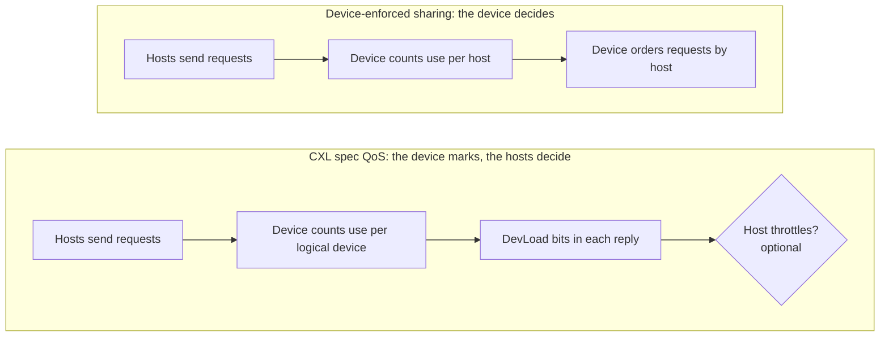

# Fair Sharing at the CXL Pool Device: Prior Work and Positioning

The fair-share mechanism studied here belongs in the pool device's controller, as a design that vendors build in or the CXL Consortium adopts; buyers cannot install it themselves. Plain round robin at the device would cut a latency-bound host's queue wait but does not deliver fairness, and no vendor publicly documents fair arbitration between hosts. The CXL spec already defines per-host bandwidth shares but leaves enforcement to the hosts. That is the gap this work addresses.

All claims below come from the sources in References: the CXL 2.0 and 3.1 specifications, published papers, vendor documents and patents. Where a source could not be opened, the text says so.

## Would simple round robin solve it?

Round robin would cut the victim's queue wait a lot but would not make sharing fair. Under FCFS in our simulations, a latency-bound host with one request in flight waits behind about 150 queued requests; with round robin across the device's ports it would wait behind at most one request per other host. This part is our own reasoning from the simulation data.

The evidence that round robin is not enough:

- **Real CXL hardware already uses round robin and is unfair.** MemChannel \[1\] measured an XConn switch platform: "the CXL switch/adapter mainly performs round-robin scheduling… Thus, the stream with more pending transactions has more opportunities to be scheduled." A 4 KB stream mixed with a 64 B stream took 97.8% of the link bandwidth.
- **Light streams suffer even at low load.** At the host adapter, whose scheduling MemChannel describes as best-effort, a thread with one outstanding load slowed from 230.2 to 1,624.2 ns per load (82.6% less bandwidth) once a second thread nearly filled the adapter, and began slowing at only 30% of capacity. This was contention between two threads in one server, not between servers.
- **Memory-scheduling research targets slowdown, not equal service.** STFM \[7\] aims to "equalize the DRAM-related slowdown experienced by each thread", taking each thread's inherent memory behaviour into account. Round robin equalizes request slots, and requests differ in cost (row hits, row misses, writes).
- **DRAM interference remains.** Other hosts' streams still close a victim's open rows and occupy its banks after round robin has picked the next request. This is our reasoning.
- **Equal per-port credits do not help either.** Credits stop a port's buffer overflowing; every port gets the same limit, but an aggressor keeps all of its credits busy while a pointer-chasing victim uses 1–2, and credits return as fast as the aggressor is served. Our simulated hosts already have equal outstanding-miss limits, which act like equal port limits, and the victims still slowed by up to 1.47×. This is our reasoning from the simulation data.

## What the CXL spec already provides

The spec lets an operator set each host's bandwidth share, but the device only reports load; the hosts must slow themselves down.

- **Shares and counters.** For multi-logical devices, the fabric manager programs a "QoS Allocation Fraction" and a "QoS Limit Fraction" per logical device. The device tracks each one's use with ReqCnt and CmpCnt counters \[2\].
- **Enforcement by marking.** The device returns a 2-bit load level, DevLoad, in each response; a logical device over its share gets a higher DevLoad. The spec says hosts use it to adjust "host request rate throttling", and that this throttling "is optional and primarily implementation specific" \[2\]. CXL 3.1 keeps the wording: "Host/peer memory request rate throttling is optional and primarily implementation specific" \[3\].
- **Multi-headed devices.** CXL 3.1 manages their memory resources "for MLD components", per logical device, so the same QoS model applies \[3\].

How to read this diagram: in the spec's model the device only reports load, and a host that ignores DevLoad keeps its full request rate. In a device-enforced design the same counters decide the order in which the device serves requests.

A host that ignores DevLoad keeps its full request rate, and the spec gives the device no way to stop it. The scheduler studied here uses the same kind of per-host counters to order requests at the device instead of only marking replies.

## How DevLoad treats each host

In pooled devices DevLoad combines the device's overall load with whether the requesting host is over its share. A single-host device reports only its overall load.

| Device's overall load | Host over its hard limit? | Host over its allocated share? | DevLoad sent to that host |
| --- | --- | --- | --- |
| Light or optimal | No | – | Same as the overall load |
| Light or optimal | Yes | – | Moderate overload |
| Moderate overload | No | No | Optimal load |
| Moderate overload | No | Yes | Moderate overload |
| Moderate overload | Yes | – | Moderate overload |
| Severe overload | – | No | Moderate overload |
| Severe overload | – | Yes | Severe overload |

The spec's stated policy is that "LDs with loads up to QoS Allocation Fraction get throttled less than LDs with loads that exceed QoS Allocation Fraction" \[3\]. Three caveats:

- **Over its share is not the same as causing contention.** It is a reasonable proxy for the heavy host, not a measurement of cause.
- **The fabric manager must set the shares.** The QoS Allocation Fraction defaults to 0, and ReqCmpBasis defaults to 0, which "disables the mechanism" for limits \[3\]. With every allocation at 0, the spec's formula would mark every active host as over its share, so hosts would get the same signal. This last step is our reading of the formula.
- **It is still only a signal.** Throttling happens in the hosts and is optional.

## What the spec reports per host

The device tracks each host's usage internally, but the spec defines no way to read those numbers out; only DevLoad leaves the device per host.

| What | Per host? | Who sees it | Details |
| --- | --- | --- | --- |
| DevLoad in each response | Yes, per logical device | Only that host | 2 bits: light, optimal, moderate overload, severe overload |
| ReqCnt and CmpCnt counters | Yes | No one; used to compute DevLoad | Requests in flight plus completions over about 1 µs by default (16 history counters, 64 ns each) |
| Get QoS Status | No, device-wide | Fabric manager | One value: "Backpressure Average Percentage", the "measured Egress Port average congestion" |
| Get QoS Allocated BW, Get QoS BW Limit | Yes | Fabric manager | The configured shares, not measured use |
| Get and Set QoS Control | No, device-wide | Fabric manager | Thresholds, sample interval, ReqCmpBasis, completion interval |
| Performance Monitoring Unit (CPMU) | Possibly | Software reading device registers | Optional: "A CXL component may have zero or more CPMU instances" |

The CPMU counts events such as memory read requests, data responses, and DRAM Activate and Precharge commands. It filters by HDM decoder (address range) or by DRAM channel, rank, bank group and bank, with no filter by host \[3\]. If each host's memory sits behind its own decoder, the decoder filter would give per-host counts; this is our inference.

The per-host state a device-side scheduler needs already exists in compliant pooled devices; the spec uses it only to choose each reply's DevLoad. No vendor document found says the counters are used for fair scheduling, though vendors could do so internally. A command that reports measured per-host use would also let operators verify fairness.

## Switches versus multi-headed devices

Per-host QoS is best defined for switch-attached devices, where every request carries a host tag; for multi-headed devices the spec does not say explicitly that it applies.

- **Switch case.** A multi-logical device behind a switch has one physical input link. The switch tags each request: "CXL.mem supports only the lower 4 bits of LD-ID and therefore can support up to 16 unique LD-ID values over the link. Requests and responses forwarded over an MLD Port are tagged with LD-ID" \[3\]. The device indexes its counters and DevLoad by that tag. The switch itself does nothing for QoS: "CXL switches have no unique requirements for supporting QoS Telemetry" \[2, 3\].
- **Multi-headed case.** Each host has its own port. Memory resources are managed per logical device, through an "LD Pool CCI" that can pass management commands to every logical device \[3\]. The QoS section, however, defines per-host DevLoad only for multi-logical devices and fabric-attached devices, and never mentions multi-headed devices. Heads presenting multi-logical devices "may support" their features; heads presenting single-logical devices fall back to single-device behaviour.

| Topology | How the device knows the host | Per-host DevLoad in the spec |
| --- | --- | --- |
| Switch + multi-logical device | LD-ID tag on each request, up to 16 | Yes, explicitly defined |
| Switch + single-logical device | Only one host | Not applicable |
| Fabric-attached device (CXL 3.x) | 12-bit requester ID | Yes, limit fraction only |
| Multi-logical multi-headed device | Head, plus LD-ID within a head | Yes, for heads presenting multi-logical devices ("may support") |
| Single-logical multi-headed device, such as today's 2-port MPDs | Head equals host | Not explicitly defined; appears to fall back to single-device behaviour (our reading) |

The directly attached multi-headed device this work targets is where the spec's per-host QoS is least defined, and where it is defined it still depends on hosts. The device always knows each request's host: from the port in a multi-headed device, or from the LD-ID tag behind a switch. Our SST model has the same property, with one link per host.

## Can a buyer change a CXL device's software?

No, not the part that schedules requests.

- **The request path is hardware.** MemChannel notes that CXL adapters and switches "offer nearly no reconfigurability and telemetry capability" and that "there is little programmability on the switch data-plane" \[1\].
- **Firmware belongs to the vendor.** Astera Labs' Leo controller runs "an embedded firmware that operates in on-chip microcontroller"; its COSMOS suite (SDK APIs and a CLI called Telescope) is described for "customizable diagnostics and telemetry features" and fleet management \[5\], not for changing arbitration.
- **Firmware still shapes performance.** Octopus measured a real 2-port device whose mixed read/write bandwidth stopped at 28.8 GiB/s "due to a MPD firmware issue" \[4\]. Buyers receive vendor updates, not their own code.
- **The only standard settings are the QoS fractions** in the previous section, set by a fabric manager and enforced through hosts \[2\].

So the mechanism is a design for the controller that a vendor would implement. That fits its low-cost argument (small per-host counters and comparison logic). "Lightweight device-side mechanism, no host cooperation" describes it more precisely than "software-only".

## What a scheduler change in SST represents

Changing the SST pool controller's scheduling models hardware in the device's memory controller, not software; the C++ code describes the controller's behaviour cycle by cycle at its configured 1.2 GHz clock.

- **Per-request decisions must be hardware.** One channel at 19.2 GB/s moves 64 bytes about every 3.3 ns, about 300 million scheduling decisions a second. An embedded microcontroller such as Leo's \[5\] cannot decide that often; dedicated logic in the request path can. The spec writes its per-host QoS counters and comparisons "for implementing the algorithms in dedicated hardware" \[2\].
- **Slower tuning can be firmware.** Existing designs split the work: in the spec, the fabric manager programs the shares while hardware counters track each request \[2\]; in MITTS \[9\], software configures hardware traffic-shaping bins.

| Part | Runs in | How often | Example |
| --- | --- | --- | --- |
| Fast path | Controller hardware | Every request, a few ns | Per-port queues, per-host credit counters, pick the next request |
| Slow path | Device firmware or fabric manager | Every few µs to ms | Set each host's share or weight, retune thresholds from counters |

**Where the fast path sits.** Pond's pool chip connects its CXL ports to DDR5 memory controllers through an on-chip network \[18\], so requests from all hosts meet at the latest in each channel's memory-controller queue. The scheduler studied here sits at that merge point. It keeps a queue per host and decides, by a ranking of the hosts, which host's request enters a channel's queue next. Round robin alone cannot do this, because the aggressor always has a request ready. The same ranking is used by the bank queues ahead of the row-hit preference. DRAM timing and the order in which banks issue commands stay unchanged.

To keep the SST model honest about hardware cost:

1. **Hold only per-request state hardware can afford:** counters, comparators and small per-port tables, not sorting, division or global statistics on every request. The spec rewrites its own QoS formula to avoid a division \[2\].
2. **Charge for decision time** if arbitration takes a cycle or two.
3. **Run adaptive logic on a realistic period,** every few µs, not per request.
4. **Use only what the device sees:** the request's port or LD-ID, address and type, never the thread or application.

## What vendors document publicly

No vendor publicly documents how its pooled devices share bandwidth fairly between hosts. Internals may do more than vendors publish.

| Product | Hosts supported | What is public about sharing between hosts |
| --- | --- | --- |
| Astera Labs Leo, Leo 2 P-Series | "dual-port PCIe 6 x8", pooling and sharing across hosts \[6\] | Embedded firmware and COSMOS for diagnostics and telemetry \[5\]; nothing on arbitration, QoS or fairness between hosts |
| Marvell Structera X and A | x16 for one host or 2 × x8 for two CPUs \[13\] | A search summary says Structera A includes QoS telemetry, but the product brief could not be opened (HTTP 403) \[14\]; nothing on fairness between hosts \[15\] |
| SK hynix Niagara | Up to 4 hosts, CXL 2.0 Gen4 x8 ports, 11 GB/s, 600 ns; Niagara 2.0 up to 8 hosts \[16\] | Capacity features such as Dynamic Capacity Device; no QoS or isolation mentioned \[16\] |
| Samsung CMM-B | Up to 3 servers, 60 GB/s, 596 ns \[17\] | Management software allocates capacity; the whitepaper does not mention QoS \[17\] |
| XConn Apollo switch, as measured | Switched pool | Mostly round-robin arbitration, shown to be unfair \[1\] |
| Octopus's 2-port device | 2 hosts | 28 GiB/s read per port; firmware limited mixed bandwidth \[4\] |

## Multi-ported devices (MPDs)

The MPDs this work targets are the same devices the CXL spec calls multi-headed devices: vendor-made controller chips whose arbitration between hosts is decided by the vendor.

- **Definition.** Octopus defines an MPD as a device that "integrates N CXL ports, allowing N CPUs to connect to the same controller and access its memory concurrently" \[4\].
- **Who makes them.** Octopus lists 2-port MPDs with two x8 ports from Astera Labs, Marvell, Google and Meta, and xFusion, and 4-port prototypes from Seagate and SK hynix \[4\]. These match the products in the table above \[6, 13, 16\].
- **Firmware decides performance.** The MPD measured by Octopus was limited "due to a MPD firmware issue" \[4\]; the vendor, not the buyer, controls it.
- **Hyperscalers set requirements through OCP.** The "Google and Meta" entry refers to the OCP Hyperscale Tiered Memory Expander specification they wrote \[21\], a requirements spec vendors build to. Its text could not be extracted, so whether it covers QoS is unknown.
- **OCP's pooled-memory appliance spec has no fairness requirement.** Seagate's Composable Memory Appliance Base Specification v1.1 \[19\] promises "Non-blocking CXL pooled memory bandwidth performance" and about 2× NUMA-hop latency. Its full text has no requirement for QoS, fairness, isolation or arbitration between hosts.

A fair-share mechanism could reach MPDs in three ways:

1. **Vendors build it into their controllers:** Astera Labs, Marvell, SK hynix, Seagate \[23\].
2. **Hyperscalers require it in an OCP spec,** as Google and Meta did for tiered memory expanders; the current pooled-memory spec leaves room for one \[19, 20, 22\].
3. **The CXL Consortium adds device enforcement** to the QoS fractions the spec already defines \[2, 3\].

## Closest prior work and what stays novel

Credit-based per-tenant scheduling inside a device is already patented for SSDs, so the novelty here has to come from what is specific to a CXL memory pool.

| Work | Where it acts | What it does | Gap left |
| --- | --- | --- | --- |
| CXL spec QoS \[2, 3\] | Device marks, hosts throttle | Per-logical-device allocation and limit fractions, DevLoad in replies | Needs host cooperation |
| Micron patent US11321257B2 \[11\] | Device controller | Credits per logical device from its QoS settings, served round robin; minimum ("reservation") and maximum ("limit") shares; unused credits passed to busy tenants | Targets NVMe SSDs and memory modules; never mentions CXL |
| MemChannel \[1\] | Host software | CSFQ-inspired rate control using DevLoad and telemetry | Needs host cooperation; switched pools |
| AMD SMBA \[12\] | Host CPU | Limits CXL bandwidth per class of service within one host | Host-side, set by that host's operator |
| MITTS \[9\] | On-chip, at the source | Inter-arrival-time traffic shaping; under 0.9% of core area | Shapes "at the source (Core or LLC)"; in a pool the source is a host we do not control |
| BLISS \[10\] | On-chip memory scheduler | Splits applications into interfering and vulnerable groups | On-chip; shows fair scheduling can be cheap |
| STFM \[7\], Fair Queuing Memory Systems \[8\] | On-chip memory scheduler | Equalize slowdown; fair bandwidth shares | On-chip, with thread-level visibility |

Pond \[18\], an earlier CXL pooling design, handles QoS by predicting each VM's slowdown and moving its memory, not by arbitrating bandwidth at the device.

What remains specific to this work:

1. **Nanosecond timescales and DRAM effects.** Row misses, bank conflicts and writes cost different amounts of DRAM time; SSD scheduling works at microseconds.
2. **Protecting latency-bound hosts.** Fairness judged by slowdown, protecting a host with one request in flight.
3. **A coarse view.** The device sees one request stream per port, with no thread information.
4. **Enforcing the spec's own shares without hosts,** using counters a compliant device already keeps.

## What can and cannot be claimed about real devices

Reports of congestion on real CXL hardware do not by themselves show that devices lack fair scheduling. A fair scheduler cannot remove congestion when demand exceeds capacity; it only decides how the slowdown is shared.

|  | Fair scheduler | No fair scheduling (FCFS) |
| --- | --- | --- |
| Demand above capacity | Congestion: queues grow, every host slows | Congestion: queues grow, every host slows |
| How the slowdown is shared | Each host keeps its share; light hosts stay protected | Heavy hosts take most of the bandwidth; light hosts suffer most |

What separates the two is unequal harm: a light or latency-bound host slowed far more than the heavy host causing the load. The published evidence of unequal harm comes from switches and host adapters, not from a pool device's controller.

| Where | What was measured | What it shows |
| --- | --- | --- |
| CXL switch \[1\] | A 4 KB stream took 97.8% of a link shared with a 64 B stream | Unfair arbitration in the switch |
| Host adapter \[1\] | A thread issuing one load at a time lost 82.6% of its bandwidth, from 230.2 to 1,624.2 ns per load | Unfair scheduling inside one server's adapter, between threads |
| 2-port pooled device \[4\] | With both servers active, each got about 22.1 GiB/s | Symmetric load split evenly. FCFS also splits evenly between identical hosts: in our simulations identical STREAM hosts slowed within 0.2–2.1% of each other |
| Multi-host CXL 2.0 study \[24\] | A search summary reports the switch split bandwidth evenly between hosts, peaking at about 12 GB/s | Also symmetric; the full paper could not be accessed, so this rests on the summary |

No public measurement of a pooled device's controller with unequal hosts, such as a streaming host next to a pointer-chasing host, was found.

**What can be claimed:**

- Real CXL switches and host adapters arbitrate unfairly, as measured on hardware \[1\].
- The CXL spec's per-host QoS relies on hosts throttling themselves, which the spec calls optional \[2, 3\].
- No vendor publicly documents fair arbitration between hosts in its pooled devices \[5, 6, 13–17, 19\].
- Under FCFS in our saturation study (doc 05), a latency-bound victim slowed up to 3.80× while the STREAM hosts causing the load slowed 2.18–2.88×.

**What cannot be claimed:**

- That shipping pooled devices have no fair scheduling. This has not been publicly measured, and vendors do not publish their arbitration.
- That the simulated slowdowns match real hardware. The simulated pool has one or two DDR4 channels and a simplified controller, so absolute numbers differ from hardware and only the trends carry over.

The careful wording is: no public documentation or measurement shows fair arbitration between hosts in pooled CXL devices; where arbitration has been measured, at switches and host adapters, it is unfair; the spec's per-host QoS depends on hosts; and this work measures what device-side scheduling changes compared with FCFS and FR-FCFS.

## Contribution of this work

A scheduler in the pool controller that orders requests by host, needs no help from the hosts, and uses only what the device can see. It is evaluated against FCFS, FR-FCFS and four published memory schedulers adapted to the device (docs 12 to 15).

## References

1. Z. Guo, E. Shriver, M. Liu. [Building A CSFQ-Inspired Transport for Switched CXL Memory Pooling (MemChannel)](https://www.usenix.org/conference/nsdi26/presentation/guo-zerui). NSDI '26. [arXiv](https://arxiv.org/html/2608.21731v1), [PDF](https://pages.cs.wisc.edu/~mgliu/papers/MemChannel-nsdi26.pdf)
2. CXL Consortium. [Compute Express Link Specification, Revision 2.0](https://computeexpresslink.org/wp-content/uploads/2024/02/CXL-2.0-Specification.pdf), section 3.3.2, QoS Telemetry for Memory
3. CXL Consortium. [Compute Express Link Specification, Revision 3.1](https://computeexpresslink.org/wp-content/uploads/2024/02/CXL-3.1-Specification.pdf), LD-ID for CXL.mem and Multi-Headed Devices (section 2.4), QoS Telemetry for Memory (section 3.3.4), fabric manager QoS and Multi-Headed Device commands (section 7.6.7), CPMU registers and events (section 8.2.7, chapter 13)
4. [Octopus: Scalable Low-Cost CXL Memory Pooling](https://arxiv.org/pdf/2501.09020v3). NSDI '26 ([conference page](https://www.usenix.org/conference/nsdi26/presentation/zhong))
5. Astera Labs. [Leo CXL Smart Memory Controllers portfolio brief](https://www.asteralabs.com/wp-content/uploads/2025/05/Leo_CXL_Smart_Memory_Controllers_Portfolio_Brief.pdf)
6. Astera Labs. [Astera Labs Bolsters Leo Smart Memory Controller Family](https://www.asteralabs.com/news/astera-labs-bolsters-leo-smart-memory-controller-family-for-agentic-ai-and-general-purpose-cloud-workloads/) (Leo 2 P-Series announcement)
7. O. Mutlu, T. Moscibroda. [Stall-Time Fair Memory Access Scheduling for Chip Multiprocessors](https://www.microsoft.com/en-us/research/?p=157094). MICRO '07
8. K. Nesbit, N. Aggarwal, J. Laudon, J. Smith. [Fair Queuing Memory Systems](https://research.cs.wisc.edu/arch/uwarch-wiki2/index.php/PubsUWArch/B2hd-DBLPconfmicroNesbitALS06). MICRO '06
9. Y. Zhou, D. Wentzlaff. [MITTS: Memory Inter-arrival Time Traffic Shaping](https://collaborate.princeton.edu/en/publications/mitts-memory-inter-arrival-time-traffic-shaping/). ISCA '16
10. L. Subramanian et al. [The Blacklisting Memory Scheduler (BLISS)](https://arxiv.org/pdf/1504.00390). ICCD '14
11. Micron Technology. [US11321257B2: Quality of Service Control of Logical Devices for a Memory Sub-System](https://patents.google.com/patent/US11321257B2/en)
12. [AMD Updates Linux QoS Patches For SMBA With CXL Memory](https://www.phoronix.com/news/AMD-QoS-SMBA-BMEC-v8). Phoronix
13. Marvell. [Structera CXL product line announcement](https://www.marvell.com/company/newsroom/marvell-introduces-breakthrough-structera-cxl-product-line-to-address-server-memory-bandwidth-and-capacity-challenges-in-cloud-data-centers.html)
14. Marvell. [Structera X 2504 product brief](https://www.marvell.com/content/dam/marvell/en/public-collateral/assets/marvell-structera-x-2504-memory-expansion-controller-product-brief.pdf) (could not be opened, HTTP 403)
15. ServeTheHome. [This CXL Memory Controller Has 16 Arm Cores: Marvell Structera A](https://www.servethehome.com/this-cxl-memory-controller-has-16-arm-cores-marvell-structera-a/)
16. SK hynix. [CXL Disaggregated Memory Solution (Niagara)](https://www.slideshare.net/slideshow/sk-hynix-cxl-disaggregated-memory-solution/262688174)
17. Samsung. [CMM-B whitepaper](https://download.semiconductor.samsung.com/resources/white-paper/CMM-B_whitepaper-V2.pdf)
18. H. Li et al. [Pond: CXL-Based Memory Pooling Systems for Cloud Platforms](https://arxiv.org/pdf/2203.00241). ASPLOS '23
19. Seagate. [Composable Memory Appliance (CMA) Base Specification v1.1](https://www.opencompute.org/documents/final-2024-ocp-cma-cfm-base-specification-rev1-1-pdf/). Open Compute Project
20. Open Compute Project. [Composable Memory Appliance Hardware project](https://www.opencompute.org/projects/server/composable-memory-system/composable-memory-appliance-hardware/)
21. P. Chauhan, C. Petersen, B. Morris, J. Glisse. [Hyperscale Tiered Memory Expander Specification for CXL](https://www.opencompute.org/documents/hyperscale-tiered-memory-expander-specification-for-compute-express-link-cxl-1-pdf). Open Compute Project (text could not be extracted)
22. Open Compute Project. [OCP launches Composable Memory Systems subgroup](https://www.opencompute.org/index.php/blog/ocp-launches-composable-memory-systems-subgroup)
23. Blocks & Files. [Seagate working on composable memory appliance with CXL memory](https://blocksandfiles.com/2025/10/17/seagate-working-on-composable-memory-appliance-with-cxl-memory/)
24. [Characterizing Multi-Host CXL 2.0: Latency, Bandwidth, and Synchronization Costs](https://doi.org/10.1145/3789237.3809131). ACM (full text could not be accessed; cited from a search summary)
