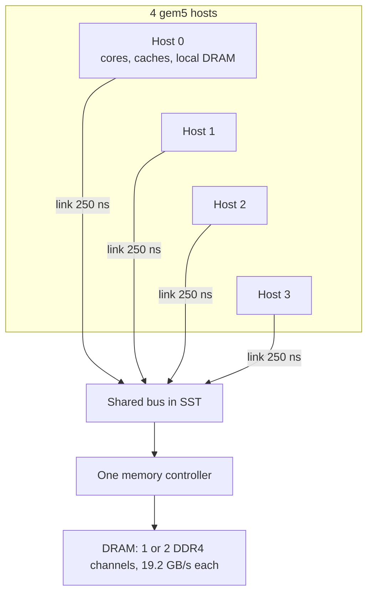
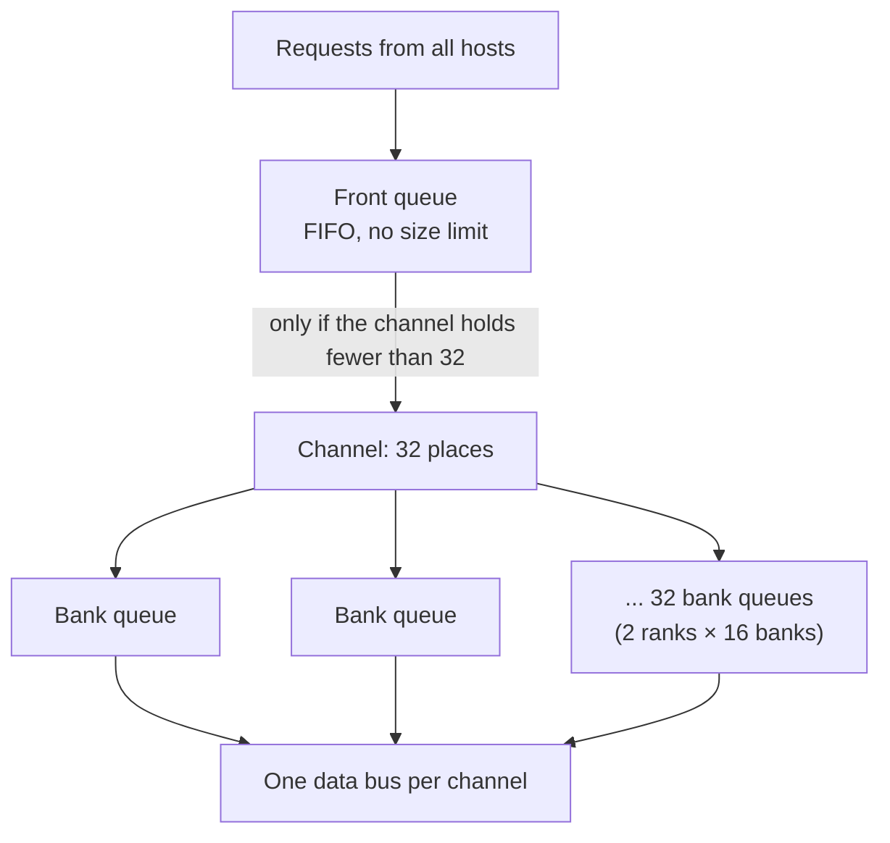
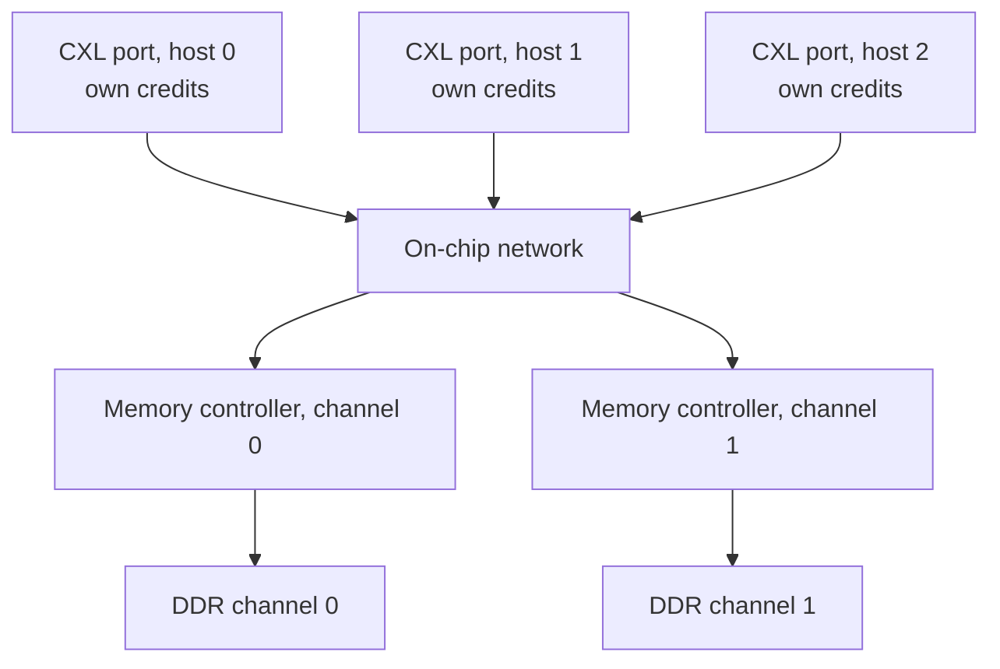
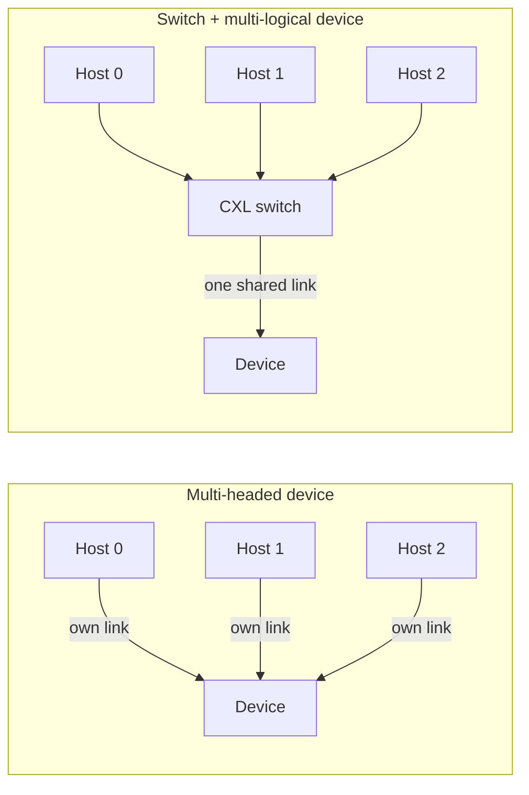
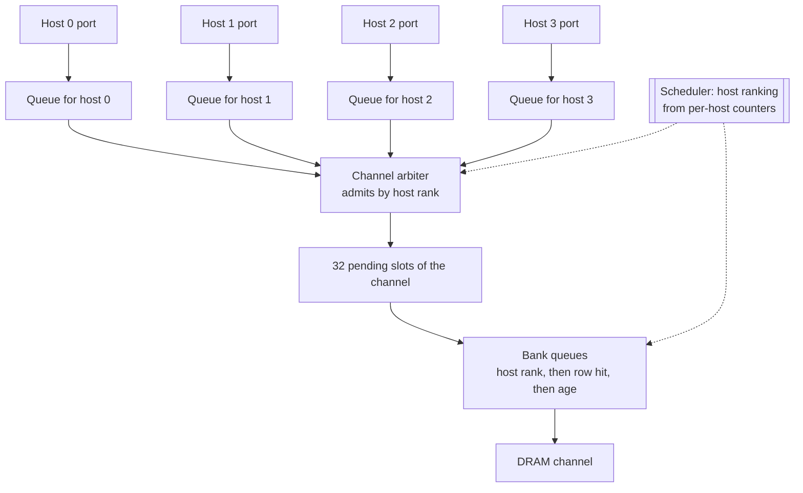

# How the Simulated CXL Pool Compares to Real Devices

The simulated pool has the same structure as a real multi-headed CXL Type-3 memory device: each host has its own link, and all hosts share one memory controller and its DRAM. It is a scaled-down, lower-efficiency version of such a device, so absolute numbers differ from hardware; what carries over is how fairness changes as demand outgrows the pool's bandwidth.

Several hosts reach one device in two ways. A multi-headed device splits its lanes into several ports, one link per host. A switch gives each host a link to the switch and shares one link from the switch to the device. Our model covers the first.

This document describes the stock simulated pool as used up to Phase 1. Later stages changed four things: gem5's out-of-order CPU for the measured region (doc 10), FR-FCFS bank queues with 8 KiB rows as an alternative to FIFO bank queues (doc 10), a 100 ms window, and the per-host scheduler front end (doc 12). The structure described here stays the same.

Figures for real hardware below are approximate, from general knowledge of CXL and PCIe rather than a specific measured device, except in the controller section, where each point links its source.

## What the simulator models

Four gem5 hosts connect to one pool simulated in SST. Each host has its own link, the links merge at a shared bus, and one memory controller with its DRAM serves all hosts.

- **Hosts:** gem5 x86 systems with 2 or 4 cores and their own local DRAM.
- **Links:** one per host, a fixed 250 ns delay with no bandwidth limit.
- **Controller:** one first-come, first-served queue shared by all hosts.
- **DRAM:** DDR4-2400-like, 19.2 GB/s per channel, 1 or 2 channels, addresses interleaved across channels every 64 B. The row size is set to 1 KiB, but the address mapper in use ignores it and keeps 256 consecutive lines (16 KiB) of a channel in one row, which gives streaming workloads long runs of open-row hits.
- **Memory:** each host gets its own 1 GiB region. Nothing is shared or kept coherent between hosts.
- **How hosts see it:** a NUMA node with no CPUs, which is how Linux shows CXL memory. Benchmarks are bound to it with numactl.

## Compared with real CXL memory devices

The structure matches a real multi-headed device; the biggest gap is how the device arbitrates between hosts.

| Part | Our model | Real devices (approximate) | Effect on results |
| --- | --- | --- | --- |
| Device type | One memory device with a port per host | Multi-headed devices are the near-term pooling design assumed by Pond and Octopus | Matches |
| Memory sharing | Separate region per host, no coherence | CXL 2.0 pooling works the same way; shared coherent memory comes with CXL 3.x | Matches |
| How the OS sees it | NUMA node with no CPUs | Same on Linux | Matches |
| Hosts per pool | 4 | Octopus uses small pools of a few hosts; Pond uses 8–16 sockets | Reasonable |
| Latency | About 230 ns fixed path plus time in the controller; 253 ns round trip alone | Commonly reported at about 2× local DRAM, a few hundred ns | Plausible |
| Link bandwidth | Fixed delay, no bandwidth limit | x4 to x16 PCIe 5.0, about 16–63 GB/s each way, with flow control | Small: each host demands at most 7–9 GB/s, so the DRAM is the limit in both |
| DRAM | DDR4-2400-like, 19.2 GB/s per channel, 1 or 2 channels | DDR4 or DDR5; 1–2 channels on most devices, 4–6 on Marvell Structera X (sources below) | Ours is smaller, which is why 4 hosts saturate it |
| DRAM scheduling | Stock model: FIFO bank queues, no reordering for row hits (FR-FCFS added in doc 10) | Controllers reorder for row hits (FR-FCFS) and reach a much higher share of peak | Ours delivers about 40% of peak, so it saturates earlier |
| Arbitration between hosts | One first-come, first-served queue across all hosts | Vendor-specific and mostly undocumented; per-port round-robin is plausible. The CXL spec adds load reporting (DevLoad) so hosts can throttle | **Largest gap: per-port arbitration may help victims a little, while row-hit-first ordering likely favours streaming hosts more** |

In the early setup with in-order 2-core hosts, our pool saturated at about 8 GB/s and victim slowdowns reached 3.8× (doc 05). Neither number will match hardware. The trend carries over: FCFS gets less fair as demand outgrows the pool's bandwidth.

## Inside the controller: queues, channels and full queues

Real devices and our model share one structure: requests are queued, a scheduler picks the next one, and DRAM channels serve them in parallel. What no vendor publishes is how many queues there are, whether hosts get separate ones, and the policy that picks between them.

### Queues and parallelism in our model

The SST pool has three levels of queues:

1. **One front queue** shared by all hosts. It is first-in, first-out and has no size limit. The "controller queue" in the report is this queue plus requests already sent to DRAM.
2. **A limit of 32 requests per channel.** A request leaves the front queue for the channel its address maps to; consecutive 64 B lines alternate channels. The channel accepts it only while it holds fewer than 32 (SST's default). The 32 is a counter, not a queue: a request uses one of the places from entering the channel until its response is sent.
3. **One queue per bank**, 2 ranks × 16 banks per channel, first-come-first-served. This is where the 32 actually wait, spread however the addresses fall: a streaming workload piles many into one bank, random accesses spread over many. Banks take turns issuing commands.

Every host's requests enter the same first-come-first-served queue. A request leaves it only when its channel has room, then waits in its bank's queue for the data bus.

Parallelism comes from the lower two levels. Every channel advances each cycle with its own banks and data bus, so 2 channels give 2 × 19.2 GB/s. Within a channel, different banks open and close rows at the same time, while data transfers take turns on the one bus.

The weak point is the front queue. If the request at its head targets a full channel, nothing behind it moves, even requests for an idle channel. This is head-of-line blocking.

Within one channel, up to 32 requests are in progress at once, but the channel sends one command per cycle, each 64 B transfer holds its data bus for 4 cycles at 1.2 GHz (about 3.3 ns), and at most one response leaves the channel per cycle. An open-row access takes about 12.5 ns and a different-row access about 33 ns, on top of the 250 ns link latency.

### What real devices publish

| Source | What it says |
| --- | --- |
| [Melody, ASPLOS '25](https://people.cs.vt.edu/huaicheng/p/asplos25-melody.pdf), four devices from different vendors | Requests are parsed and placed "in the request queue. The request scheduler then selects the next request to process based on the scheduling policy and other factors such as thermal management"; a command scheduler then issues the DDR commands |
| Melody, the devices | One device has 2 memory channels with 16 PCIe 5.0 lanes; the other three have 1 channel with 8 lanes. Differences are put down to "vendor-specific optimizations (e.g., scheduling policies, row buffer and thermal…)" |
| Melody, tail latency | "memory request scheduling could lead to temporary queuing delays. Currently, no tools exist to pinpoint tail latencies" |
| [Demystifying CXL Memory (Sun et al.)](https://arxiv.org/pdf/2303.15375) | A device is a PCIe physical layer, CXL link and transaction layers, and memory controller blocks. Its three devices have 1 DDR5-4800, 2 DDR4-2400 and 1 DDR4-3200 channels |
| [Astera Leo product brief](https://asteralabs.com/wp-content/uploads/2024/05/231220_Product_Brief_Leo_CXL_Smart_Memory_Controllers.pdf) | Every Leo part: 2 DDR5 channels up to 5600 MT/s, CXL 2.0 x8 or x16. Nothing on queues or scheduling |
| [Marvell Structera X, second generation](https://investor.marvell.com/news-events/press-releases/detail/1037/marvell-unveils-second-generation-structera-x-industry-first-six-channel-cxl-3-2-memory-expanders-for-ai-inference) | 6 DDR4/DDR5 channels, 50% more than the 4 of the first generation; sharing with up to four hosts. Nothing on QoS, arbitration or scheduling |
| [Micron CZ120](https://www.storagereview.com/news/micron-launch-cxl-expansion-module-portfolio) | "Dual-channel memory architecture", up to 36 GB/s |

|  | Real devices (published) | Our model |
| --- | --- | --- |
| Front queue | A request queue after the CXL controller | One FIFO, no size limit |
| Picking the next request | A request scheduler with an unpublished vendor policy | Strict arrival order |
| DDR commands | A separate command scheduler | Per-bank FIFOs, banks in turn, one data bus per channel |
| Channels | 1–2 on most devices; 4–6 on Marvell Structera X | 1 or 2 |
| Separate queues per host | Not documented | None |

Most shipping devices have one or two channels, so our 1- and 2-channel pools are realistic. The step a fair-share scheme would replace, choosing which waiting request goes next, is the one part every vendor keeps private. No source says whether the front queue is shared by all hosts or split per host, or whether it reorders for row hits.

The one published pool-chip design, [Pond](https://arxiv.org/pdf/2203.00241)'s external memory controller, says its "multiple ×8-CXL ports" reach "DDR5 memory controllers (MC) via an on-chip network (NOC)", with about 25 ns in the port, 10–20 ns in the network and 15 + 45 ns in the controller and DRAM. However the ports are arbitrated, requests from every host meet at the latest in each channel's memory controller, because a channel has one command bus and one data bus. Round-robin between ports would not by itself make that fair: the aggressor always has a request ready, so the controller's queue still fills mostly with its requests and a victim's request waits behind them.

Each host has its own port and credit limit, but all ports merge before the memory controller, so every host competes for the same controller queue and DRAM channels.

### What happens when a queue fills

Nothing is dropped, in real hardware or in the model. CXL.mem uses credit-based flow control: the [CXL 2.0 specification](https://computeexpresslink.org/) ("Channel Crediting") says "each channel must use a credit for sending any message", the receiver returns a credit "whenever it has processed the message (i.e., freed up a buffer)", and "if no credits are available, the sender must wait for the receiver to return one." Credits are counted separately for requests, responses and data.

A full device buffer therefore pushes the wait back toward the hosts:

1. The device stops returning request credits.
2. The switch or host port holds requests in its egress buffer. The specification calls this flow-control backpressure, and enough of it can make a device report DevLoad Moderate or Severe.
3. The host's root port fills, then its outstanding-miss slots, and its cores stall.

Requests are re-sent only after link errors such as a failed CRC check, not because of congestion.

In the model, a full channel queue makes the front queue retry the same request every cycle; one run with two STREAM hosts, bc and multichase counted 98 million such cycles. Because the front queue has no size limit, all waiting happens inside the controller, where a real device would push some of it back into the switch or host port.

For fair sharing this means a heavy host never loses requests; it makes every host wait for buffer space and credits. Holding one host back would mean withholding its credits or keeping per-host queues inside the device. A multi-headed device already has a separate port and credit pool per host; behind a switch, hosts share one link and are told apart only by their logical-device tag.

Per-port credits do not make sharing fair on their own. Every port gets the same limit, but an aggressor keeps all its credits busy while a pointer-chasing victim has 1–2 requests in flight, and credits come back as fast as the device serves the aggressor's requests. Behind the ports the channel is shared, so each host gets service roughly in proportion to its requests in flight. Our runs show this already: every simulated host has the same cap on outstanding misses (20, or 192 at the L3), which acts like an equal port limit, and victims still slowed by up to 1.47×. The CXL overview by [Das Sharma, Blankenship and Berger](https://arxiv.org/pdf/2306.11227) notes that pooled devices "may become oversubscribed resulting in Quality-of-Service problems", which is why the standard adds DevLoad and source throttling; both rely on hosts slowing down.

## How several hosts connect to one device

The 32–63 GB/s figure is for one link, and in a multi-headed device each host gets its own link. Only in the switch design do hosts share a single link to the device.

**Multi-headed device.** The device has a fixed number of lanes, often 16, and splits them across several ports called heads. Each head is a separate PCIe/CXL link to a different host. PCIe 5.0 carries about 4 GB/s per lane in each direction, so the split sets each host's limit:

| Lanes split as | Link per host | Sum of all links |
| --- | --- | --- |
| 1 × x16 (one host, no pooling) | about 63 GB/s | about 63 GB/s |
| 2 × x8 | about 32 GB/s each | about 63 GB/s |
| 4 × x4 | about 16 GB/s each | about 63 GB/s |

No link is shared, so hosts first contend where the heads meet: the internal crossbar, the controller's queues and the DRAM channels. The DRAM behind a device is often smaller than the links' total, so a busy pooled device saturates at its controller and DRAM. Our model has this structure, and each host's peak demand of 7–9 GB/s is below even an x4 head's 16 GB/s, so leaving out the link limit does not change our results.

**Switch-based.** Each host has its own link to a CXL switch, and the switch reaches the device over one link, for example x16 at about 63 GB/s each way, shared by every host. The device can be split into up to 16 logical devices, one per host; CXL calls this a multi-logical device. Hosts contend on that shared link and again inside the device, and the switch adds latency.

## Topology

We model one multi-headed device attached directly to every host, the simplest and most common pooling design today.

| Topology | Where hosts first contend | Covered by our model |
| --- | --- | --- |
| One multi-headed device, directly attached | Inside the device: controller and DRAM | Yes |
| Switch + memory device | The shared switch-to-device link, then the device | No; needs a bandwidth-limited link and a switch hop |
| Octopus-style overlapping pools: each host links to several small multi-headed devices, each device serves a different subset of hosts | Inside each device, among the hosts attached to it | Yes, one device of it |

In every design the hosts end up competing for the same memory controller and DRAM, which is the contention measured here. A switch adds a second point of contention before the device, which would make the case for fair sharing stronger.

## Where the scheduler goes

The scheduler studied here sits at the merge point, between the per-port buffers and the per-channel queues. It also gives its host ranking to the bank queues. DRAM timing and the order in which banks issue commands are left unchanged.

How to read this diagram: requests flow top to bottom. Each host's requests wait in their own queue; the channel arbiter decides which host fills the channel's 32 pending slots, and each bank picks among its waiting requests by host rank first. The scheduler only sets the ranking.

- **In a real device:** it decides which host's request enters a channel's memory-controller queue next. Every input it needs (the request's port or logical-device tag, its address, and counts of what each host has been served) is already in the device.
- **Why not elsewhere:** hosts are untrusted, so the policy cannot live in them. Working at the merge point keeps the controller's DRAM timing logic as it is.
- **In our simulator:** the stock pool feeds every channel from one front queue (SST's `MemBackendConvertor`). The scheduler's front end, in `code/btpmem`, accepts every request at once into a queue per host and channel, and each channel's arbiter fills that channel's 32 pending slots. Hosts are told apart by their pool address slot. Per-host queues also remove the head-of-line blocking described above.
- **Baselines:** FCFS and FR-FCFS run on the same simulator, so every comparison differs only in the scheduling rule. Doc 12 describes each scheduler.
