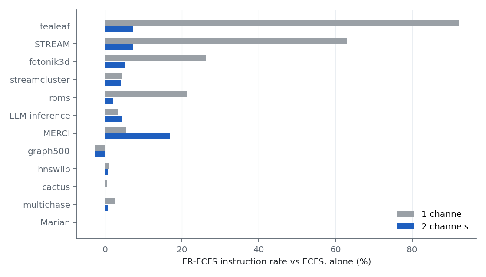
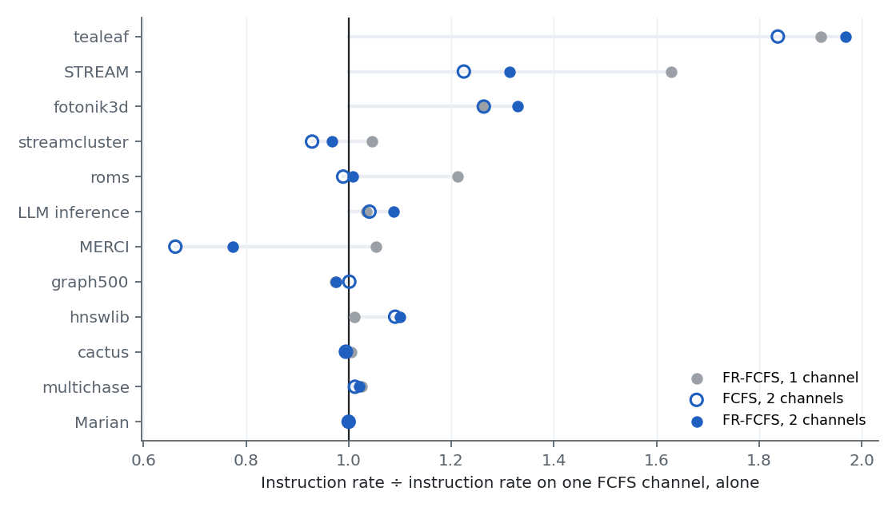
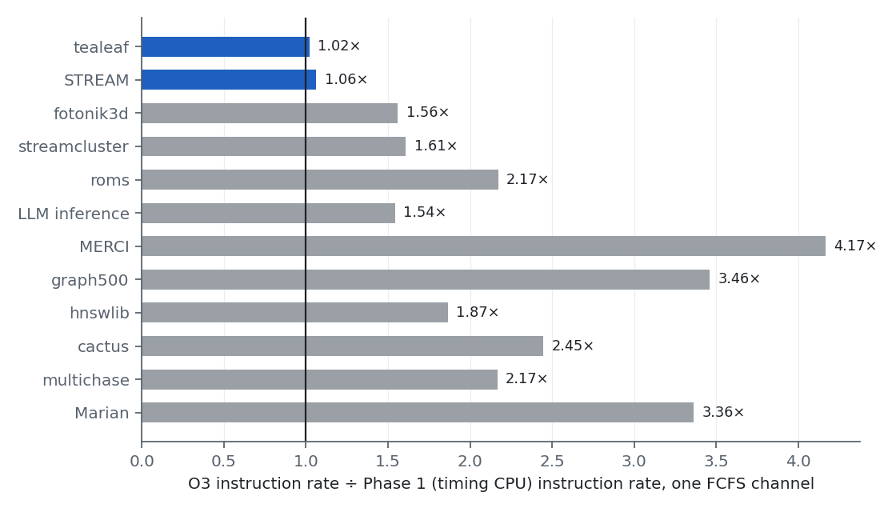

# O3 Alone Runs: FCFS and FR-FCFS on 1 and 2 Channels

- On one pool channel, FR-FCFS speeds up 11 of the 12 workloads, most of all those that load the channel hardest: tealeaf runs 92% more instructions per second and STREAM 63% more (each workload's instruction rate under FR-FCFS ÷ under FCFS on the same pool, mean of its 4 slots).&#32;
- A second channel removes most of that queueing on its own. Two FCFS channels give tealeaf +84% and fotonik3d +26%, about what FR-FCFS gave them on one.&#32;
- With two channels FR-FCFS then changes speed by only −3% to +7% for 11 workloads. graph500 runs 2.6% slower under FR-FCFS on either pool, because it rarely reuses an open row.&#32;
- Part of the 1-channel FR-FCFS gain comes through the host's L3 prefetcher, not the pool alone: with it removed, STREAM's gain falls from +64% to +27% and MERCI's from +17% to +4%, while tealeaf keeps +83% (slot 2, each in its own measure: pool bandwidth for STREAM and MERCI, instructions for tealeaf).&#32;
- Those prefetcher-off figures are the safer ones, because a gem5 flaw makes the prefetcher's per-core tables share one set of entries and so inflates its effect (see Caveats).&#32;
- All 192 runs (12 workloads, 4 checkpoint slots, 2 schedulers, 1 or 2 channels) reached the end of their 100 ms window.

## Setup

Each run puts one workload on one host, with its data in the pool. The host, caches and link match the Phase 1 alone runs. Four things changed: the cores are out of order, rows are 8 KiB, the pool scheduler is either FCFS or FR-FCFS, and the pool has one or two channels.

| Part | Setting |
| --- | --- |
| Host CPU | 4 x86 cores at 3 GHz, gem5 O3 (out of order): 192-entry reorder buffer, 32-entry load and store queues, 8-wide issue and commit |
| Caches | per core: 32 KiB L1d and L1i (16 miss slots each), 512 KiB L2 (48 miss slots); shared 8 MiB L3 (192 miss slots); stride prefetchers |
| Guest | Ubuntu 24.04, workload data placed in the pool with `numactl --membind=1` |
| Host link | fixed 250 ns delay, no bandwidth limit |
| Pool | one or two DDR channels, 19.2 GB/s peak each (38.4 GB/s for two), each 2 ranks x 16 banks |
| DRAM rows | 8 KiB (a DDR4 rank's page); with two channels, consecutive 64 B lines alternate between them; within a channel, lines fill a row, then move to the next bank; no address hashing |
| Window | 100 ms of simulated time from each checkpoint (3×10^8 core cycles), statistics every 10 ms |

**How to read this table.** One row per part of the model, with its setting as configured; nothing in it is calculated.

The two schedulers differ only inside each bank of the pool's DRAM:

| Scheduler | Which request a bank serves next | Row after an access |
| --- | --- | --- |
| FCFS | the oldest in the bank's queue | closed: precharged right away (stock SST `timingDRAM`, as in Phase 1) |
| FR-FCFS | the oldest request to the open row; if none, the oldest ([Rixner et al., ISCA 2000](https://doi.org/10.1145/339647.339668)) | kept open until a request for another row arrives |

**How to read this table.** One row per scheduler: which queued request a bank serves next, and whether the row stays open after an access.

FR-FCFS has no cap on how many row hits may pass an older request. The request path from host to pool is the same for both; only the DRAM bank queues change.

Each workload has 4 checkpoints, one per pool slot (the host position it takes in a mix), the same ones as in Phase 1. Every slot ran in all four set-ups (1 or 2 channels, FCFS or FR-FCFS) from the same checkpoint. A comparison of the run configurations confirms they differ only in these two settings.

## Measures

Each measure has its own column, the same one for all four set-ups. A run's figure is averaged over its statistics periods. A workload's figure is the mean of its 4 slots.

| Measure | Unit | What it counts |
| --- | --- | --- |
| Pool bandwidth | GB/s | read and write requests the host sends to the pool, × 64 B, per simulated second |
| Pool latency | ns | mean time from a request leaving the host to its reply coming back, including the link's fixed 250 ns delay |
| Instruction rate | G instructions/s | instructions committed by the host's 4 cores per simulated second |
| Row-hit rate | share of accesses | column accesses that found their row already open: 1 − activates / column accesses |
| L3 prefetches | per 1000 instructions | prefetches issued by the host's shared L3 stride prefetcher (degree 4, trained on L3 misses and on hits to prefetched lines) |
| L3 demand misses | per 1000 instructions | demand accesses that miss in the L3 and allocate a miss entry, i.e. that wait for memory |

Row-hit rate is shown for FR-FCFS only. FCFS closes every row after its access, so every access needs a new activate and the rate is 0 by design.

## Results per workload

On one channel, FCFS holds every workload to 9.0 GB/s or less (fotonik3d), while FR-FCFS lets tealeaf reach 13.9 GB/s, 72% of the channel's 19.2 GB/s peak. The peak is the most one channel can move: each 64 B line takes 4 data cycles at 1.2 GHz, so one line every 3.3 ns. Two channels let tealeaf reach 13.2 GB/s even under FCFS, 34% of their 38.4 GB/s. Values are means of the 4 slots; aggressors first, as in Phase 1.

### One channel

| Workload | Role | Bandwidth FCFS (GB/s) | Bandwidth FR-FCFS (GB/s) | Latency FCFS (ns) | Latency FR-FCFS (ns) | Instr. rate FCFS (G/s) | Instr. rate FR-FCFS (G/s) | Row-hit rate FR-FCFS |
| --- | --- | --- | --- | --- | --- | --- | --- | --- |
| tealeaf | aggressor | 7.03 | 13.87 | 775 | 399 | 5.10 | 9.80 | 0.74 |
| STREAM | aggressor | 7.34 | 12.14 | 434 | 316 | 0.98 | 1.59 | 0.78 |
| fotonik3d | aggressor | 8.98 | 11.73 | 536 | 408 | 4.13 | 5.21 | 0.74 |
| streamcluster | aggressor | 4.93 | 5.50 | 304 | 285 | 4.68 | 4.89 | 0.91 |
| roms | aggressor | 7.78 | 10.02 | 386 | 320 | 9.04 | 10.96 | 0.79 |
| LLM inference | aggressor | 3.86 | 3.96 | 285 | 269 | 10.13 | 10.47 | 0.97 |
| MERCI | victim | 2.95 | 3.47 | 326 | 292 | 1.85 | 1.96 | 0.82 |
| graph500 | victim | 3.78 | 3.70 | 289 | 292 | 1.97 | 1.92 | 0.27 |
| hnswlib | victim | 0.49 | 0.54 | 285 | 278 | 2.46 | 2.48 | 0.76 |
| cactus | victim | 1.45 | 1.55 | 335 | 292 | 3.16 | 3.18 | 0.52 |
| multichase | victim | 0.22 | 0.22 | 272 | 264 | 0.040 | 0.041 | 0.95 |
| Marian | victim | 0.014 | 0.014 | 281 | 273 | 6.07 | 6.07 | 0.99 |

**How to read this table.** One row per workload on one channel; each value is the mean of its 4 slot runs. Bandwidth: the read and write requests the host sends to the pool × 64 B ÷ the covered time (the sum of the run's statistics periods, 90–100 ms). Latency: the mean pool round trip, weighted by each period's request count, including the link's fixed 250 ns. Instruction rate: instructions committed by the host's 4 cores ÷ the covered time. Row-hit rate: 1 − activates ÷ column commands, for FR-FCFS only (FCFS closes every row, so its rate is 0). Role: aggressor or victim, as classified in Phase 1.

**Without the host's L3 prefetcher.** Slot 2 of 8 workloads was also run on one channel with the L3 prefetcher removed (L1d and L2 keep theirs), which is closer to a common server, whose L3 has no stride prefetcher of its own. The FR-FCFS gains are then: tealeaf +83% (+94% with it), STREAM +27% (+64%), fotonik3d +22% (+28%), roms +13% (+24%), MERCI +4% (+17%), streamcluster +1% (+4%), cactus 0% (+3%) and graph500 −3% (−3%), each in the workload's own measure. How the prefetcher adds to the gain is set out under "Why some workloads run slower with two channels".

Five workloads (LLM inference, graph500, hnswlib, multichase, Marian) use under 4 GB/s and keep pool latency below 300 ns under both schedulers. For them the scheduler barely matters, whatever their row-hit rate: Marian and multichase hit an open row 95–99% of the time but send so few requests that latency drops only 8 ns. With so few requests waiting in a bank at once, FR-FCFS rarely has a choice to make, so reordering changes little.

### Two channels

Pool latency stays between 263 and 337 ns under both schedulers, so no workload queues much. Under FCFS, bandwidth rises by more than 3% over one channel only for the three heaviest: tealeaf, STREAM and fotonik3d.

| Workload | Bandwidth FCFS (GB/s) | Bandwidth FR-FCFS (GB/s) | Latency FCFS (ns) | Latency FR-FCFS (ns) | Instr. rate FCFS (G/s) | Instr. rate FR-FCFS (G/s) | Row-hit rate FR-FCFS |
| --- | --- | --- | --- | --- | --- | --- | --- |
| tealeaf | 13.17 | 14.22 | 337 | 308 | 9.37 | 10.04 | 0.47 |
| STREAM | 8.94 | 9.50 | 304 | 297 | 1.20 | 1.28 | 0.51 |
| fotonik3d | 11.61 | 12.20 | 300 | 289 | 5.22 | 5.50 | 0.61 |
| streamcluster | 4.39 | 4.82 | 282 | 274 | 4.34 | 4.53 | 0.85 |
| roms | 6.86 | 7.07 | 294 | 285 | 8.95 | 9.12 | 0.66 |
| LLM inference | 3.97 | 4.20 | 276 | 265 | 10.54 | 11.01 | 0.98 |
| MERCI | 2.71 | 2.89 | 289 | 285 | 1.23 | 1.44 | 0.55 |
| graph500 | 3.78 | 3.68 | 282 | 288 | 1.98 | 1.92 | 0.24 |
| hnswlib | 0.35 | 0.36 | 278 | 277 | 2.68 | 2.70 | 0.62 |
| cactus | 1.40 | 1.42 | 282 | 279 | 3.14 | 3.14 | 0.51 |
| multichase | 0.22 | 0.22 | 272 | 263 | 0.041 | 0.041 | 0.96 |
| Marian | 0.014 | 0.014 | 279 | 270 | 6.07 | 6.07 | 0.99 |

**How to read this table.** One row per workload on two channels; each value is the mean of its 4 slot runs. Bandwidth: the read and write requests the host sends to the pool × 64 B ÷ the covered time (the sum of the run's statistics periods, 90–100 ms). Latency: the mean pool round trip, weighted by each period's request count, including the link's fixed 250 ns. Instruction rate: instructions committed by the host's 4 cores ÷ the covered time. Row-hit rate: 1 − activates ÷ column commands, for FR-FCFS only.

## FCFS vs FR-FCFS

The more a workload loads the channel under FCFS, the more FR-FCFS helps it. On one channel, the four workloads that gain 20% or more all used 7–9 GB/s and saw 386–775 ns pool latency under FCFS, well above the roughly 245 ns a request takes when nothing queues. Their requests spent much of that time waiting in the pool, and that waiting is what FR-FCFS shortens. On two channels, where none of them queues, FR-FCFS gains at most 7%; only MERCI gains more (+17%), and its instruction rate is the least reliable measure here (see below).

**How to read this chart.** One row per workload. Each bar is its FR-FCFS instruction rate ÷ its FCFS instruction rate on the same pool, − 1, each the mean of its 4 slots; grey for one channel, blue for two. Every workload uses its instruction rate here, MERCI and multichase included.

Four effects explain the pattern:

- **Row hits shorten each access.** A hit needs only a column command. A miss needs a precharge, an activate, then the column. With this pool's timing (1.2 GHz; 11 cycles to activate a row, 11 for the column, 14 to precharge, 4 to move a 64 B line), a row hit takes about 12.5 ns, a closed row (as under FCFS) about 22 ns and a conflict with another open row about 33 ns. With rows left open, 74–99% of accesses hit in 10 of the 12 workloads.
- **Shorter accesses matter only when requests queue.** Under FCFS, tealeaf's requests take about 530 ns longer than the roughly 245 ns unloaded latency (its 775 ns mean latency minus those 245 ns, which is time spent queueing); FR-FCFS cuts its latency by 376 ns (49%). LLM inference, hnswlib, multichase and Marian see only 7–16 ns less latency, so their instruction rate moves 0–3.4% on one channel. With two channels tealeaf's FCFS latency is already down to 337 ns, and FR-FCFS cuts only 29 ns more (9%).
- **An open row costs a miss extra time.** When the next request goes to another row, the bank must first precharge the open one, which a closed page has already done. That precharge adds 14 cycles, about 12 ns, to each access that misses the open row. graph500 hits an open row only 27% of the time, so these extra precharges outweigh the hits: latency rises 3 ns and its instruction rate falls 2.6%.
- **The host's L3 prefetcher adds to the 1-channel gain.** Only in the 1-channel FR-FCFS runs does the L3 stride prefetcher issue far more prefetches per instruction (for 7 workloads, 1.5–9× the highest of the other three set-ups, counted per 1000 instructions, 4-slot means), which cuts L3 demand misses: STREAM's fall from 77 to 34 per 1000 instructions (one FCFS channel → one FR-FCFS channel). It is trained as often in every set-up, but only that channel's back-to-back row service gives it runs of consecutive lines from one thread, so only there is it confident enough to issue. With it removed, STREAM's FR-FCFS gain falls from +64% to +27%, roms' from +24% to +13% and MERCI's from +17% to +4%, while tealeaf keeps +83% (slot 2). The prefetcher-off figures are the safer ones, because of a gem5 flaw in the prefetcher's tables (see Caveats).

On one channel, bandwidth rises with instruction rate: tealeaf's pool traffic doubles (7.03 to 13.87 GB/s) and STREAM's rises 65%. A faster pool lets the out-of-order cores keep more misses in flight, so they send more requests per second.

## Slot to slot

For 8 of the 12 workloads the FR-FCFS change is about the same in every slot. On one channel it differs by slot for four workloads: cactus, fotonik3d, roms and MERCI. On two channels the spread shrinks with the gains: MERCI still varies most (+8.4% to +26.5%), then tealeaf (+4.1% to +11.3%) and fotonik3d (+0.9% to +7.5%).

| Workload | 1 channel: instr. rate change, slots 0 / 1 / 2 / 3 | 1 channel: row-hit rate FR-FCFS, slots 0–3 | 2 channels: instr. rate change, slots 0 / 1 / 2 / 3 | 2 channels: row-hit rate FR-FCFS, slots 0–3 |
| --- | --- | --- | --- | --- |
| tealeaf | +97.9% / +91.9% / +94.3% / +84.6% | 0.74 / 0.74 / 0.74 / 0.74 | +4.1% / +7.6% / +5.8% / +11.3% | 0.47 / 0.47 / 0.47 / 0.47 |
| STREAM | +56.4% / +68.8% / +59.2% / +68.0% | 0.78 / 0.78 / 0.78 / 0.78 | +7.3% / +8.4% / +5.7% / +7.5% | 0.51 / 0.51 / 0.51 / 0.51 |
| fotonik3d | +4.7% / +32.4% / +27.7% / +43.1% | 0.71 / 0.74 / 0.74 / 0.76 | +0.9% / +5.7% / +6.5% / +7.5% | 0.59 / 0.60 / 0.60 / 0.63 |
| streamcluster | +4.6% / +4.5% / +3.7% / +5.2% | 0.91 / 0.91 / 0.91 / 0.91 | +4.6% / +4.0% / +3.5% / +4.8% | 0.85 / 0.85 / 0.85 / 0.84 |
| roms | +17.6% / +15.4% / +24.3% / +29.9% | 0.77 / 0.80 / 0.81 / 0.79 | +1.2% / +4.0% / +1.5% / +1.0% | 0.62 / 0.69 / 0.70 / 0.65 |
| LLM inference | +3.4% / +3.4% / +3.1% / +3.7% | 0.97 / 0.97 / 0.97 / 0.97 | +5.4% / +3.7% / +5.1% / +3.8% | 0.98 / 0.98 / 0.98 / 0.98 |
| MERCI | +4.9% / +25.1% / +2.2% / −4.5% | 0.82 / 0.81 / 0.81 / 0.82 | +17.5% / +15.9% / +8.4% / +26.5% | 0.56 / 0.56 / 0.55 / 0.55 |
| graph500 | −3.1% / −3.2% / −3.1% / −1.3% | 0.21 / 0.21 / 0.21 / 0.44 | −3.2% / −3.2% / −3.2% / −1.0% | 0.20 / 0.20 / 0.20 / 0.37 |
| hnswlib | +2.0% / +0.4% / +2.3% / −0.2% | 0.75 / 0.76 / 0.76 / 0.76 | +0.2% / +0.6% / +2.8% / 0.0% | 0.62 / 0.62 / 0.62 / 0.62 |
| cactus | −0.7% / +12.8% / +2.7% / −0.8% | 0.30 / 0.80 / 0.70 / 0.26 | −0.5% / +3.4% / +0.4% / −0.6% | 0.44 / 0.65 / 0.60 / 0.37 |
| multichase | +2.0% / +5.0% / +0.4% / +0.8% | 0.96 / 0.94 / 0.96 / 0.94 | +0.4% / +2.0% / +0.4% / +0.4% | 0.96 / 0.96 / 0.96 / 0.96 |
| Marian | 0.0% / 0.0% / 0.0% / 0.0% | 0.99 / 0.99 / 0.99 / 0.99 | 0.0% / 0.0% / 0.0% / 0.0% | 0.99 / 0.99 / 0.99 / 0.99 |

**How to read this table.** One row per workload. Instruction rate change: FR-FCFS ÷ FCFS − 1 within each slot, both runs from the same checkpoint, listed for slots 0 / 1 / 2 / 3. Row-hit rate: each slot's FR-FCFS run, 1 − activates ÷ column commands.

- **cactus follows its program phase.** Slots 1 and 2 fall in the phase Phase 1 found using 4–6 times more pool bandwidth. There FR-FCFS hits 70–80% and helps (+2.7% to +12.8%). Slots 0 and 3 hit only 26–30% and lose 0.7–0.8%, as graph500 does. On two channels the same split holds at a smaller size: slot 1 gains 3.4%, slots 0 and 3 lose 0.5–0.6%.
- **graph500's slot 3 differs**, as in Phase 1: its row-hit rate doubles to 0.44, and the loss shrinks to 1.3%. On two channels it does the same: 0.37 and −1.0%, against −3.2% in the other slots.
- **fotonik3d's slot 0 gains least (+4.7%)**: its row-hit rate is the lowest of its four (0.71), and its FR-FCFS bandwidth stays at 10.4 GB/s against 11.8–12.8 GB/s in the other slots. On two channels slot 0 again gains least (+0.9%), with the lowest bandwidth (10.5 GB/s).
- **MERCI's slot 1 gain (+25.1%) comes from its FCFS run**, whose instruction rate is 1.41 G/s against 1.97–2.07 G/s in its other slots, at the same bandwidth. That low rate comes from MERCI's own statistics reset, not slower running (see Caveats). Its other three slots range from −4.5% to +4.9%. On two channels slot 1's FCFS run is not slower than the others (1.27 against 1.13–1.28 G/s), so that gap does not recur.

## One channel or two

A second channel does for the workloads that saturated one channel what FR-FCFS did: tealeaf runs 84% faster with two FCFS channels, close to its 92% with FR-FCFS on one. With two channels FR-FCFS changes speed by −3% to +7% for 11 of the 12 workloads; only MERCI gains more (+17%).

Each row is one workload; the vertical line is its 1-channel FCFS speed. Grey dots are FR-FCFS on one channel, hollow rings FCFS on two channels and blue dots FR-FCFS on two, each the mean of its 4 slots. Where the hollow ring sits near the grey dot, a second channel bought what FR-FCFS bought on one.

**How to read this chart.** Each mark is a set-up's instruction rate ÷ the workload's 1-channel FCFS instruction rate, both the mean of its 4 slots: grey dot 1-channel FR-FCFS, hollow ring 2-channel FCFS, blue dot 2-channel FR-FCFS. 1.2× means 20% faster than on one FCFS channel.

- **Queueing is gone.** Under FCFS the highest pool latency falls from 775 ns (tealeaf, one channel) to 337 ns, and every workload stays within about 90 ns of the roughly 245 ns unloaded latency. The heaviest workload, tealeaf, now uses 13.2–14.2 GB/s, 34–37% of the 38.4 GB/s peak.
- **A second channel buys as much as FR-FCFS for two workloads.** tealeaf reaches 9.37 G/s with two FCFS channels against 9.80 with FR-FCFS on one; fotonik3d reaches 5.22 against 5.22. Both were the workloads queueing hardest on one channel.
- **Row-hit rates drop.** Under FR-FCFS they fall from 0.74–0.82 to 0.47–0.62 for tealeaf, STREAM, fotonik3d, MERCI and hnswlib, and from 0.79 to 0.66 for roms. Rates of 0.85 and above (streamcluster, LLM inference, multichase, Marian) barely move. The cause was not isolated. A likely reason, not tested: with two channels each channel's queue is shorter, so fewer requests to one row wait at the same time for FR-FCFS to serve together.
- **Light workloads do not change.** graph500, cactus, multichase and Marian stay within ±1.2% of their 1-channel speed under both schedulers; LLM inference gains 4–5% and hnswlib 9%.

## Why some workloads run slower with two channels

Four workloads are slower on two FR-FCFS channels than on one: MERCI (−27%), STREAM (−19%), roms (−17%) and streamcluster (−7%) (instruction rate on two FR-FCFS channels ÷ on one, − 1, mean of 4 slots). Every one of their 2-channel runs has lower pool latency, so the pool itself is not slower. Two effects explain most of the gap; streamcluster's is only narrowed down.

L3 prefetches and L3 demand misses per 1000 instructions, means of the 4 slots:

| Workload | Prefetches, 1 ch FCFS | Prefetches, 1 ch FR-FCFS | Prefetches, 2 ch FCFS | Prefetches, 2 ch FR-FCFS | Demand misses, 1 ch FCFS | Demand misses, 1 ch FR-FCFS |
| --- | --- | --- | --- | --- | --- | --- |
| tealeaf | 2.4 | 24.6 | 2.4 | 4.1 | 14.6 | 9.9 |
| STREAM | 5.7 | 204.1 | 10.9 | 23.0 | 76.7 | 33.6 |
| fotonik3d | 10.4 | 39.7 | 9.4 | 14.8 | 21.7 | 16.6 |
| streamcluster | 12.1 | 21.8 | 14.3 | 19.7 | 12.5 | 11.5 |
| roms | 21.5 | 43.1 | 15.7 | 18.5 | 8.4 | 5.7 |
| LLM inference | 2.5 | 3.3 | 3.2 | 4.2 | 5.4 | 5.2 |
| MERCI | 18.5 | 51.8 | 21.1 | 26.5 | 14.4 | 10.8 |
| graph500 | 16.1 | 35.5 | 11.8 | 12.2 | 25.7 | 22.9 |
| hnswlib | 15.2 | 19.7 | 12.1 | 12.5 | 1.5 | 1.1 |
| cactus | 22.2 | 40.5 | 21.6 | 26.4 | 9.3 | 6.8 |
| multichase | 4.1 | 4.9 | 4.3 | 4.5 | 96.8 | 97.9 |
| Marian | 0.1 | 0.2 | 0.2 | 0.2 | 0.0 | 0.0 |

**How to read this table.** One row per workload, each value the mean of its 4 slots, counted per 1000 instructions (count × 1000 ÷ the host's committed instructions). Prefetches: lines issued by the host's L3 stride prefetcher, in each of the 4 set-ups. Demand misses: demand accesses that miss in the L3 and wait for memory, on one channel under each scheduler.

- **The host's L3 prefetcher runs far ahead only on one channel with FR-FCFS.** In those runs the L3 stride prefetcher issues 1.5–9× more prefetches per instruction than in any other set-up for 7 workloads, in every slot (for cactus only in slots 1 and 2, its high-bandwidth phase). For STREAM it issues 204 per 1000 instructions against 6–23 in the other three set-ups, and its L3 demand misses fall from 77 to 34 per 1000 instructions (one FCFS channel → one FR-FCFS channel). Demand accesses then find their lines already fetched or on the way, which is part of why STREAM and roms run faster on one FR-FCFS channel than on two. How this happens is set out after this list.
- **A faster pool moves program phases inside the window.** The window is a fixed 100 ms, so a faster run reaches later phases sooner. STREAM's slot 1 on two FCFS channels runs its main phase at 10.8 GB/s against 8.0 on one, 35% faster. It reaches the point where STREAM dumps its own statistics at 57 ms instead of 77 ms, then runs a slower phase at about 7.2 GB/s. Over the last 50 ms the 2-channel STREAM runs are 6–17% slower than on one channel, which cuts the window gain to +22% (instruction rate on two FCFS channels ÷ on one over the whole window, − 1, mean of 4 slots). MERCI's instruction rate swings from 0.13 to 9.6 G/s between its phases, so its window means (−34% on two FCFS channels against one) say little about its speed.
- **streamcluster is slower in its last 50 ms; the loss starts at its L1d prefetcher.** From 50 ms on, its 2-channel FCFS runs commit 3.9 G instructions/s against 4.6 on one channel (−15%, the same in all 4 slots). They do so with 17% less pool bandwidth (5.5 against 6.6 GB/s) at 24 ns lower latency. Its first 50 ms run 1% faster, and its L3 prefetching is similar (12–14 per 1000 instructions). The difference is in its L1d prefetcher: in slot 2 over the last 50 ms it finds 67–68 prefetch candidates per 1000 instructions on two channels against 91 on one, and L1d misses rise from 59–64 to 72–74 per 1000 instructions. Why it trains worse on two channels was not traced.

**It is not trained more often; more of its training passes the confidence check.** The prefetcher learns from L3 misses and from hits on lines it prefetched; ordinary hits do not train it. It keeps one entry per core and load PC with a 3-bit confidence counter. An access whose distance from that PC's previous access equals the stored stride raises the counter; any other distance lowers it, and below half the entry relearns the stride. It issues only at half confidence or above, so it needs the same distance to repeat. For STREAM in slot 2 the training is the same in both 1-channel set-ups, but far more of it passes:

| 1 channel, STREAM slot 2 | Training events per 1000 instructions | Prefetch candidates per 1000 instructions | Events that passed the check |
| --- | --- | --- | --- |
| FCFS | 79 (78 misses + 0.7 prefetch hits) | 6.5 | about 1.6 (2%) |
| FR-FCFS | 80 (65 misses + 15 prefetch hits) | 217 | about 54 (68%) |

**How to read this table.** STREAM in slot 2 on one channel, one row per scheduler. Training events: the L3 misses and hits on prefetched lines that update the prefetcher, per 1000 instructions. Prefetch candidates: lines the prefetcher queues, per 1000 instructions. Events that passed: candidates ÷ 4, since each event at or above half confidence queues 4 lines, with their share of the training events in brackets.

**Most of its prefetches are dropped as already in flight, by design.** Each confident event queues the next 4 lines (degree 4) without checking the cache. The L3 checks a candidate only when it issues it, after counting it as issued: a line already cached or already being fetched is dropped. In a stream, consecutive events ask for overlapping 4-line windows, so about 3 of every 4 candidates are already on the way. In STREAM's slot 1 run on one FR-FCFS channel, 72% were dropped this way. The count stands out only because this is the one set-up with many candidates.

**Why steady strides appear only on one FR-FCFS channel (traced).** A trace of every L3 prefetcher training event from 4 to 6 ms after the checkpoint, for STREAM slot 2 in each set-up, shows what the prefetcher sees. The requests of all four STREAM threads for the same load reach one prefetcher entry, and each thread adds two sequences about 5 lines apart. This sharing is a gem5 flaw, not the intended design: the prefetcher creates a separate table for each requestor, but all its tables register their entries in one shared index, so every lookup lands in the same entries (see Caveats). Each address is compared with the entry's previous one, so the stride matches only while several consecutive events come from the same sequence. That depends on the order in which the L2s send their misses, which follows the order in which the pool returns lines:

| STREAM slot 2, 4–6 ms, its two loads | Mean run of consecutive events from one thread | Events in runs of 5 or more | Steps of +64 B | Steps of +128 B | Events at confidence ≥ 4 | Prefetch candidates in the 2 ms |
| --- | --- | --- | --- | --- | --- | --- |
| 1 channel, FCFS | 1.6 | 19% | 13% | 1% | 0% | 7,265 |
| 1 channel, FR-FCFS | 3.9 | 71% | 52% | 4% | 31% | 660,864 |
| 2 channels, FCFS | 2.4 | 42% | 23% | 10% | 2% | 37,154 |
| 2 channels, FR-FCFS | 3.7 | 65% | 30% | 15% | 5% | 94,175 |

**How to read this table.** From a trace of every L3 prefetcher training event for STREAM's two loads, 4–6 ms after the checkpoint in slot 2, one row per set-up. Mean run: the average number of consecutive events from the same thread. Events in runs of 5 or more: their share of all events. Steps of +64 B and +128 B: the share of events whose address is one or two lines after the previous event in the same entry; only steady +64 B steps build confidence for a stream. Events at confidence ≥ 4: the share at or above the prefetch threshold (the counter runs 0–7). Prefetch candidates: lines queued in the 2 ms.

On one FCFS channel, requests are served one at a time in arrival order, so the four threads' events alternate almost one by one and no stride repeats. On one FR-FCFS channel, a thread's queued lines in an open row are served back to back, so the L3 sees runs of consecutive lines from one thread and confidence builds. On two channels, runs are long under FR-FCFS too, but consecutive lines sit on different channels and come back on separate timing, so many steps are +128 B instead of +64 B and break the stride. In the first 2 ms after the checkpoint the kernel is zeroing pages and all four set-ups look alike (1.4× the candidates), so the effect belongs to STREAM's main loop.

**How much of the gain is the prefetcher.** Slot 2 of the 8 workloads was rerun on one channel with the L3 prefetcher removed (L1 and L2 keep theirs), and STREAM and roms also on two channels:

| Slot 2 | Measure | FR-FCFS gain, prefetcher on | FR-FCFS gain, prefetcher off | Prefetcher's effect, 1 ch FCFS | Prefetcher's effect, 1 ch FR-FCFS |
| --- | --- | --- | --- | --- | --- |
| tealeaf | instructions/s | +94% | +83% | −2% | +4% |
| STREAM | pool bandwidth | +64% | +27% | +3% | +33% |
| fotonik3d | instructions/s | +28% | +22% | 0% | +5% |
| streamcluster | instructions/s | +4% | +1% | +18% | +22% |
| roms | instructions/s | +24% | +13% | +7% | +17% |
| MERCI | pool bandwidth | +17% | +4% | +3% | +16% |
| graph500 | instructions/s | −3% | −3% | 0% | 0% |
| cactus | instructions/s | +3% | 0% | 0% | +2% |

**How to read this table.** Slot 2 on one channel, one row per workload, rerun with the L3 prefetcher removed (the L1d and L2 keep theirs). Measure: the instruction rate, or the pool bandwidth for STREAM and MERCI. FR-FCFS gain: FR-FCFS ÷ FCFS − 1, with the prefetcher on and with it off; the difference between the two columns is the part of the gain that comes through the prefetcher. Prefetcher's effect: prefetcher on ÷ off − 1 under the same scheduler.

With the prefetcher off, FR-FCFS still gives tealeaf +83% and fotonik3d +22%, so their gains are the pool's. For STREAM about 60% of the gain is the prefetcher: its pool-bandwidth gain falls from +64% to +27% without it, and (64 − 27) ÷ 64 ≈ 58%; its instruction rate gain falls from +59% to +12%. Without it, STREAM on one FR-FCFS channel (9.2 GB/s) is about as fast as on two channels (8.9 GB/s, prefetcher off), so its lead over two channels comes from the prefetcher. roms keeps a lead without it: 8.4 against 7.0 G instructions/s on two channels. streamcluster gains about 20% from the prefetcher under either scheduler, so its effect there is not tied to FR-FCFS. These reruns are one slot each. Because the prefetcher-on gains include the effect of the shared tables, the prefetcher-off figures are the better estimate of the scheduler's own gain for STREAM (+27%), roms (+13%) and MERCI (+4%).

## Against the Phase 1 timing-CPU runs

Phase 1 used one channel, so this comparison uses the 1-channel runs. Switching to O3 cores shows that FCFS with closed rows caps the channel at about 7–9 GB/s (the most any workload moved alone under FCFS: tealeaf 7.0, STREAM 7.3 and fotonik3d 9.0 GB/s). Workloads below that cap speed up with O3; the two that were already near it barely do.

**How to read this chart.** One bar per workload: its O3 FCFS alone instruction rate ÷ its Phase 1 timing-CPU alone instruction rate, both on one FCFS channel from the same checkpoints and each the mean of its 4 slots. 1× means the faster cores gained nothing; blue marks the two workloads below 1.2×.

- **tealeaf hits the cap.** Its bandwidth stays at 7.0 GB/s (7.13 with the timing CPU), but its pool latency rises from 462 to 775 ns. Its O3 cores send more requests, and those requests queue rather than get served.
- **STREAM is close behind:** bandwidth rises only from 6.42 to 7.34 GB/s, while latency falls from 549 to 434 ns.
- **The other ten speed up 1.5–4.2×.** The speed-up is the O3 instruction rate ÷ the timing-CPU instruction rate, mean of 4 slots, as in the chart. Their extra requests still fit on the channel: graph500's bandwidth rises 3.4× (1.11 to 3.78 GB/s) and roms's 2.0× (3.85 to 7.78 GB/s).
- **FR-FCFS lifts the cap.** The same O3 cores reach 12–14 GB/s with tealeaf and STREAM, which is why those two gain most in the comparison above.

The two sets of runs differ in more than the core: the O3 window is the first 100 ms of Phase 1's 400 ms, and rows are 8 KiB instead of 16 KiB. With closed rows, row size changes only how addresses spread over banks.

## Caveats

1. **FR-FCFS here changes two things at once:** it reorders requests within a bank and keeps rows open. These runs do not separate how much of each gain comes from either.
2. **Alone runs measure speed, not fairness.** FR-FCFS favours requests to an open row, so when hosts share the pool, a host with high row locality can delay the others. One host per run cannot show this.
3. **Row-hit rates are likely higher than on real hardware.** Each run has one workload on the pool and a linear address map, so consecutive lines stay in one row. Real controllers hash addresses across banks and serve many streams at once, which breaks up rows.
4. **FR-FCFS has no row-hit cap**, so an old request to a closed row can wait behind any number of hits. Real controllers usually bound this (gem5's memory controller uses 16).
5. **The pool's channels are the only bandwidth limit.** The host link adds a fixed 250 ns and has no bandwidth limit.
6. **Statistics periods do not always cover the full 100 ms.** Some workloads reset statistics themselves, so a run's periods cover 90–100 ms. hnswlib also dumps statistics itself, so its periods overlap. Every run did reach the end of its window, and all rates are per simulated second over the covered periods.
7. **MERCI's slot-1 FCFS run on one channel is 28% slower than its other slots** at the same bandwidth, but the gap comes from MERCI's own statistics reset, not from slower running. MERCI resets gem5's statistics itself between its measured repeats. This run reached the end of its first repeat about 10 ms before the window closed, earlier than the other slots, so about 8 ms of its fast query phase is missing from its statistics and its last 10 ms is the slow set-up of the second repeat. Over the first 80 ms, before any reset, it executed 18–27% more instructions than the other slots.
8. **Scheduler gains pass through the host's L3 prefetcher.** In the 1-channel FR-FCFS runs the L3 stride prefetcher issues 1.5–9× more prefetches per instruction than in the other set-ups for 7 workloads, so their FR-FCFS gains are not the pool's effect alone: removing it takes STREAM's gain from +64% to +27% and MERCI's from +17% to +4%. The reruns without it and the trace cover slot 2 only.
9. **gem5's stride prefetcher shares its per-requestor tables.** Each L1d, L2 and L3 prefetcher is set to keep a separate history table for each requestor (each core, and each lower cache's prefetcher), and gem5 does create them. But all the tables of one prefetcher register their entries in a single shared index, so every lookup reaches the same entries. At the L3 this puts all four cores' requests for a load into one entry, which is why its training depends on the order in which the pool returns lines. On common server processors the prefetchers that learn strides sit in each core's private caches and see only that core's requests: Intel's L1 IP-based stride prefetcher and L2 streamer (Intel 64 and IA-32 Architectures Optimization Reference Manual), and AMD's L1 stride and L1 and L2 stream prefetchers (AMD Software Optimization Guide for Family 19h Processors). A shared L3 there does not train a PC-indexed stride table like gem5's, so the scheduler's effect through the L3 prefetcher is likely smaller on such processors. Some designs do prefetch at a shared cache or at memory; those were not modelled here. gem5's L3 has a stride prefetcher at all only because its standard cache class, shared with the L2, comes with one by default. For the pool, the hosts' prefetcher set-up is part of the traffic it receives: these runs give it two kinds of traffic, with and without an L3 prefetcher that reacts to the pool's serving order, and a device-side controller has to handle both. The prefetcher-off gains are the ones to quote as what a common server would see for STREAM, roms and MERCI.
10. **Window means mix program phases.** The window is a fixed 100 ms, so a faster run reaches later phases sooner and its mean covers a different part of the program. This matters most for STREAM and MERCI between 1 and 2 channels.
11. **streamcluster runs 15% slower in its last 50 ms with two channels** at lower pool latency; its L1d prefetcher finds about 26% fewer candidates there (slot 2), and why was not traced.
