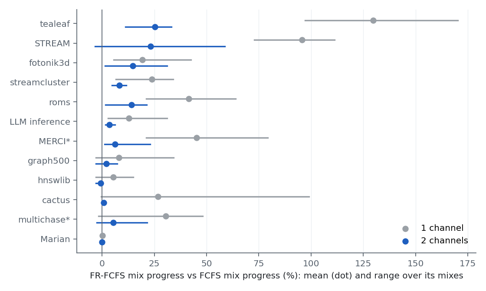
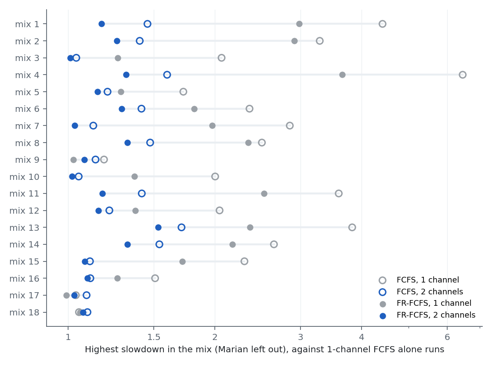

# O3 Mixed Runs: FCFS and FR-FCFS on 1 and 2 Channels

- Four out-of-order (O3) hosts share the pool in the 18 Phase 1 mixes; each mix ran under FCFS and FR-FCFS on a one-channel and a two-channel pool (72 runs).&#32;
- On one 19.2 GB/s channel, FR-FCFS raises what the pool delivers from 7.0–12.2 GB/s to 7.7–16.8 GB/s and cuts the worst host's slowdown from up to 6.45× to 4.33× (the largest slowdown of any host in any mix, each host against its own alone run under the same scheduler).&#32;
- A second channel does more than FR-FCFS. On two FCFS channels no host slows more than 1.87× against its own 2-channel alone run.&#32;
- Measured from one common baseline, the worst host fares better on two FCFS channels than on one FR-FCFS channel in 15 of 18 mixes.&#32;
- With two channels FR-FCFS still speeds up the streaming hosts (tealeaf +25%, STREAM +23% on average over their mixes, FR-FCFS against FCFS in the same mix) and lowers unfairness in 16 mixes, to at most 1.27.

## Setup

Every setting is the O3 alone runs' except that four hosts share the pool. Each host's mix numbers are compared with its own alone run: the same workload, checkpoint slot, scheduler and channel count.

- **Hosts.** 4 hosts, each with 4 x86 cores at 3 GHz on gem5's O3 CPU from the start of the measured region: ROB 192, LQ/SQ 32, 8-wide issue and commit. Caches: L1 32 KiB (16 MSHRs), L2 512 KiB (48), L3 8 MiB (192).
- **Pool.** One or two DDR4-2400-like channels in SST, 19.2 GB/s peak each (38.4 GB/s for two), 2 ranks × 16 banks per channel, 8 KiB rows; with two channels consecutive 64 B lines alternate between them. The pool sits behind a fixed 250 ns link. Host i uses pool slot i (its own 1 GiB range) and restores that workload's slot-i checkpoint.
- **Schedulers.** FCFS is SST's stock timingDRAM: FIFO bank queues and closed pages. FR-FCFS serves the oldest request to an open row first, else the oldest; rows stay open and there is no cap on how many row hits may pass older requests.
- **Window.** 100 ms of simulated time from restore, statistics every 10 ms. All four hosts share one clock, so each window covers the same span on every host.
- **Mixes.** The 18 Phase 1 mixes, with the same workload in the same slot: 3 aggressors + 1 victim (mixes 1–6), 2 + 2 (7–12), 4 aggressors (13, 14), 1 + 3 (15, 16), all AI (17) and 4 victims (18). Each mix ran in four set-ups: 1 or 2 channels, FCFS or FR-FCFS.

## Measures

The measures are the Phase 1 mixed runs' definitions, so the two sets compare directly.

- **Slowdown** is alone progress ÷ mix progress, against the alone run under the same scheduler and channel count. Progress is the instruction rate, or the pool request rate for MERCI and multichase, whose instruction counts include spin and wait loops.
- **Unfairness** is the largest slowdown ÷ the smallest in the mix, leaving out Marian, which sends almost no traffic to the pool and never slows.
- **Weighted speedup** adds the four hosts' mix-to-alone instruction ratios (4 means no loss). **Jain's index** is (Σx)² ÷ (n × Σx²) over the same four ratios. Both use instructions for all four hosts, as in Phase 1, so they are slightly flattering where MERCI or multichase appear.
- **Demand** is the sum of the four hosts' alone pool bandwidth, under FCFS. **Delivered** is the sum of their bandwidth in the mix. **Mean latency** is the pool round trip of all four hosts' requests, weighted by each host's request rate (requests per second).
- **Row-hit rate** is 1 − activates ÷ column commands over the whole pool, recorded only by the FR-FCFS backend.
- **Common baselines.** Each set-up's own alone run sets its slowdowns, and FR-FCFS and 2-channel alone runs are faster. So two further measures share a baseline: one column in each host table measures FR-FCFS mix progress against the FCFS alone run on the same pool, and the *One channel or two* section measures all four set-ups against the 1-channel FCFS alone run.

## Results per mix

On one channel FR-FCFS delivers more bandwidth and lower mean latency than FCFS in all 18 mixes and has the smaller max slowdown in 17. On two channels it does both in 17 mixes and has the smaller max slowdown in 15. Both tables list mixes from highest to lowest 1-channel demand; every column uses one measure for all four hosts.

### One channel

| Mix | Workloads (hosts 0–3) | Demand alone, FCFS (GB/s) | Delivered (GB/s) FCFS → FR-FCFS | Mean latency (ns) FCFS → FR-FCFS | Max slowdown FCFS (host) | Max slowdown FR-FCFS (host) | Unfairness FCFS → FR-FCFS | Weighted speedup FCFS → FR-FCFS | Jain FCFS → FR-FCFS | Row-hit rate FR-FCFS |
| --- | --- | --- | --- | --- | --- | --- | --- | --- | --- | --- |
| 13 | tealeaf, STREAM, fotonik3d, streamcluster | 27.9 | 10.7 → 16.8 | 1760 → 1056 | 3.83 (STREAM) | 3.37 (STREAM) | 2.35 → 1.74 | 1.53 → 1.64 | 0.89 → 0.96 | 0.74 |
| 4 | tealeaf, fotonik3d, roms, MERCI | 26.4 | 10.6 → 16.5 | 1396 → 874 | 6.45 (MERCI) | 4.33 (MERCI) | 3.39 → 2.19 | 1.24 → 1.31 | 0.73 → 0.78 | 0.72 |
| 14 | fotonik3d, roms, LLM inference, streamcluster | 26.3 | 12.2 → 16.7 | 829 → 696 | 2.65 (roms) | 2.29 (streamcluster) | 1.55 → 1.83 | 1.96 → 2.29 | 0.97 → 0.94 | 0.75 |
| 2 | tealeaf, streamcluster, roms, graph500 | 23.8 | 10.1 → 16.3 | 1065 → 709 | 3.28 (graph500) | 2.88 (graph500) | 1.92 → 1.68 | 1.66 → 1.83 | 0.94 → 0.97 | 0.70 |
| 1 | tealeaf, STREAM, fotonik3d, multichase | 23.1 | 10.4 → 16.6 | 1649 → 978 | 4.42 (multichase) | 3.21 (STREAM) | 2.75 → 1.67 | 3.05 → 2.48 | 0.62 → 0.78 | 0.73 |
| 11 | STREAM, roms, MERCI, graph500 | 22.2 | 11.3 → 16.5 | 767 → 592 | 3.59 (MERCI) | 2.49 (graph500) | 1.70 → 1.52 | 1.33 → 1.64 | 0.79 → 0.83 | 0.72 |
| 8 | fotonik3d, roms, graph500, cactus | 22.2 | 12.1 → 15.8 | 829 → 736 | 2.50 (roms) | 2.27 (graph500) | 1.65 → 1.81 | 2.13 → 2.36 | 0.96 → 0.94 | 0.64 |
| 6 | tealeaf, fotonik3d, streamcluster, Marian | 20.3 | 9.4 → 16.3 | 1362 → 711 | 2.36 (streamcluster) | 2.25 (fotonik3d) | 1.26 → 1.41 | 2.41 → 2.60 | 0.87 → 0.90 | 0.72 |
| 3 | STREAM, fotonik3d, LLM inference, hnswlib | 20.1 | 11.5 → 16.8 | 815 → 562 | 2.07 (STREAM) | 1.67 (fotonik3d) | 1.64 → 1.34 | 2.51 → 2.83 | 0.97 → 0.99 | 0.75 |
| 5 | STREAM, streamcluster, LLM inference, cactus | 16.9 | 10.7 → 16.4 | 619 → 412 | 1.72 (STREAM) | 1.34 (streamcluster) | 1.42 → 1.11 | 2.80 → 3.19 | 0.98 → 1.00 | 0.79 |
| 12 | fotonik3d, streamcluster, cactus, Marian | 16.2 | 11.3 → 14.7 | 693 → 527 | 2.05 (cactus) | 1.44 (streamcluster) | 1.85 → 1.39 | 2.94 → 3.61 | 0.92 → 0.98 | 0.74 |
| 7 | tealeaf, STREAM, hnswlib, multichase | 14.9 | 8.5 → 16.4 | 1114 → 656 | 2.85 (multichase) | 2.35 (STREAM) | 1.95 → 1.80 | 2.65 → 2.77 | 0.93 → 0.94 | 0.74 |
| 16 | roms, MERCI, cactus, multichase | 12.3 | 9.4 → 12.9 | 602 → 447 | 1.51 (MERCI) | 1.30 (multichase) | 1.44 → 1.26 | 3.07 → 3.75 | 0.87 → 1.00 | 0.75 |
| 9 | streamcluster, LLM inference, MERCI, Marian | 11.7 | 9.5 → 11.8 | 391 → 308 | 1.19 (streamcluster) | 1.09 (MERCI) | 1.09 → 1.03 | 3.20 → 3.89 | 0.93 → 1.00 | 0.87 |
| 10 | tealeaf, LLM inference, hnswlib, multichase | 11.5 | 7.8 → 16.0 | 888 → 435 | 2.00 (multichase) | 1.41 (multichase) | 1.61 → 1.27 | 3.44 → 3.57 | 0.95 → 1.00 | 0.78 |
| 15 | tealeaf, multichase, hnswlib, graph500 | 11.4 | 8.1 → 15.1 | 842 → 457 | 2.30 (graph500) | 1.69 (graph500) | 1.96 → 1.52 | 2.90 → 3.18 | 0.95 → 0.98 | 0.66 |
| 18 | MERCI, graph500, hnswlib, multichase | 7.4 | 7.0 → 7.7 | 328 → 302 | 1.05 (MERCI) | 1.09 (multichase) | 1.08 → 1.06 | 3.61 → 3.81 | 0.97 → 1.00 | 0.48 |
| 17 | LLM inference, MERCI, hnswlib, Marian | 7.4 | 7.0 → 7.9 | 327 → 287 | 1.04 (MERCI) | 1.02 (LLM inference) | 1.07 → 1.03 | 4.12 → 3.94 | 1.00 → 1.00 | 0.87 |

**How to read this table.** One row per mix on one channel; A → B gives the FCFS value, then the FR-FCFS value. Demand alone, FCFS: the four hosts' pool bandwidth in their FCFS alone runs in the same slots, added up, which is what they would move with the pool to themselves. Delivered: the four hosts' pool bandwidth in the mix, added up. Mean latency: the four hosts' mean pool round trips weighted by request rate, including the fixed 250 ns link. Max slowdown (host): the largest host slowdown and its workload, Marian left out. Slowdown is alone progress ÷ mix progress against the alone run under the same scheduler, and progress is the instruction rate, or the pool bandwidth for MERCI and multichase. Unfairness: the largest ÷ the smallest slowdown, Marian left out. Weighted speedup: the four hosts' mix ÷ alone instruction rates added up (4 = no loss). Jain: (Σx)² ÷ (4 × Σx²) over those four ratios (1 = all equal). Row-hit rate: 1 − activates ÷ column commands over the whole pool, in the FR-FCFS run.

Demand under FR-FCFS alone is higher than the FCFS column (7.9–43.6 GB/s), because FR-FCFS alone runs move more data. In mixes 1 and 17, FCFS weighted speedup is lifted by multichase and MERCI, whose instruction rates rise in the mix (spin loops).

### Two channels

Two channels deliver 6.9–22.5 GB/s under FCFS and 7.0–28.8 GB/s under FR-FCFS, at most 75% of their 38.4 GB/s peak (mix 13, 28.8 GB/s). Mean latency stays at 276–552 ns, and no host slows more than 1.87× against its 2-channel alone run. Demand from 2-channel FCFS alone runs is 7.0–38.1 GB/s, higher than on one channel because those runs move more data.

| Mix | Workloads (hosts 0–3) | Demand alone, FCFS (GB/s) | Delivered (GB/s) FCFS → FR-FCFS | Mean latency (ns) FCFS → FR-FCFS | Max slowdown FCFS (host) | Max slowdown FR-FCFS (host) | Unfairness FCFS → FR-FCFS | Weighted speedup FCFS → FR-FCFS | Jain FCFS → FR-FCFS | Row-hit rate FR-FCFS |
| --- | --- | --- | --- | --- | --- | --- | --- | --- | --- | --- |
| 13 | tealeaf, STREAM, fotonik3d, streamcluster | 38.1 | 22.5 → 28.8 | 552 → 389 | 1.87 (STREAM) | 1.49 (streamcluster) | 1.18 → 1.16 | 2.32 → 2.89 | 1.00 → 1.00 | 0.54 |
| 4 | tealeaf, fotonik3d, roms, MERCI | 35.2 | 22.1 → 27.6 | 505 → 372 | 1.64 (tealeaf) | 1.41 (fotonik3d) | 1.19 → 1.20 | 2.22 → 2.77 | 0.96 → 0.99 | 0.54 |
| 14 | fotonik3d, roms, LLM inference, streamcluster | 25.8 | 21.6 → 23.4 | 363 → 310 | 1.47 (roms) | 1.31 (roms) | 1.40 → 1.27 | 3.30 → 3.44 | 0.99 → 0.99 | 0.64 |
| 2 | tealeaf, streamcluster, roms, graph500 | 28.8 | 21.4 → 25.2 | 412 → 332 | 1.46 (tealeaf) | 1.21 (streamcluster) | 1.21 → 1.09 | 3.03 → 3.42 | 1.00 → 1.00 | 0.53 |
| 1 | tealeaf, STREAM, fotonik3d, multichase | 33.9 | 21.8 → 27.8 | 514 → 367 | 1.82 (STREAM) | 1.32 (fotonik3d) | 1.28 → 1.09 | 2.74 → 3.32 | 0.95 → 0.99 | 0.53 |
| 11 | STREAM, roms, MERCI, graph500 | 22.4 | 19.9 → 20.9 | 338 → 309 | 1.35 (roms) | 1.16 (roms) | 1.29 → 1.09 | 3.32 → 3.49 | 0.99 → 1.00 | 0.50 |
| 8 | fotonik3d, roms, graph500, cactus | 22.1 | 19.9 → 20.6 | 344 → 312 | 1.40 (roms) | 1.31 (roms) | 1.35 → 1.27 | 3.48 → 3.61 | 0.99 → 0.99 | 0.50 |
| 6 | tealeaf, fotonik3d, streamcluster, Marian | 29.4 | 20.5 → 25.1 | 440 → 342 | 1.46 (tealeaf) | 1.24 (fotonik3d) | 1.11 → 1.05 | 3.16 → 3.46 | 0.98 → 0.99 | 0.55 |
| 3 | STREAM, fotonik3d, LLM inference, hnswlib | 24.9 | 20.3 → 23.1 | 348 → 309 | 1.20 (fotonik3d) | 1.12 (fotonik3d) | 1.20 → 1.11 | 3.72 → 3.69 | 1.00 → 1.00 | 0.58 |
| 5 | STREAM, streamcluster, LLM inference, cactus | 18.2 | 16.4 → 17.4 | 313 → 293 | 1.12 (streamcluster) | 1.11 (streamcluster) | 1.14 → 1.09 | 3.84 → 3.72 | 1.00 → 1.00 | 0.62 |
| 12 | fotonik3d, streamcluster, cactus, Marian | 16.6 | 15.5 → 16.0 | 325 → 293 | 1.13 (streamcluster) | 1.11 (streamcluster) | 1.11 → 1.10 | 3.85 → 3.86 | 1.00 → 1.00 | 0.62 |
| 7 | tealeaf, STREAM, hnswlib, multichase | 22.9 | 18.8 → 22.3 | 391 → 324 | 1.28 (tealeaf) | 1.09 (STREAM) | 1.31 → 1.08 | 3.64 → 3.85 | 0.99 → 1.00 | 0.49 |
| 16 | roms, MERCI, cactus, multichase | 11.1 | 10.7 → 11.0 | 319 → 296 | 1.05 (roms) | 1.06 (MERCI) | 1.06 → 1.05 | 3.79 → 3.80 | 1.00 → 1.00 | 0.57 |
| 9 | streamcluster, LLM inference, MERCI, Marian | 11.0 | 10.3 → 11.0 | 289 → 278 | 1.06 (streamcluster) | 1.06 (MERCI) | 1.04 → 1.01 | 3.76 → 3.86 | 1.00 → 1.00 | 0.78 |
| 10 | tealeaf, LLM inference, hnswlib, multichase | 18.0 | 16.5 → 18.2 | 339 → 304 | 1.08 (tealeaf) | 1.05 (multichase) | 1.12 → 1.03 | 3.93 → 3.91 | 1.00 → 1.00 | 0.56 |
| 15 | tealeaf, multichase, hnswlib, graph500 | 17.6 | 16.2 → 17.8 | 344 → 311 | 1.10 (tealeaf) | 1.08 (multichase) | 1.11 → 1.06 | 3.73 → 3.82 | 1.00 → 1.00 | 0.44 |
| 18 | MERCI, graph500, hnswlib, multichase | 7.1 | 7.0 → 7.0 | 287 → 289 | 1.01 (MERCI) | 1.07 (multichase) | 1.05 → 1.07 | 3.90 → 3.85 | 1.00 → 1.00 | 0.34 |
| 17 | LLM inference, MERCI, hnswlib, Marian | 7.0 | 6.9 → 7.3 | 284 → 276 | 1.02 (LLM inference) | 1.03 (LLM inference) | 1.06 → 1.04 | 3.92 → 3.81 | 1.00 → 0.99 | 0.78 |

**How to read this table.** One row per mix on two channels; A → B gives the FCFS value, then the FR-FCFS value. Demand alone, FCFS: the four hosts' pool bandwidth in their 2-channel FCFS alone runs in the same slots, added up. Delivered: the four hosts' pool bandwidth in the mix, added up. Mean latency: the four hosts' mean pool round trips weighted by request rate, including the fixed 250 ns link. Max slowdown (host): the largest host slowdown and its workload, Marian left out, against each host's 2-channel alone run under the same scheduler; progress is the instruction rate, or the pool bandwidth for MERCI and multichase. Unfairness: the largest ÷ the smallest slowdown, Marian left out. Weighted speedup: the four hosts' mix ÷ alone instruction rates added up (4 = no loss). Jain: (Σx)² ÷ (4 × Σx²) over those four ratios (1 = all equal). Row-hit rate: 1 − activates ÷ column commands over the whole pool, in the FR-FCFS run.

### Every host, one channel

All 72 host positions under both schedulers. Bandwidth, latency and instructions are mix values; slowdowns are against each host's same-slot alone run.

| Mix | Host | Workload | Bandwidth (GB/s) FCFS → FR-FCFS | Latency (ns) FCFS → FR-FCFS | Instructions (10⁹/s) FCFS → FR-FCFS | Slowdown FCFS → FR-FCFS | FR-FCFS slowdown vs FCFS alone |
| --- | --- | --- | --- | --- | --- | --- | --- |
| 13 | 0 | tealeaf | 2.99 → 5.76 | 1915 → 1000 | 1.704 → 4.176 | 2.93 → 2.37 | 1.20 |
| 13 | 1 | STREAM | 2.17 → 4.35 | 1697 → 1024 | 0.247 → 0.474 | 3.83 → 3.37 | 2.00 |
| 13 | 2 | fotonik3d | 4.68 → 5.48 | 1710 → 1137 | 2.540 → 2.732 | 1.63 → 1.94 | 1.52 |
| 13 | 3 | streamcluster | 0.88 → 1.19 | 1654 → 1069 | 1.490 → 1.995 | 3.16 → 2.49 | 2.36 |
| 4 | 0 | tealeaf | 3.62 → 6.96 | 1511 → 847 | 2.093 → 5.006 | 2.39 → 1.98 | 1.00 |
| 4 | 1 | fotonik3d | 4.06 → 4.67 | 1442 → 979 | 2.019 → 2.134 | 1.90 → 2.38 | 1.80 |
| 4 | 2 | roms | 2.52 → 4.04 | 1203 → 822 | 2.078 → 3.406 | 3.81 → 2.89 | 2.32 |
| 4 | 3 | MERCI\* | 0.45 → 0.80 | 1140 → 771 | 0.060 → 0.081 | 6.45 → 4.33 | 3.65 |
| 14 | 0 | fotonik3d | 5.38 → 7.61 | 919 → 771 | 2.673 → 3.813 | 1.71 → 1.25 | 1.20 |
| 14 | 1 | roms | 3.89 → 5.79 | 796 → 670 | 3.932 → 5.336 | 2.65 → 2.25 | 1.95 |
| 14 | 2 | LLM inference | 1.71 → 1.98 | 743 → 586 | 5.733 → 6.345 | 1.77 → 1.65 | 1.60 |
| 14 | 3 | streamcluster | 1.20 → 1.34 | 659 → 545 | 2.032 → 2.168 | 2.32 → 2.29 | 2.17 |
| 2 | 0 | tealeaf | 4.44 → 8.49 | 1188 → 711 | 2.929 → 5.771 | 1.71 → 1.71 | 0.87 |
| 2 | 1 | streamcluster | 1.20 → 1.59 | 1029 → 713 | 2.006 → 2.332 | 2.33 → 2.09 | 2.00 |
| 2 | 2 | roms | 3.13 → 4.74 | 967 → 700 | 2.730 → 4.118 | 2.90 → 2.39 | 1.92 |
| 2 | 3 | graph500 | 1.29 → 1.46 | 912 → 716 | 0.652 → 0.736 | 3.28 → 2.88 | 2.91 |
| 1 | 0 | tealeaf | 3.19 → 6.29 | 1771 → 926 | 1.829 → 4.676 | 2.73 → 2.11 | 1.07 |
| 1 | 1 | STREAM | 2.37 → 4.57 | 1553 → 961 | 0.268 → 0.497 | 3.53 → 3.21 | 1.90 |
| 1 | 2 | fotonik3d | 4.80 → 5.68 | 1617 → 1050 | 2.575 → 2.754 | 1.61 → 1.92 | 1.50 |
| 1 | 3 | multichase\* | 0.05 → 0.07 | 1432 → 876 | 0.046 → 0.031 | 4.42 → 3.06 | 2.98 |
| 11 | 0 | STREAM | 4.43 → 6.95 | 831 → 589 | 0.480 → 0.967 | 2.11 → 1.64 | 1.05 |
| 11 | 1 | roms | 4.33 → 6.44 | 747 → 587 | 4.251 → 6.117 | 2.45 → 1.96 | 1.70 |
| 11 | 2 | MERCI\* | 0.82 → 1.47 | 761 → 625 | 0.083 → 0.240 | 3.59 → 2.35 | 2.01 |
| 11 | 3 | graph500 | 1.73 → 1.68 | 656 → 595 | 0.874 → 0.849 | 2.45 → 2.49 | 2.52 |
| 8 | 0 | fotonik3d | 5.79 → 7.66 | 926 → 804 | 2.878 → 3.814 | 1.59 → 1.25 | 1.20 |
| 8 | 1 | roms | 4.12 → 5.96 | 774 → 676 | 4.162 → 5.533 | 2.50 → 2.17 | 1.88 |
| 8 | 2 | graph500 | 1.66 → 1.62 | 670 → 645 | 0.836 → 0.818 | 2.29 → 2.27 | 2.34 |
| 8 | 3 | cactus | 0.58 → 0.58 | 717 → 697 | 3.554 → 3.543 | 1.52 → 1.51 | 1.52 |
| 6 | 0 | tealeaf | 3.79 → 9.29 | 1467 → 663 | 2.286 → 6.176 | 2.19 → 1.60 | 0.81 |
| 6 | 1 | fotonik3d | 4.39 → 5.05 | 1342 → 812 | 2.052 → 2.257 | 1.87 → 2.25 | 1.70 |
| 6 | 2 | streamcluster | 1.18 → 1.96 | 1101 → 676 | 1.990 → 2.582 | 2.36 → 1.88 | 1.82 |
| 6 | 3 | Marian | 0.02 → 0.02 | 1195 → 660 | 6.031 → 6.055 | 1.01 → 1.00 | 1.00 |
| 3 | 0 | STREAM | 4.51 → 7.60 | 809 → 516 | 0.490 → 1.032 | 2.07 → 1.53 | 0.98 |
| 3 | 1 | fotonik3d | 4.93 → 6.44 | 869 → 650 | 2.220 → 3.039 | 1.73 → 1.67 | 1.26 |
| 3 | 2 | LLM inference | 1.80 → 2.39 | 697 → 469 | 6.594 → 8.093 | 1.54 → 1.29 | 1.25 |
| 3 | 3 | hnswlib | 0.28 → 0.36 | 746 → 567 | 1.960 → 1.982 | 1.26 → 1.25 | 1.25 |
| 5 | 0 | STREAM | 5.46 → 9.11 | 669 → 418 | 0.587 → 1.239 | 1.72 → 1.28 | 0.82 |
| 5 | 1 | streamcluster | 2.27 → 3.59 | 616 → 428 | 2.804 → 3.645 | 1.67 → 1.34 | 1.28 |
| 5 | 2 | LLM inference | 2.27 → 2.93 | 538 → 370 | 8.328 → 8.657 | 1.22 → 1.21 | 1.17 |
| 5 | 3 | cactus | 0.69 → 0.72 | 499 → 419 | 4.279 → 4.427 | 1.26 → 1.21 | 1.22 |
| 12 | 0 | fotonik3d | 8.26 → 9.74 | 717 → 515 | 4.119 → 4.621 | 1.11 → 1.03 | 0.99 |
| 12 | 1 | streamcluster | 1.92 → 3.21 | 630 → 434 | 2.556 → 3.398 | 1.83 → 1.44 | 1.38 |
| 12 | 2 | cactus | 1.11 → 1.75 | 625 → 765 | 0.472 → 0.939 | 2.05 → 1.06 | 1.03 |
| 12 | 3 | Marian | 0.02 → 0.02 | 585 → 463 | 6.060 → 6.065 | 1.00 → 1.00 | 1.00 |
| 7 | 0 | tealeaf | 4.59 → 9.69 | 1192 → 623 | 3.063 → 6.432 | 1.63 → 1.54 | 0.78 |
| 7 | 1 | STREAM | 3.57 → 6.23 | 1027 → 709 | 0.393 → 0.679 | 2.40 → 2.35 | 1.39 |
| 7 | 2 | hnswlib | 0.24 → 0.34 | 1007 → 672 | 1.667 → 1.907 | 1.46 → 1.31 | 1.28 |
| 7 | 3 | multichase\* | 0.08 → 0.11 | 831 → 565 | 0.024 → 0.024 | 2.85 → 2.03 | 1.98 |
| 16 | 0 | roms | 5.63 → 8.04 | 576 → 418 | 8.758 → 10.619 | 1.13 → 1.09 | 0.93 |
| 16 | 1 | MERCI\* | 1.98 → 2.88 | 505 → 416 | 0.374 → 1.580 | 1.51 → 1.21 | 1.04 |
| 16 | 2 | cactus | 1.68 → 1.85 | 824 → 631 | 0.918 → 0.961 | 1.05 → 1.03 | 1.00 |
| 16 | 3 | multichase\* | 0.16 → 0.17 | 383 → 350 | 0.025 → 0.025 | 1.37 → 1.30 | 1.26 |
| 9 | 0 | streamcluster | 3.81 → 4.94 | 385 → 313 | 3.910 → 4.578 | 1.19 → 1.06 | 1.01 |
| 9 | 1 | LLM inference | 3.20 → 3.66 | 350 → 287 | 9.249 → 9.821 | 1.09 → 1.06 | 1.03 |
| 9 | 2 | MERCI\* | 2.51 → 3.19 | 451 → 326 | 0.864 → 2.021 | 1.18 → 1.09 | 0.93 |
| 9 | 3 | Marian | 0.02 → 0.02 | 348 → 296 | 6.068 → 6.070 | 1.00 → 1.00 | 1.00 |
| 10 | 0 | tealeaf | 5.56 → 12.43 | 968 → 450 | 3.960 → 8.699 | 1.26 → 1.14 | 0.57 |
| 10 | 1 | LLM inference | 1.80 → 3.00 | 683 → 376 | 6.624 → 8.681 | 1.52 → 1.20 | 1.16 |
| 10 | 2 | hnswlib | 0.28 → 0.39 | 733 → 433 | 1.952 → 2.243 | 1.25 → 1.11 | 1.08 |
| 10 | 3 | multichase\* | 0.11 → 0.16 | 578 → 383 | 0.031 → 0.025 | 2.00 → 1.41 | 1.37 |
| 15 | 0 | tealeaf | 5.82 → 12.18 | 924 → 465 | 4.222 → 8.464 | 1.18 → 1.17 | 0.59 |
| 15 | 1 | multichase\* | 0.11 → 0.15 | 597 → 410 | 0.041 → 0.047 | 1.99 → 1.50 | 1.46 |
| 15 | 2 | hnswlib | 0.29 → 0.41 | 696 → 453 | 2.075 → 2.228 | 1.17 → 1.12 | 1.09 |
| 15 | 3 | graph500 | 1.84 → 2.38 | 623 → 420 | 0.931 → 1.250 | 2.30 → 1.69 | 1.71 |
| 18 | 0 | MERCI\* | 2.79 → 3.37 | 370 → 308 | 1.242 → 1.825 | 1.05 → 1.02 | 0.87 |
| 18 | 1 | graph500 | 3.62 → 3.58 | 299 → 299 | 1.832 → 1.811 | 1.04 → 1.02 | 1.05 |
| 18 | 2 | hnswlib | 0.42 → 0.51 | 319 → 293 | 2.488 → 2.413 | 0.98 → 1.03 | 1.01 |
| 18 | 3 | multichase\* | 0.21 → 0.20 | 284 → 289 | 0.026 → 0.026 | 1.04 → 1.09 | 1.06 |
| 17 | 0 | LLM inference | 3.66 → 3.86 | 302 → 273 | 9.960 → 10.247 | 1.02 → 1.02 | 0.99 |
| 17 | 1 | MERCI\* | 2.88 → 3.50 | 361 → 301 | 1.562 → 1.724 | 1.04 → 1.00 | 0.86 |
| 17 | 2 | hnswlib | 0.44 → 0.51 | 314 → 287 | 2.505 → 2.453 | 0.97 → 1.01 | 0.99 |
| 17 | 3 | Marian | 0.02 → 0.02 | 304 → 282 | 6.069 → 6.071 | 1.00 → 1.00 | 1.00 |

**How to read this table.** One row per host in a mix on one channel, FCFS → FR-FCFS. Bandwidth: the host's pool requests × 64 B ÷ the covered time. Latency: its mean pool round trip, including the 250 ns link. Instructions: committed by its 4 cores per second. Slowdown: its alone progress ÷ its mix progress, each scheduler against its own alone run in the same slot. FR-FCFS slowdown vs FCFS alone: its FCFS alone progress ÷ its FR-FCFS mix progress, so both schedulers share one baseline; below 1 means it ran faster in the FR-FCFS mix than alone under FCFS.

\* slowdown for this host uses its pool request rate (bandwidth), because its instruction count includes spin and wait loops.

### Every host, two channels

The same 72 host positions on the 2-channel pool, in the same order. Slowdowns are against each host's same-slot 2-channel alone run.

| Mix | Host | Workload | Bandwidth (GB/s) FCFS → FR-FCFS | Latency (ns) FCFS → FR-FCFS | Instructions (10⁹/s) FCFS → FR-FCFS | Slowdown FCFS → FR-FCFS | FR-FCFS slowdown vs FCFS alone |
| --- | --- | --- | --- | --- | --- | --- | --- |
| 13 | 0 | tealeaf | 8.10 → 10.95 | 575 → 394 | 5.597 → 7.281 | 1.73 → 1.38 | 1.33 |
| 13 | 1 | STREAM | 5.85 → 7.14 | 545 → 394 | 0.630 → 1.000 | 1.87 → 1.28 | 1.18 |
| 13 | 2 | fotonik3d | 6.44 → 8.15 | 536 → 383 | 2.971 → 3.896 | 1.72 → 1.40 | 1.31 |
| 13 | 3 | streamcluster | 2.12 → 2.58 | 535 → 371 | 2.758 → 3.079 | 1.59 → 1.49 | 1.42 |
| 4 | 0 | tealeaf | 8.66 → 11.35 | 545 → 384 | 5.898 → 7.664 | 1.64 → 1.31 | 1.26 |
| 4 | 1 | fotonik3d | 6.59 → 8.07 | 492 → 368 | 3.143 → 3.738 | 1.59 → 1.41 | 1.34 |
| 4 | 2 | roms | 4.86 → 5.78 | 452 → 353 | 4.955 → 6.014 | 1.59 → 1.33 | 1.31 |
| 4 | 3 | MERCI\* | 1.99 → 2.45 | 499 → 369 | 0.401 → 0.792 | 1.38 → 1.18 | 1.12 |
| 14 | 0 | fotonik3d | 9.46 → 10.01 | 370 → 317 | 4.607 → 4.718 | 1.04 → 1.03 | 1.02 |
| 14 | 1 | roms | 5.88 → 6.36 | 372 → 316 | 6.755 → 7.856 | 1.47 → 1.31 | 1.26 |
| 14 | 2 | LLM inference | 3.11 → 3.45 | 330 → 288 | 8.996 → 9.559 | 1.17 → 1.15 | 1.10 |
| 14 | 3 | streamcluster | 3.12 → 3.62 | 355 → 305 | 3.499 → 3.828 | 1.25 → 1.20 | 1.14 |
| 2 | 0 | tealeaf | 9.90 → 12.41 | 457 → 347 | 6.608 → 8.667 | 1.46 → 1.16 | 1.12 |
| 2 | 1 | streamcluster | 2.89 → 3.44 | 381 → 311 | 3.330 → 3.709 | 1.30 → 1.21 | 1.17 |
| 2 | 2 | roms | 5.65 → 6.22 | 379 → 318 | 5.933 → 6.739 | 1.33 → 1.19 | 1.17 |
| 2 | 3 | graph500 | 2.91 → 3.12 | 356 → 321 | 1.714 → 1.837 | 1.21 → 1.12 | 1.13 |
| 1 | 0 | tealeaf | 8.75 → 11.53 | 535 → 373 | 5.883 → 7.839 | 1.64 → 1.28 | 1.23 |
| 1 | 1 | STREAM | 6.04 → 7.51 | 517 → 373 | 0.649 → 1.025 | 1.82 → 1.25 | 1.15 |
| 1 | 2 | fotonik3d | 6.83 → 8.61 | 488 → 356 | 3.156 → 4.130 | 1.62 → 1.32 | 1.24 |
| 1 | 3 | multichase\* | 0.15 → 0.18 | 399 → 323 | 0.025 → 0.025 | 1.42 → 1.20 | 1.17 |
| 11 | 0 | STREAM | 7.78 → 8.55 | 353 → 316 | 1.092 → 1.169 | 1.09 → 1.10 | 1.02 |
| 11 | 1 | roms | 6.30 → 6.40 | 336 → 304 | 7.340 → 8.841 | 1.35 → 1.16 | 1.12 |
| 11 | 2 | MERCI\* | 2.57 → 2.64 | 327 → 304 | 0.914 → 1.047 | 1.05 → 1.10 | 1.02 |
| 11 | 3 | graph500 | 3.25 → 3.31 | 313 → 303 | 1.901 → 1.922 | 1.09 → 1.07 | 1.08 |
| 8 | 0 | fotonik3d | 9.72 → 10.01 | 348 → 312 | 4.636 → 4.712 | 1.04 → 1.03 | 1.02 |
| 8 | 1 | roms | 6.06 → 6.37 | 352 → 312 | 7.056 → 7.851 | 1.40 → 1.31 | 1.26 |
| 8 | 2 | graph500 | 3.31 → 3.40 | 321 → 311 | 1.675 → 1.723 | 1.16 → 1.09 | 1.13 |
| 8 | 3 | cactus | 0.82 → 0.83 | 320 → 309 | 5.066 → 5.161 | 1.07 → 1.04 | 1.05 |
| 6 | 0 | tealeaf | 9.95 → 12.26 | 466 → 354 | 6.632 → 8.527 | 1.46 → 1.18 | 1.13 |
| 6 | 1 | fotonik3d | 7.65 → 9.49 | 423 → 335 | 3.590 → 4.251 | 1.39 → 1.24 | 1.18 |
| 6 | 2 | streamcluster | 2.87 → 3.35 | 396 → 321 | 3.315 → 3.643 | 1.31 → 1.24 | 1.19 |
| 6 | 3 | Marian | 0.02 → 0.02 | 417 → 333 | 6.062 → 6.068 | 1.00 → 1.00 | 1.00 |
| 3 | 0 | STREAM | 7.51 → 8.50 | 367 → 320 | 1.154 → 1.170 | 1.04 → 1.10 | 1.02 |
| 3 | 1 | fotonik3d | 9.25 → 10.74 | 345 → 308 | 4.158 → 4.705 | 1.20 → 1.12 | 1.06 |
| 3 | 2 | LLM inference | 3.22 → 3.51 | 314 → 284 | 9.737 → 10.007 | 1.08 → 1.10 | 1.05 |
| 3 | 3 | hnswlib | 0.28 → 0.30 | 332 → 304 | 2.675 → 2.651 | 1.01 → 1.01 | 1.01 |
| 5 | 0 | STREAM | 8.37 → 8.88 | 327 → 305 | 1.216 → 1.176 | 0.98 → 1.09 | 1.02 |
| 5 | 1 | streamcluster | 3.64 → 3.95 | 304 → 285 | 3.878 → 4.066 | 1.12 → 1.11 | 1.06 |
| 5 | 2 | LLM inference | 3.53 → 3.69 | 291 → 274 | 9.924 → 10.103 | 1.06 → 1.09 | 1.04 |
| 5 | 3 | cactus | 0.85 → 0.85 | 291 → 291 | 5.282 → 5.295 | 1.02 → 1.01 | 1.02 |
| 12 | 0 | fotonik3d | 10.07 → 10.30 | 320 → 294 | 4.736 → 4.804 | 1.02 → 1.01 | 1.00 |
| 12 | 1 | streamcluster | 3.60 → 3.92 | 311 → 287 | 3.844 → 4.046 | 1.13 → 1.11 | 1.07 |
| 12 | 2 | cactus | 1.78 → 1.78 | 383 → 301 | 0.938 → 0.941 | 1.02 → 1.02 | 1.02 |
| 12 | 3 | Marian | 0.02 → 0.02 | 314 → 292 | 6.069 → 6.070 | 1.00 → 1.00 | 1.00 |
| 7 | 0 | tealeaf | 11.13 → 13.27 | 397 → 325 | 7.572 → 9.517 | 1.28 → 1.06 | 1.02 |
| 7 | 1 | STREAM | 7.25 → 8.49 | 387 → 323 | 1.004 → 1.177 | 1.18 → 1.09 | 1.00 |
| 7 | 2 | hnswlib | 0.28 → 0.31 | 343 → 299 | 2.702 → 2.694 | 0.98 → 1.01 | 0.98 |
| 7 | 3 | multichase\* | 0.19 → 0.21 | 310 → 281 | 0.026 → 0.026 | 1.13 → 1.06 | 1.03 |
| 16 | 0 | roms | 6.02 → 6.24 | 315 → 295 | 9.612 → 9.765 | 1.05 → 1.05 | 1.03 |
| 16 | 1 | MERCI\* | 2.69 → 2.72 | 311 → 294 | 1.074 → 1.266 | 0.99 → 1.06 | 0.98 |
| 16 | 2 | cactus | 1.83 → 1.86 | 348 → 301 | 0.954 → 0.960 | 1.01 → 1.01 | 1.00 |
| 16 | 3 | multichase\* | 0.21 → 0.21 | 281 → 279 | 0.026 → 0.026 | 1.03 → 1.05 | 1.03 |
| 9 | 0 | streamcluster | 3.89 → 4.35 | 291 → 279 | 4.070 → 4.308 | 1.06 → 1.05 | 1.00 |
| 9 | 1 | LLM inference | 3.74 → 3.89 | 281 → 269 | 9.977 → 10.442 | 1.06 → 1.05 | 1.01 |
| 9 | 2 | MERCI\* | 2.66 → 2.73 | 296 → 289 | 1.076 → 1.268 | 1.02 → 1.06 | 0.99 |
| 9 | 3 | Marian | 0.02 → 0.02 | 291 → 281 | 6.070 → 6.071 | 1.00 → 1.00 | 1.00 |
| 10 | 0 | tealeaf | 12.56 → 13.98 | 352 → 313 | 8.919 → 9.916 | 1.08 → 1.02 | 0.97 |
| 10 | 1 | LLM inference | 3.41 → 3.73 | 297 → 274 | 10.285 → 10.464 | 1.03 → 1.05 | 1.01 |
| 10 | 2 | hnswlib | 0.31 → 0.30 | 310 → 290 | 2.733 → 2.654 | 0.97 → 1.02 | 1.00 |
| 10 | 3 | multichase\* | 0.20 → 0.21 | 287 → 277 | 0.026 → 0.026 | 1.05 → 1.05 | 1.02 |
| 15 | 0 | tealeaf | 12.38 → 13.88 | 357 → 315 | 8.758 → 9.830 | 1.10 → 1.02 | 0.98 |
| 15 | 1 | multichase\* | 0.20 → 0.21 | 289 → 287 | 0.049 → 0.051 | 1.06 → 1.08 | 1.05 |
| 15 | 2 | hnswlib | 0.30 → 0.31 | 312 → 292 | 2.655 → 2.663 | 0.99 → 1.02 | 0.99 |
| 15 | 3 | graph500 | 3.33 → 3.36 | 303 → 298 | 1.932 → 1.979 | 1.07 → 1.04 | 1.05 |
| 18 | 0 | MERCI\* | 2.68 → 2.73 | 292 → 288 | 1.128 → 1.284 | 1.01 → 1.06 | 0.99 |
| 18 | 1 | graph500 | 3.80 → 3.69 | 284 → 291 | 1.926 → 1.868 | 1.01 → 1.01 | 1.04 |
| 18 | 2 | hnswlib | 0.32 → 0.32 | 286 → 282 | 2.723 → 2.734 | 0.97 → 0.99 | 0.97 |
| 18 | 3 | multichase\* | 0.21 → 0.21 | 275 → 283 | 0.026 → 0.026 | 1.01 → 1.07 | 1.04 |
| 17 | 0 | LLM inference | 3.86 → 4.01 | 278 → 267 | 10.300 → 10.693 | 1.02 → 1.03 | 0.98 |
| 17 | 1 | MERCI\* | 2.74 → 2.90 | 291 → 288 | 1.142 → 1.228 | 0.98 → 0.99 | 0.92 |
| 17 | 2 | hnswlib | 0.33 → 0.34 | 284 → 280 | 2.743 → 2.727 | 0.96 → 1.00 | 0.97 |
| 17 | 3 | Marian | 0.02 → 0.02 | 287 → 278 | 6.071 → 6.071 | 1.00 → 1.00 | 1.00 |

**How to read this table.** One row per host in a mix on two channels, FCFS → FR-FCFS. Bandwidth: the host's pool requests × 64 B ÷ the covered time. Latency: its mean pool round trip, including the 250 ns link. Instructions: committed by its 4 cores per second. Slowdown: its alone progress ÷ its mix progress, each scheduler against its own 2-channel alone run in the same slot. FR-FCFS slowdown vs FCFS alone: its 2-channel FCFS alone progress ÷ its FR-FCFS mix progress, so both schedulers share one baseline; below 1 means it ran faster in the FR-FCFS mix than alone under FCFS.

\* slowdown for this host uses its pool request rate (bandwidth), as above.

## FCFS vs FR-FCFS

FR-FCFS raises total delivery by keeping rows open, and the hosts that stream through rows take most of the extra bandwidth. On two channels, where the pool queues far less, every workload's gain is smaller.

**How to read this chart.** One row per workload. For each mix it is in: its FR-FCFS mix progress ÷ its FCFS mix progress − 1, same host and pool. The dot is the mean over its mixes and the line runs from the lowest to the highest; grey for one channel, blue for two. Progress is the instruction rate, or the pool bandwidth for the starred MERCI and multichase.

- **Throughput.** Under FCFS the channel delivers at most 12.2 GB/s, 63% of peak, even when demand is 23–28 GB/s. Demand is what the four hosts move when each has the pool to itself, so demand well above delivery means the channel, not the hosts, sets the limit, and the difference shows up as queueing. FR-FCFS delivers 14.7–16.8 GB/s (77–88% of peak) in every mix whose FR-FCFS demand exceeds 17 GB/s. On two channels FCFS delivers up to 22.5 GB/s (59% of 38.4) and FR-FCFS up to 28.8 GB/s (75%), both in mix 13.
- **Latency.** Mean pool latency falls from 0.39–1.76 µs to 0.31–1.06 µs in the 16 mixes with demand above 10 GB/s (each mix's mean round trip over all four hosts' requests, including the fixed 250 ns link). In mix 10 it halves, from 888 to 435 ns. On two channels FR-FCFS cuts it by up to 30% (mix 13: 552 → 389 ns); in mix 18 it rises 2 ns.
- **Row hits.** The pool row-hit rate in FR-FCFS mixes is 0.64–0.87, below the 0.74–0.99 most workloads reach alone, because four hosts' requests close each other's rows. Mix 18, with graph500 and three light victims, has the lowest at 0.48. On two channels the rate is 0.34–0.78, lower than on one, as in the alone runs.
- **Who gains.** In mixes, tealeaf takes 5.8–12.4 GB/s under FR-FCFS where it had 3.0–5.8 under FCFS (its bandwidth in each of its 8 mixes), as in mix 6 (3.8 → 9.3 GB/s). graph500 loses 2–3% of its instruction rate in mixes 8 and 11, where its bandwidth falls slightly (1.66 → 1.62 and 1.73 → 1.68 GB/s). On two channels tealeaf's gain is 11–33% (its FR-FCFS ÷ FCFS instruction rate in the same mix, lowest and highest over its mixes), and hnswlib's progress changes by −3% to 0%.
- **fotonik3d is slowed more under FR-FCFS.** Against its own alone run its slowdown rises in mixes 1, 4, 6 and 13 (for example 1.90 → 2.38 in mix 4), because FR-FCFS speeds it up alone by 28–32% in the slots it holds there but in those mixes by only 6–10%. On two channels this reverses: FR-FCFS lowers fotonik3d's slowdown in all four mixes (1.59 → 1.41 in mix 4).
- **Gains shrink with a second channel.** Averaged over each workload's mixes, the FR-FCFS gain falls from +130% to +25% for tealeaf, +96% to +23% for STREAM and +41% to +14% for roms. fotonik3d keeps most of its gain (+19% to +15%). The 2-channel gains are still larger than in the 2-channel alone runs (+7% for tealeaf, the mean of its 4 slots; over the slots it holds in its mixes it is +4%, as in the table below), because four hosts still load two channels to 7–38 GB/s of demand.

### Each workload alone and averaged over its mixes

Each row sets a workload's alone runs beside its runs in mixes, in its own progress measure. The alone values average its alone runs over the slots it holds in its mixes, once per mix, so they can differ slightly from the 4-slot means in doc 10. The in-mix values average its progress over those mixes. Each gain is the mean over those mixes of FR-FCFS ÷ FCFS − 1: for the alone runs in the same slots, and for the mix runs.

**One channel**

| Workload | Measure | Mixes | Alone FCFS | Alone FR-FCFS | FR-FCFS gain alone | In mixes FCFS | In mixes FR-FCFS | FR-FCFS gain in mixes |
| --- | --- | --- | --- | --- | --- | --- | --- | --- |
| tealeaf | instructions (10⁹/s) | 8 | 5.00 | 9.89 | +98% | 2.76 | 6.17 | +130% |
| STREAM | instructions (10⁹/s) | 6 | 0.98 | 1.59 | +63% | 0.41 | 0.81 | +96% |
| fotonik3d | instructions (10⁹/s) | 8 | 4.19 | 5.02 | +21% | 2.63 | 3.15 | +19% |
| roms | instructions (10⁹/s) | 6 | 9.48 | 11.22 | +19% | 4.32 | 5.85 | +41% |
| streamcluster | instructions (10⁹/s) | 7 | 4.68 | 4.90 | +5% | 2.40 | 2.96 | +24% |
| MERCI | pool bandwidth (GB/s) | 6 | 2.96 | 3.47 | +17% | 1.91 | 2.54 | +45% |
| graph500 | instructions (10⁹/s) | 5 | 2.05 | 2.01 | −2% | 1.03 | 1.09 | +8% |
| cactus | instructions (10⁹/s) | 4 | 3.18 | 3.17 | +1% | 2.31 | 2.47 | +27% |
| LLM inference | instructions (10⁹/s) | 6 | 10.11 | 10.44 | +3% | 7.75 | 8.64 | +13% |
| hnswlib | instructions (10⁹/s) | 6 | 2.44 | 2.49 | +2% | 2.11 | 2.20 | +5% |
| multichase | pool bandwidth (GB/s) | 6 | 0.215 | 0.221 | +3% | 0.117 | 0.143 | +30% |
| Marian | instructions (10⁹/s) | 4 | 6.07 | 6.07 | 0% | 6.06 | 6.07 | 0% |

**Two channels**

| Workload | Measure | Mixes | Alone FCFS | Alone FR-FCFS | FR-FCFS gain alone | In mixes FCFS | In mixes FR-FCFS | FR-FCFS gain in mixes |
| --- | --- | --- | --- | --- | --- | --- | --- | --- |
| tealeaf | instructions (10⁹/s) | 8 | 9.67 | 10.07 | +4% | 6.98 | 8.66 | +25% |
| STREAM | instructions (10⁹/s) | 6 | 1.19 | 1.28 | +8% | 0.96 | 1.12 | +23% |
| fotonik3d | instructions (10⁹/s) | 8 | 4.96 | 5.16 | +4% | 3.87 | 4.37 | +15% |
| roms | instructions (10⁹/s) | 6 | 9.27 | 9.52 | +3% | 6.94 | 7.84 | +14% |
| streamcluster | instructions (10⁹/s) | 7 | 4.34 | 4.53 | +4% | 3.53 | 3.81 | +8% |
| MERCI | pool bandwidth (GB/s) | 6 | 2.70 | 2.89 | +7% | 2.55 | 2.70 | +6% |
| graph500 | instructions (10⁹/s) | 5 | 2.02 | 1.98 | −2% | 1.83 | 1.87 | +2% |
| cactus | instructions (10⁹/s) | 4 | 3.18 | 3.17 | 0% | 3.06 | 3.09 | +1% |
| LLM inference | instructions (10⁹/s) | 6 | 10.52 | 11.01 | +5% | 9.87 | 10.21 | +4% |
| hnswlib | instructions (10⁹/s) | 6 | 2.65 | 2.71 | +2% | 2.71 | 2.69 | −1% |
| multichase | pool bandwidth (GB/s) | 6 | 0.215 | 0.221 | +3% | 0.195 | 0.204 | +5% |
| Marian | instructions (10⁹/s) | 4 | 6.07 | 6.07 | 0% | 6.07 | 6.07 | 0% |

On one channel most workloads gain more from FR-FCFS in mixes than alone: tealeaf +130% against +98%, roms +41% against +19%, streamcluster +24% against +5%, MERCI +45% against +17% and multichase +30% against +3%. fotonik3d gains about the same (+19% against +21%), and cactus's +27% comes mostly from one mix (+99%). On two channels the alone gains are 8% or less, while tealeaf, STREAM, fotonik3d and roms still gain 14–25% in mixes; the other eight change by −1% to +8% in mixes, close to their alone gains.

## Fairness

FR-FCFS narrows the gap between hosts in 15 of 18 mixes but does not close it: in the nine mixes with demand above 20 GB/s, its worst host still slows 1.67–4.33×. On two channels the gap is small under either scheduler: FR-FCFS narrows it in 16 mixes, and its worst host in those nine mixes slows 1.12–1.49×.

- **Max slowdown.** FCFS: 1.04–6.45; FR-FCFS: 1.02–4.33, smaller in 17 mixes. Leaving out MERCI and multichase, whose slowdowns use the pool request rate and, for MERCI, set different program phases against each other (see Caveats), the FR-FCFS worst host in those nine mixes slows 1.67–3.37× (STREAM in mix 13, graph500 in mix 2 at 2.88). On two channels: FCFS 1.01–1.87, FR-FCFS 1.03–1.49, smaller in 15 mixes; it is larger only in the light mixes 16, 17 and 18, by 0.004–0.05.
- **Unfairness.** FR-FCFS lowers it in 15 mixes, most in mix 1 (2.75 → 1.67) and mix 4 (3.39 → 2.19). It rises in mixes 6, 8 and 14 (1.26 → 1.41, 1.65 → 1.81, 1.55 → 1.83), where the least-slowed host (tealeaf in mix 6, fotonik3d in mixes 8 and 14) gains much more than the most-slowed one (fotonik3d, graph500, streamcluster). On two channels unfairness is 1.04–1.40 under FCFS and 1.01–1.27 under FR-FCFS; FR-FCFS lowers it in 16 mixes and raises it in mixes 4 and 18 (1.19 → 1.20, 1.05 → 1.07).
- **Against one baseline.** Measured against the FCFS alone run, tealeaf in an FR-FCFS mix runs faster than alone under FCFS in mixes 2, 6, 7, 10 and 15 (slowdown 0.57–0.87): this is FCFS alone progress ÷ FR-FCFS mix progress, so below 1 means tealeaf ran faster in the shared FR-FCFS pool than alone on the FCFS pool. In mix 2 graph500 still slows 2.91× on the same baseline. FR-FCFS weighted speedup against FCFS alone is 2.03–4.49, above 4 in mixes 10, 15, 16 and 17, meaning the four hosts together made more progress in the FR-FCFS mix than each made alone under FCFS. On two channels it is 3.00–4.02, and tealeaf beats its FCFS alone speed only in mixes 10 and 15 (0.97, 0.98).
- **Jain's index hides the gap.** Under FR-FCFS it is 0.90 or above in 15 mixes, though unfairness there reaches 1.83. In mix 2 it is 0.97 while graph500 slows 2.88× and tealeaf 1.71×. It falls below 0.90 only in mixes 1, 4 and 11, and there because of instruction counts: multichase's rises 18% in mix 1, and MERCI keeps 4% and 12% of its alone rate in mixes 4 and 11 (see Caveats). On two channels it is 0.95–1.00 under FCFS and 0.99–1.00 under FR-FCFS, so it shows almost no gap.

## One channel or two

A second channel protects the worst-hit host more than FR-FCFS does. Measured against each host's 1-channel FCFS alone run, the worst host in a mix slows at most 1.71× on two FCFS channels, against 3.65× on one FR-FCFS channel and 6.45× on one FCFS channel.

Each row is one mix, mixes 1 to 18 from top to bottom; Marian is left out, as in unfairness.

**How to read this chart.** For each mix, the largest host slowdown in each of the 4 set-ups, Marian left out. All four use one baseline, each host's 1-channel FCFS alone run, so the set-ups compare directly: slowdown = that alone progress ÷ the host's progress in the mix. Hollow marks are FCFS, filled FR-FCFS; grey one channel, blue two; the scale is logarithmic.

- **Capacity beats scheduling for the worst host.** Two FCFS channels give a smaller worst-host slowdown than one FR-FCFS channel in 15 of 18 mixes. The exceptions are the light mixes 9, 17 and 18 (alone demand 7–12 GB/s), where every set-up stays within 1.19×.
- **Both together are best.** Two FR-FCFS channels hold the worst host to 1.01–1.53×. Weighted speedup on this common baseline rises from 1.24–4.12 (one FCFS channel) and 2.03–4.49 (one FR-FCFS channel) to 2.82–4.92 (two FCFS) and 3.43–5.25 (two FR-FCFS); above 4, hosts run faster than alone on one FCFS channel.
- **Every workload is faster on two FCFS channels than on one FR-FCFS channel.** Averaged over its mixes, the gain (its progress on two FCFS channels ÷ on one FR-FCFS channel in the same mix, − 1) is +15–16% for tealeaf, cactus and LLM inference, +22–26% for STREAM, hnswlib, streamcluster, roms, MERCI and fotonik3d, +47% for multichase and +85% for graph500. Marian does not change.
- **graph500 gains most from the second channel.** It rarely reuses an open row, so FR-FCFS barely helps it (+8% on one channel), but the extra banks and bandwidth do: its progress in mixes nearly doubles from one channel to two (+99% under FCFS, +90% under FR-FCFS).
- **Light mixes move less data on two FR-FCFS channels than on one.** Mixes 9, 16, 17 and 18 deliver 7–15% less bandwidth in total over their four hosts. As in the alone runs, the hosts' L3 prefetchers issue far more prefetches on one FR-FCFS channel: MERCI's in mix 17 issues 60 per 1000 instructions against 29 on two channels, and STREAM's in mix 13 issues 218 against 17. The cause is the one traced in the alone runs. Over the 48 mixed hosts with at least 10 L3 misses per 1000 instructions, the prefetcher is trained as often in every set-up (38–39 events per 1000 instructions), but 39% of those events reach its confidence threshold on one FR-FCFS channel against 8–12% in the other three, and that share is highest on one FR-FCFS channel for 43 of the 48. There 67% of its prefetches are dropped as already being fetched (median), against 42–47%. So part of the 1-channel FR-FCFS gain in mixes is also a host-side effect. Its size is inflated by a gem5 flaw: the prefetcher's per-core tables share one set of entries, so all four cores of a host train the same entry (see Caveats).

## Against the Phase 1 timing-CPU mixes

The same 18 mixes on the same FCFS pool hit the same ceiling with either CPU model, about 11.5–12 GB/s, but O3 hosts ask for more and are hurt more. Phase 1 values are from the Phase 1 mixed runs (timing CPU, 16 KiB rows, 400 ms window), which used one channel; the bullets compare the 1-channel O3 runs with them, and the 2-channel columns show how far a second channel moves each range.

| Across the 18 mixes | Phase 1, timing CPU, FCFS, 1 ch | O3, FCFS, 1 ch | O3, FR-FCFS, 1 ch | O3, FCFS, 2 ch | O3, FR-FCFS, 2 ch |
| --- | --- | --- | --- | --- | --- |
| Demand alone (GB/s) | 3.0–23.9 | 7.4–27.9 | 7.9–43.6 | 7.0–38.1 | 7.2–40.9 |
| Delivered (GB/s) | 3.0–11.5 | 7.0–12.2 | 7.7–16.8 | 6.9–22.5 | 7.0–28.8 |
| Max slowdown | 1.01–3.05 | 1.04–6.45 | 1.02–4.33 | 1.01–1.87 | 1.03–1.49 |
| Unfairness | 1.02–1.92 | 1.07–3.39 | 1.03–2.19 | 1.04–1.40 | 1.01–1.27 |
| Jain's index (instructions) | 0.93–1.00 | 0.62–1.00 | 0.78–1.00 | 0.95–1.00 | 0.99–1.00 |

**How to read this table.** Each cell is the lowest–highest value of one mix measure over the 18 mixes, for the Phase 1 timing-CPU runs (one FCFS channel, 16 KiB rows, 400 ms) and the four O3 set-ups. Demand, delivered, max slowdown, unfairness and Jain's index are as in the per-mix tables; Jain's index uses instructions for all hosts.

- **The ceiling is the FCFS channel, not the hosts.** Faster O3 cores raise demand by up to 11 GB/s per mix (mix 8: 10.8 → 22.2 GB/s, the four hosts' FCFS alone bandwidth added up, timing CPU → O3), yet FCFS delivers at most 12.2 GB/s against 11.5 with the timing CPU. Only FR-FCFS goes past it.
- **Same victims, larger slowdowns.** graph500 is the worst host in mix 2 in both sets, at 2.58× (timing) and 3.28× (O3 FCFS). multichase in mix 1 goes from 3.05× to 4.42×. In mix 13 the worst host changes from fotonik3d (2.55×) to STREAM (3.83×).
- **Longer waits.** In the nine mixes above 20 GB/s, O3 FCFS mean latency is 0.77–1.76 µs. With the timing CPU, the heavy mixes added 200–850 ns to each request.
- **Jain's index drops lower with O3,** below 0.90 in six FCFS mixes (1, 4, 6, 11, 13, 16) against none in Phase 1. In mixes 1, 4, 11 and 16 MERCI's or multichase's instruction count is the cause (see Caveats). In mix 6 Marian keeps its full rate while the three heavy hosts keep 42–53% of their alone instruction rate (mix ÷ alone), and in mix 13 the four heavy hosts keep 26–61%.
- **Two O3 channels end up fairer than Phase 1's one timing-CPU channel.** The faster O3 hosts on two channels have a smaller max slowdown (at most 1.87× under FCFS) and unfairness (at most 1.40) than the slower timing-CPU hosts had on one channel (3.05× and 1.92), while moving up to twice the data (22.5 against 11.5 GB/s).

## Caveats

- **MERCI changes phase inside the window.** Alone (FCFS, slot 3) it runs at 0.13–0.20 × 10⁹ instructions/s for the first 50 ms, then rises to 2–9.5 in the last 40 ms. Slowed in a heavy mix, it stays in the first phase: 0.04–0.07 for all 100 ms of mix 4. Its mix-4 and mix-11 slowdowns (3.6–6.5× FCFS, 2.4–4.3× FR-FCFS) set different phases against each other and overstate the loss; within the first phase the loss is about 2–5×. On two channels MERCI slows at most 1.38× (mix 4, FCFS), so the mismatch matters little there.
- **multichase's instruction count does not track its pointer chasing.** At 245 ns per load the chase alone would retire about 0.004 × 10⁹ instructions/s, against 0.025–0.05 measured, so most counted instructions are other work. Its slowdown uses the request rate; its instruction ratio still enters weighted speedup and Jain's index.
- **Marian sends almost no traffic to the pool** (0.02 GB/s) and never slows. It is a control, left out of unfairness.
- **Slots differ for two workloads.** graph500's slot-3 alone run has an 11–14% higher instruction rate than its other slots (row-hit rate 0.44 against 0.21 under FR-FCFS); it sits in slot 3 in mixes 2, 11 and 15. MERCI's slot-1 FCFS alone instruction rate is about 28% below its other slots at the same bandwidth, but not because it runs slower: MERCI resets gem5's statistics itself between its measured repeats, and that run reached the reset about 10 ms before the window closed, so about 8 ms of its fast query phase is missing from its statistics. This enters only the instruction-based summaries of mixes 16 and 17. On two channels that slot-1 run is not slower than the others.
- **Row-hit rate is for the whole pool,** not per host, so it does not show which host's rows stay open.
- **One 100 ms window per run.** The Phase 1 mixes used 400 ms and 16 KiB rows, so the comparison with them is of the same mixes and pool channel, not of identical settings. Each configuration ran once; the simulation is deterministic. A faster pool also moves a workload into later program phases within the fixed window, which shifts window means between one and two channels (shown for STREAM in the O3 alone runs).
- **The host's L3 prefetcher is more active on one FR-FCFS channel,** in mixes as in the alone runs: it is trained as often in every set-up, but only there does it often see steady strides. In the alone runs, removing it takes STREAM's FR-FCFS gain from +64% to +27% and MERCI's from +17% to +4% (slot 2); mixes were not rerun without it. So the 1-channel FR-FCFS gains are not the pool's effect alone. Part of this is a gem5 flaw, not the design: the stride prefetcher is set to keep a separate table per requestor and gem5 creates them, but all of one prefetcher's tables register their entries in a single shared index, so every lookup reaches the same entries. At the L3 this puts all four cores' requests for a load into one entry, which makes its training depend on the order in which the pool returns lines. On common server processors (Intel, AMD) the prefetchers that learn strides sit in each core's private caches and see only that core's requests, and a shared L3 does not train a PC-indexed stride table like gem5's, so this effect is likely smaller on such processors. Some designs do prefetch at a shared cache or at memory; those were not modelled here. gem5's L3 has a stride prefetcher at all only because its standard cache class, shared with the L2, comes with one by default. For the pool, the hosts' prefetcher set-up is part of the traffic it receives: these mixes give it hosts whose demand rises with the pool's serving order, and a device-side controller has to handle that as well as hosts without such a prefetcher. For hosts running STREAM, roms or MERCI, the alone runs' prefetcher-off gains are the ones to quote as what a common server would see.
- **Slowdowns on one and two channels use different alone runs.** The 2-channel alone runs are faster, so the per-pool slowdowns measure interference on each pool, not speed. The *One channel or two* section compares the set-ups on a common baseline.
