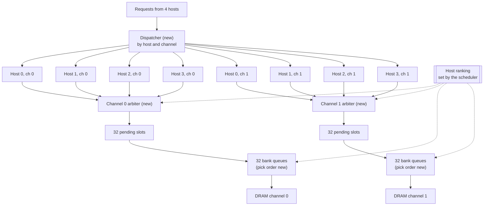

# Scheduler Design

This document describes the scheduler front end added to the pool device, the five schedulers compared on it against FCFS and FR-FCFS, how their settings were chosen, and how results are scored. The tuning results are in doc 13 and the campaign results in docs 14 and 15.

## Aim

The aim is fairness first, with the victim as a constraint. In each four-host mix the scheduler should lower the highest slowdown and bring the hosts' slowdowns closer together. The victim's slowdown must not rise above FR-FCFS, and weighted speedup must stay at or above FR-FCFS. Every change is inside the pool device; the gem5 hosts, their caches and their prefetchers stay as they are.

**The victim of each mix is named before any run.** It is the host with the lowest alone pool bandwidth (1 channel, FR-FCFS), ignoring hosts under 0.1 GB/s, which barely use the pool. Only Marian (0.014 GB/s) falls under that line. Alone bandwidths, in GB/s: tealeaf 13.9, STREAM 12.1, fotonik3d 11.7, roms 10.0, streamcluster 5.5, LLM inference 4.0, graph500 3.7, MERCI 3.5, cactus 1.5, hnswlib 0.54, multichase 0.22, Marian 0.014.

**Fairness and victim protection are different goals.** Fairness counts every host equally, so STREAM slowed 3.37× is as unfair as streamcluster slowed 2.49×. Victim protection serves the light host first, because the heavy hosts cause the interference. The two agree only when the victim is also the most slowed host.

| Mix | Victim | Victim slowdown | Most slowed host | Its slowdown | Goals |
| --- | --- | --- | --- | --- | --- |
| 4 | MERCI | 4.33 | MERCI | 4.33 | Agree |
| 13 | streamcluster | 2.49 | STREAM | 3.37 | Conflict |
| 1 | multichase | 3.07 | STREAM | 3.21 | Conflict |
| 2 | graph500 | 2.88 | graph500 | 2.88 | Agree |
| 11 | MERCI | 2.35 | graph500 | 2.49 | Conflict |
| 7 | multichase | 2.03 | STREAM | 2.35 | Conflict |
| 14 | LLM inference | 1.65 | streamcluster | 2.29 | Conflict |
| 8 | cactus | 1.51 | graph500 | 2.27 | Conflict |
| 6 | streamcluster | 1.88 | fotonik3d | 2.25 | Conflict |
| 15 | multichase | 1.50 | graph500 | 1.69 | Conflict |
| 3 | hnswlib | 1.25 | fotonik3d | 1.67 | Conflict |
| 12 | cactus | 1.06 | streamcluster | 1.44 | Conflict |
| 10 | multichase | 1.41 | multichase | 1.41 | Agree |
| 5 | cactus | 1.21 | streamcluster | 1.34 | Conflict |
| 16 | multichase | 1.30 | multichase | 1.30 | Agree |
| 18 | multichase | 1.09 | multichase | 1.09 | Agree |
| 9 | MERCI | 1.09 | MERCI | 1.09 | Agree |
| 17 | hnswlib | 1.01 | LLM inference | 1.02 | Conflict |

How to read this table: slowdown = the host's progress alone ÷ its progress in the mix, both on 1 channel with FR-FCFS. Progress is the instruction rate, or pool bandwidth for MERCI and multichase. Rows are sorted by the highest slowdown. The goals agree in 6 of 18 mixes. In the other 12, helping the victim first leaves a heavier host as the most slowed. In mixes 14, 8, 3, 12 and 5 the victim is already at 1.06–1.65× while another host is at 1.34–2.29×, so victim-first would spend priority where it is needed least. That is why fairness leads and the victim is a constraint.

On 2 channels slowdowns are lower (at most 1.5×), and the most slowed hosts are mostly medium or heavy ones: streamcluster, roms and fotonik3d.

## Where the scheduler sits

The scheduler acts in two places inside the device. A channel arbiter decides which host's requests get into each channel's 32 pending slots, and the bank queues pick by host priority before row hit.



How to read this diagram: requests flow top to bottom. Parts marked new are the scheduler front end; the rest is as in the O3 runs (docs 10 and 11). Runs with 1 channel have only channel 0.

- **Dispatcher.** It never asks whether a channel has room, so it can't be refused. In the stock pool one front queue fed both channels and stopped at the first refused request, so a full channel 0 also held back requests for an idle channel 1. The dispatcher removes that head-of-line blocking.
- **Per-host queues.** Each keeps arrival order. They are unbounded in the model; the hosts' MSHR limits keep them finite in practice.
- **Channel arbiter.** Most of the control is here. Each channel has 2 ranks × 16 banks = 32 bank queues but only 32 pending slots, so a light host usually has 0–1 requests per bank. Who gets the slots matters more than the order inside a bank.
- **Bank queues.** Putting host priority before row hit stops the row-hit preference from favouring the host with the best row locality, which is what happened to STREAM in mixes 13 and 1. With one host every request has the same priority, so the bank picks exactly as FR-FCFS does.
- **Ranking across channels.** Every scheduler keeps one host ranking for the whole pool, used by both arbiters and all bank queues. ATLAS, TCM and SAA build it from both channels' counters, as the ATLAS and TCM papers do across controllers. BLISS keeps one streak counter for the whole pool, and PAR-BS forms each batch over every bank queue of the pool.

## Schedulers compared

Five schedulers were run against the two baselines: two for victim protection, two for fairness first, and our own, SAA. All five need only what the device can see: requests, their host and the bank state. STFM is left out because it needs each core's stall time, which the device can't see.

| Group | Scheduler | How it picks the next request | Change needed for the device | Main settings (paper values) | Expected on our mixes, before the runs |
| --- | --- | --- | --- | --- | --- |
| Baseline | FCFS | Oldest first. | None, as in O3 | – | – |
| Baseline | FR-FCFS | Row hit first, then oldest. | None, as in O3 | – | – |
| Victim protection | TCM (MICRO 2010) | Splits hosts into a light, latency-sensitive group and a heavy group. The light group goes first; the order inside the heavy group is shuffled periodically. | Groups by measured bandwidth, because misses per kilo-instruction are only known at the core | Quantum (1M cycles), shuffle interval (800 cycles), cluster threshold | Lowest victim slowdown. Can leave STREAM or fotonik3d as the most slowed host in the 12 conflict mixes. |
| Victim protection | ATLAS (HPCA 2010) | Serves first the host that has received the least service, measured over long quanta with older history weighted in. Light hosts receive little service, so they end up first. | Service counted at the device | Quantum (10M cycles), history weight | Like TCM, but slower to react to bursts, and it favours the lightest host (even one never slowed) over a slowed medium host. |
| Fairness first | BLISS (ICCD 2014) | Counts requests served in a row from one host. A host that reaches the limit is blacklisted and goes behind the others until the list is cleared. | None | Streak limit (4), clear interval (10,000 cycles) | Breaks tealeaf's and fotonik3d's runs of row hits; lowers the highest slowdown, may help the victim less. |
| Fairness first | PAR-BS (ISCA 2008) | Groups the oldest requests of every host into a batch, served before newer ones. Inside a batch the host with the fewest requests goes first. | None | Batch cap (5 per host per bank) | Bounds how long any host's oldest requests wait. |
| Ours | SAA | The host with the highest estimated slowdown goes first, with a guard for light hosts. See the next section. | New | Epoch, reserved slots, imbalance threshold, run cap | Close to the best of both goals. |

How to read this table: "Change needed for the device" is what has to differ from the paper, because the device sees only requests, their host and the bank state. Every scheduler is scored on both goals (see How results are read), so the two groups show the trade-off and SAA is judged against both. The last column records what the design expected; doc 15 gives what happened. The paper values were tuned for an on-chip memory system; see Settings and tuning for why they were re-chosen here.

### How each scheduler works

Each scheduler answers one question: which waiting request does the device serve next? Below, each one gets its idea, its rule step by step, and what that rule does with our four hosts. "Host" is what the papers call a thread, and times are pool cycles at 1.2 GHz (1,000 cycles = 0.83 µs). In our device every scheduler turns its decision into a host rank, which both the channel arbiter (who gets a pending slot) and the bank queues (which request a bank serves next) use.

| Scheduler | What it measures per host | Who goes first | How often it re-decides |
| --- | --- | --- | --- |
| FCFS | Nothing | The oldest request | Every request |
| FR-FCFS | Nothing; it looks only at the bank's open row | A request to the open row, else the oldest | Every request |
| TCM | Memory use (bank service time), bank-level parallelism, row-hit rate | The light cluster, lightest first; then the heavy hosts in a rotating order | Regroups every 1M cycles (0.83 ms), rotates every 800 cycles (0.67 µs) |
| ATLAS | Service received, with old service fading slowly | The host that has received the least service | Every 10M cycles (8.3 ms); any request older than 100K cycles (83 µs) jumps ahead |
| BLISS | How many requests in a row one host has had served | Hosts not on the blacklist | Every pick; the blacklist is cleared every 10,000 cycles (8.3 µs) |
| PAR-BS | Requests each host has waiting in each bank | Requests in the current batch, then row hits, then the host with the fewest batched requests | A new batch when the last one is finished |
| SAA | Each host's round-trip time and requests served | The host with the highest estimated slowdown; light hosts are guarded | Every epoch, 12,000 cycles (10 µs) |

How to read this table: one row per scheduler. The columns say what each scheduler has to count, which request wins, and how quickly it can change its mind. The paragraphs below explain each row.

**FCFS (first come, first served).** The simplest rule: requests are served in the order they arrive.

- Each bank queue is a first-in, first-out list, and the bank takes its oldest request.
- Rows are closed after use (closed page): a bank closes its row once no command is in progress, so nearly every request pays for opening a row.
- No host is favoured because of how it accesses memory, but a host that floods the queue makes everyone behind it wait. Paying for a row opening on almost every request also costs bandwidth: on one channel the pool delivers at most 12.2 GB/s of its 19.2 GB/s in any mix.

**FR-FCFS (first ready, first come first served).** The usual rule in real DRAM controllers, built to get the most bandwidth out of open rows.

- Rows stay open after use (open page).
- The bank picks the oldest request that hits the row it has open. Only if no waiting request hits that row does it take the oldest request overall.
- There is no cap on how many row hits may pass an older request.
- Example: host A is streaming through one row while host B has one request to another row of the same bank. A's later requests keep hitting the open row and pass B's older request until A leaves that row.
- The result is the highest bandwidth, but hosts with few requests or poor row locality wait. This is why MERCI, a light host, is slowed 4.33× in 1-channel mix 4.

**TCM (thread cluster memory scheduling, Kim et al., MICRO 2010).** Light hosts barely use memory, so serving them first costs the heavy hosts little and helps the light hosts a lot. Among the heavy hosts, the priority order keeps changing so that no one is always last.

1. Every quantum (1M cycles), it measures how much each host used memory. Our device counts bank service time; the paper uses misses per kilo-instruction, which only the core knows.
2. Going from the lightest host up, it adds hosts to the latency-sensitive cluster while their combined use stays within the cluster threshold (4/24 of the total). The rest form the bandwidth cluster.
3. The latency-sensitive cluster always ranks first, lightest host first.
4. The bandwidth cluster is ordered by niceness. A host that spreads its requests over many banks (high bank-level parallelism) is nicer; one that holds a bank with long runs of row hits (high row-hit rate) is less nice. Every 800 cycles this order rotates by one host; the paper shuffles by insertion instead.

With our mixes, the light hosts, the victim among them, go into the latency-sensitive cluster whenever their combined use stays under 4/24 of the total. They are then served ahead of every heavy host, and the heavy hosts take turns among themselves.

**ATLAS (adaptive per-thread least-attained-service, Kim et al., HPCA 2010).** It serves first the host that has received the least service so far, like a least-attained-service queue in an operating system.

1. It counts each host's attained service: the bank time its requests have used.
2. At the end of every quantum (10M cycles), each host's total becomes 0.875 × its old total + 0.125 × this quantum's service, so past service fades slowly.
3. Hosts are ranked by that total, least first, and the ranking holds for the whole next quantum.
4. Over-threshold rule: a request that has waited longer than 100K cycles goes first whatever its host's rank, so heavy hosts are never starved.

Light hosts collect little service, so they rank first, as under TCM. The rank changes only once per quantum, so ATLAS reacts slowly to bursts, and it favours the lightest host even when that host is not slowed.

**BLISS (blacklisting memory scheduler, Subramanian et al., ICCD 2014).** A cheap alternative to ranking. Interference comes from one host getting many requests served back to back, so BLISS watches for such streaks and moves that host behind the others.

1. It watches consecutive picks. When the same host is picked more than 4 times in a row, that host is blacklisted. Our device keeps one streak counter for the whole pool.
2. Hosts not on the blacklist go first; inside each group the bank still picks row hit first, then oldest.
3. Every 10,000 cycles the blacklist is cleared and every host starts equal again.

BLISS breaks the long row-hit runs of streaming hosts such as tealeaf and fotonik3d with one counter and one bit per host. It does not know which host is slowed, so it may help the victim less.

**PAR-BS (parallelism-aware batch scheduling, Mutlu and Moscibroda, ISCA 2008).** Two ideas combined. Batching bounds waiting: requests are grouped into batches, and a batch is finished before newer requests are served, so no request waits longer than about a batch. Ranking keeps parallelism: inside a batch one host's requests in different banks are served together, so they overlap instead of queueing one after another.

1. When no batched request is left, it marks up to 5 of the oldest requests of each host in every bank queue. Those marked requests form the new batch.
2. Marked requests go before unmarked ones; then row hits; then the higher-ranked host; then the oldest.
3. Rank: the host with the fewest marked requests in its busiest bank goes first, ties broken by the fewest marked requests in total. A light host has few requests, so it ranks first, which is shortest job first.

PAR-BS bounds how long any host's oldest requests wait and helps light hosts within each batch. Batching also changes the order when a host runs alone, so PAR-BS needs its own alone runs.

**SAA (slowdown-aware arbiter, ours).** Fairness first: every epoch the device estimates how much each host is slowed and serves the most slowed host first. Reserved pending slots and a guard for light hosts keep the victim from losing out, and when the estimates are close (within 1.1×) it behaves exactly like FR-FCFS. The next section gives the full rules. The campaign runs used the variant chosen in tuning: the estimate is the host's round trip ÷ the 270 ns empty-pool round trip, capped so the implied alone bandwidth stays within the pool peak, smoothed with weight 0.75 on the previous estimate, and with the row-hit run cap off.

## SAA: slowdown-aware arbiter

SAA puts fairness first: it serves the host the device estimates to be most slowed. A guard for light hosts keeps the fairness gain from coming at the victim's expense. It uses only counts the device already has. The code is the `Saa` class in `code/btpmem/btpSched.cc`.

Every epoch (12,000 pool cycles, 10 µs), for each host h that was served, the device computes its mean round trip L (time in the device plus the 250 ns link) and the requests it was served per cycle, R. SAA has two estimates of the host's slowdown:

```latex
\hat{S}^{\mathrm{bw}}_h = \max\left(\min\left(\frac{L_h}{L_0},\ \frac{R_{\mathrm{peak}}}{R_h}\right),\ 1\right)
\qquad
\hat{S}^{\mathrm{lat}}_h = \frac{L_h}{\max(L_h - I_h,\ L_0)}
```

Here L0 = 270 ns is the empty-pool round trip, R_peak is the most the pool serves (0.219 requests per pool cycle per channel, times the number of channels), and I is the host's mean interference: the time a request waited while its bank or its pending slot was in use by another host's request. The bandwidth form assumes a host alone would see the empty-pool latency and so would be served L/L0 times faster, but never faster than the pool's peak. The latency form subtracts interference from the measured latency. The campaign used the bandwidth form, smoothed over epochs: the estimate used for ranking is 0.75 × the previous one + 0.25 × the new one.

1. **Rank** hosts by estimated slowdown, highest first. This applies only while the largest estimate is more than 1.1× the smallest; otherwise every host has the same rank, and the device behaves exactly like FR-FCFS, so throughput is kept when hosts are already even.
2. **Admission:** each host has 4 reserved pending slots per channel. A host above its reservation is admitted only if the slots still free cover the reservations of the other active hosts. Among the requests that may be admitted, the higher-ranked host goes first.
3. **Victim guard:** a host is light if it received under 10% of the requests served in the last epoch. A light host below its reservation is admitted first, whatever its rank, so it never waits behind a heavy host for a slot. The device can't know the evaluation's victim label, so it classifies online from what it measures.
4. **Bank choice:** host rank, then row hit, then oldest.
5. **Row-hit run cap (optional):** a host's run of row hits in one bank can be cut after N picks while another host is waiting on that bank. It is off in the campaign runs.

What the rules were meant to do on our data:

- **A heavy host is the most slowed** (STREAM in mixes 13, 1 and 7). Rule 1 puts it ahead of tealeaf in the bank queues, so tealeaf's long runs of row hits no longer hold a bank against it.
- **The victim is the most slowed** (MERCI in mix 4, graph500 in mix 2). Rules 1 and 3 both move its few requests to the front. MERCI waits 771 ns against 267 ns on an empty pool while using 0.80 of 16.5 GB/s, so most of its wait is queueing behind heavier hosts.
- **The victim is not the most slowed** (mixes 14, 8, 3, 12 and 5). Rule 1 sends priority to the most slowed host, and rule 3 keeps the victim from losing its slots.
- **No harm alone.** With one host there is nothing to rank and no other host to reserve slots against. So SAA alone is FR-FCFS, and the FR-FCFS alone runs are its baseline. Check runs confirm this (doc 14).

What isn't new: the latency estimate is close to STFM's, the run cap to BLISS's, and slot reservation is common. What is new is that the estimate uses only what the device can see, and that admission into the pending slots is part of the scheduler. On-chip schedulers assume every request is already in their buffer.

## Settings and tuning

Each scheduler's settings were chosen once on three heavy 1-channel mixes (4, 13 and 1) and then fixed for all 18 mixes on both channel counts. The papers' values don't carry over, because our latencies and queue sizes are different. The values the campaign used are in the last column.

| Scheduler | Time-window settings (paper value) | Count or threshold settings (paper value) | Used in the campaign |
| --- | --- | --- | --- |
| TCM | Quantum for regrouping (1M cycles); shuffle interval (800 cycles) | Cluster threshold: the bandwidth share that counts as light | Quantum 1M, shuffle 800, threshold 4/24 |
| ATLAS | Quantum (10M cycles) | History weight; over-threshold age (100,000 cycles) | Quantum 10M, weight 0.875, over-threshold rule 100,000 |
| BLISS | Blacklist clear interval (10,000 cycles) | Streak limit (4 requests in a row) | Clear 10,000, limit 4 |
| PAR-BS | None; a new batch starts when the previous one finishes | Batch cap (5 requests per host per bank) | Cap 5 |
| SAA | Epoch (about 10 µs) | Reserved slots, light-host threshold, imbalance threshold, row-hit run cap | Epoch 12,000, 4 reserved slots, light under 10%, imbalance 1.1, bandwidth estimate smoothed 0.75, run cap off |

How to read this table: time-window settings decide how often a scheduler recounts or regroups. Count settings decide how many requests or slots a rule allows. Cycles are pool cycles at 1.2 GHz. Doc 13 gives the variants tried and how each did.

**Why the windows change.** The papers simulated one chip with directly attached DRAM, where a memory request takes roughly 50–100 ns. In our pool the fastest round trip is about 267 ns: 250 ns on the CXL link, there and back, plus about 12.5 ns for a DRAM row hit and a few ns in the device. In heavy 1-channel mixes, queueing raises the mean to 700–1,000 ns with FR-FCFS. Each host can have only a fixed number of requests in flight, limited by its MSHRs, so a fixed window holds far fewer requests here:

| Latency per request | Requests one host completes in 8.3 µs (10,000 DRAM cycles at 1.2 GHz) |
| --- | --- |
| 50 ns (papers' setting) | about 1,660 |
| 267 ns (our empty pool) | about 310 |
| 1,000 ns (our busy pool) | about 83 |

How to read this table: the example assumes 10 requests in flight per host, and requests completed = 10 × window ÷ latency. A window sized for the papers would make BLISS clear its list, or TCM regroup, after 5–20× fewer requests than intended, so each decision rests on less information.

**Why the counts change.** The papers had 8–24 cores and request buffers of about 64–128 entries. We have 4 hosts and 32 pending slots per channel, spread over 32 bank queues. A light host usually has 0–1 requests in a bank, so a PAR-BS cap of 5 per host per bank would almost never bind for it. A BLISS streak limit of 4 also means something different with 4 hosts than with 24 cores.

**Why mixes 4, 13 and 1.** They are the heaviest 1-channel mixes and cover both cases. In mix 4 the victim is also the most slowed host (MERCI 4.33×). In mixes 13 and 1 a heavy host is the most slowed (STREAM 3.37× and 3.21×) while the victim is at 2.49× and 3.07×. Light mixes give about 1.0–1.1× with any setting, so they show nothing.

**Held-out check.** The other 15 mixes and all 2-channel runs were never used for tuning. Their results are reported separately (doc 15), to show the settings were not fitted to the three tuning mixes.

## Why rate limiting is not included

Rate limiters are left out because each one either acts on the host side, which a device-side mechanism rules out, or has problems that would have to be solved first, and the fixes turn it into one of the priority schedulers already in the list.

**Host-side rate limiters** (related work only):

| Mechanism | Where it acts |
| --- | --- |
| MemGuard | The OS gives each core a bandwidth budget. |
| FST (source throttling) | Limits how fast each core issues misses. |
| MITTS | Shapes each core's request timing at the core. |
| MemChannel | The host rate-limits itself (CSFQ) behind a switch. |
| CXL DevLoad | The device sends a 2-bit load signal; the host decides whether to throttle. |

A device can also limit rates itself, for example with a per-host token bucket at the channel arbiter, or with CXL's per-device QoS (a guaranteed Allocation Fraction and a Limit Fraction). These would fit a device-side design, but each has problems on our data:

| Issue | What goes wrong on our data | What fixing it needs |
| --- | --- | --- |
| Wasted bandwidth | A hard cap delays a host even when the pool is idle. In light mixes, where slowdowns are already 1.0–1.1, it would only cost throughput. | Apply the cap only while another host is waiting. The limiter then behaves like a priority scheduler with a budget. |
| Choosing the rate | An equal split is about 4.1 GB/s each of 16.5 on 1 channel. It would cut tealeaf from 7.0 to 4.1 GB/s in mix 4, yet the victim, MERCI, uses only 0.80 GB/s. | A rate that follows measured latency or slowdown, which is a control loop close to SAA. |
| Victims aren't short of bandwidth | The light victims are slowed by queueing delay, not by their share. A cap helps them only indirectly, by shortening the queue. | Priority for their few requests, as ATLAS, TCM and SAA give. |
| Row locality untouched | A rate limit controls how much a host gets, not the bank's row-hit preference. tealeaf's row-hit advantage over STREAM stays. | A change to the bank rule as well, as BLISS and SAA make. |
| Alone baseline changes | A hard cap also limits a host running alone, so it needs its own alone runs and looks slower alone. | The cap-only-when-waiting variant, which again is a priority rule. |
| No per-host credits in the model | Throttling at the source would mean withholding credits on one host's port. Our SST model has no per-port credits. | A model change to the link and its credits. |

How to read this table: each row is one problem a device-side rate limiter would have on our mixes. The figures are from the 1-channel FR-FCFS mixes. Once every fix is applied, what is left is a priority scheduler that the list already covers.

## Feasibility on real devices

The design can be built into a real CXL memory device. It changes only the priority inside queues the device already has, uses information the device already holds, and needs an estimated few hundred bytes of state.

- **It sits where devices already make this decision.** A CXL memory expander or multi-headed device already buffers incoming requests and feeds a DDR memory controller per channel, which already reorders them, usually with FR-FCFS. Only the priority in those queues changes; no stage is added to the request path.
- **The device already knows each request's host.** In a multi-headed device each host comes in on its own port. In a multi-logical device each request carries its logical device's ID, and CXL 3.x fabrics carry a source port ID. No host, OS or protocol change is needed. In our model the address slot plays this role.
- **Per-host tracking is already in the spec.** CXL 2.0 and later define per-logical-device QoS: a guaranteed Allocation Fraction, a Limit Fraction and load telemetry. A compliant multi-logical device already counts bandwidth per logical device, which is the same kind of state as our counters.
- **It adds nothing to the per-cycle critical path.** The ranking is recomputed once per epoch, about every 12,000 DRAM cycles at 10 µs and 1.2 GHz. One divide per host per epoch is easy, and cross-multiplying avoids it altogether. Each cycle, the bank pick compares a key that is already row hit + age, now with 2 bits of host rank in front: the same comparator, slightly wider. The channel arbiter is a 4-way priority choice per channel.
- **A single host can't do worse.** With one host every rule reduces to FR-FCFS, so a lone tenant behaves exactly as on today's device. The alone runs check this.
- **Products already prioritise by requester.** Arm's memory controllers and the AXI bus carry a per-requester QoS priority into the DRAM queues. Fairness-aware ordering inside a memory controller (BLISS, ATLAS, TCM) was designed with hardware cost as a stated goal, and BLISS was proposed as the cheap option. The design moves a known class of hardware to a new place.
- **It fits how pools are deployed.** The hosts belong to different tenants who don't cooperate, so the device is the only point that sees every host's traffic. Host-side schemes such as MemChannel or DevLoad throttling need every host to behave.

**Decision time is not modelled, for any scheduler.** In the simulation every choice, by the channel arbiter or a bank queue, takes no time. This is left out on purpose rather than set to a guessed value:

1. **Every scheduler gets the same treatment.** FCFS and FR-FCFS also choose at no cost in the model, while real FR-FCFS controllers spend a pipeline stage on it. Leaving the cost out does not favour our schedulers over the baselines.
2. **The cost is small next to a request.** The per-request choice adds 2 bits of host rank in front of FR-FCFS's existing row-hit and age comparison: the same comparator, one stage, about 1–2 cycles (0.8–1.7 ns at 1.2 GHz). That is under 1% of the 267 ns minimum round trip and under 0.3% of the 700–1,000 ns seen in busy 1-channel mixes.
3. **Ranking updates are off the request path.** They happen once per epoch of about 12,000 DRAM cycles, while requests keep flowing on the previous ranking.
4. **The scheduler papers did the same.** STFM, PAR-BS, ATLAS, TCM and BLISS were evaluated with free scheduling decisions, and their logic was argued to fit in the controller's cycle.

Keeping decision time at zero also keeps the 1-channel FCFS and FR-FCFS results identical to O3, which is the correctness check for the new front end.

| State (SAA, 4 hosts, 2 channels) | Size, estimated |
| --- | --- |
| Per host per channel: requests served, latency sum, interference sum, rank, reserved-slot count | about 100 bits |
| All hosts and channels: 4 × 2 × about 100 bits | about 800 bits |
| Host tag per pending slot: 2 bits × 32 slots × 2 channels | 128 bits |
| Hosts waiting per bank: 4 bits × 32 banks × 2 channels | 256 bits |
| **Total** | **under 200 bytes** |

How to read this table: these are estimates from the counter widths, not synthesis results. The size grows linearly with the number of hosts, so a 16-head device would still need under 1 KB. BLISS, ATLAS and TCM need the same kind of counters or fewer.

Common questions about the design, and where they are answered:

| Question | Answer |
| --- | --- |
| Is the simulator close enough to a real controller? | The model leaves out refresh, write draining and the larger queues of real controllers. This is a limitation; doc 04 covers the differences. |
| Do the settings carry over? | They were fixed on three 1-channel mixes; doc 15 reports the 15 held-out 1-channel mixes and all 18 2-channel mixes separately. |
| Does it scale past 4 hosts? | State grows linearly and no rule depends on the host count. Only 4 hosts were simulated. |
| Why not use CXL's own QoS? | It works by limiting rates; see "Why rate limiting is not included". |

## Alone baselines

New alone runs were needed only where a scheduler still changes something with one host: PAR-BS on both channel counts, and everything on 2 channels because of the new front end. Every slowdown is measured against the alone run on the same pool, scheduler and channel count.

| Scheduler | Alone baseline, 1 channel | Alone baseline, 2 channels |
| --- | --- | --- |
| FCFS | O3 FCFS alone runs, kept | New FCFS alone runs on the new front end |
| FR-FCFS | O3 FR-FCFS alone runs, kept | New FR-FCFS alone runs on the new front end |
| BLISS, ATLAS, TCM, SAA | Same as FR-FCFS (O3 runs) | Same as the new FR-FCFS runs |
| PAR-BS | Its own alone runs | Its own alone runs |

How to read this table: "Same as FR-FCFS" means that with one host the scheduler picks exactly as FR-FCFS does. There is nothing to rank, no other host to reserve slots against, and caps that need another host waiting never trigger. Eleven check runs confirm that the results are identical (doc 14).

Why 2 channels needed new runs: the new dispatcher removes the head-of-line blocking across channels even with one host, so the O3 2-channel runs no longer match the front end. With 1 channel there is no other channel to block, so the O3 1-channel runs stay valid. PAR-BS needs its own runs because it batches requests even when only one host is running.

## What was run

| Set | What | Runs |
| --- | --- | --- |
| Equivalence checks | One host, tealeaf slot 2: the new front end with FR-FCFS, BLISS, ATLAS, TCM and SAA against FR-FCFS on 1 and 2 channels, and a second 2-channel FCFS run | 11 |
| Tuning | Mixes 4, 13 and 1 on 1 channel: TCM, BLISS, PAR-BS, four ATLAS variants, SAA with and without smoothing (doc 13) | 27 |
| 2-channel baselines, alone | FCFS and FR-FCFS on the new front end: 12 workloads × 4 slots × 2 | 96 |
| PAR-BS alone | 12 workloads × 4 slots × 2 channel counts | 96 |
| Mixes, 1 channel | TCM, ATLAS, BLISS, PAR-BS and SAA on the 15 held-out mixes (tuning mixes come from the tuning runs) | 75 |
| Mixes, 2 channels | FCFS, FR-FCFS and the five schedulers on all 18 mixes | 126 |

How to read this table: alone runs cover every workload in every host slot, because each slot has its own checkpoint. A mix run counts once, though it has four hosts. The 1-channel FCFS and FR-FCFS mixes and alone runs are the O3 runs (docs 10 and 11). Their joblists are in `code/experiments/`.

## How results are read

Every scheduler is scored on both goals, fairness and the victim, in this order:

1. Lowest highest slowdown across all 18 mixes.
2. The victim's slowdown is not above FR-FCFS in any mix.
3. Weighted speedup at or above FR-FCFS.

| Measure | How it is calculated | What it shows |
| --- | --- | --- |
| Slowdown (per host) | Alone progress ÷ mix progress, same pool, scheduler and channel count. Progress = instruction rate, or pool bandwidth for MERCI and multichase. | How much the other hosts cost this host |
| Highest slowdown (and host) | Largest of the four slowdowns | Fairness: the worst-off host |
| Victim slowdown | Slowdown of the mix's named victim (see Aim) | Victim protection |
| Unfairness | Highest ÷ lowest slowdown | How uneven the slowdowns are |
| Weighted speedup | Sum over hosts of mix ÷ alone progress (4 = no slowdown) | Total progress kept |
| Jain's index | (Σx)² ÷ (n · Σx²) over the hosts' mix ÷ alone progress ratios (1 = equal) | Evenness, in the usual form |
| Delivered bandwidth | Total GB/s served by the pool in the mix | Throughput cost of fairness |
| Mean latency | Mean pool round trip over all requests (ns) | Queueing at the device |
| Row-hit rate | Row hits ÷ requests served | How much row locality the scheduler gives up |

How to read this table: the first six measures are relative to each host's alone run on the same type of pool. The last three are absolute and are compared directly between schedulers.

Results on the three tuning mixes (4, 13, 1) are reported apart from the 15 held-out mixes and the 2-channel runs.

## Kept as they are

Only the request order inside the device changes; the rest of the set-up stays as in the O3 runs.

- **DRAM timings**, and the round-robin order in which commands go to banks. Host priority therefore works within each bank but not across banks.
- **Unbounded per-host queues.** A finite shared buffer with per-host caps would be closer to hardware, but it adds settings that would change the baselines.
- **The L3 prefetcher**, including its shared training table, so results stay comparable with the O3 runs.
- **Hosts, workloads, checkpoints and the 18 mixes**, as in O3.
