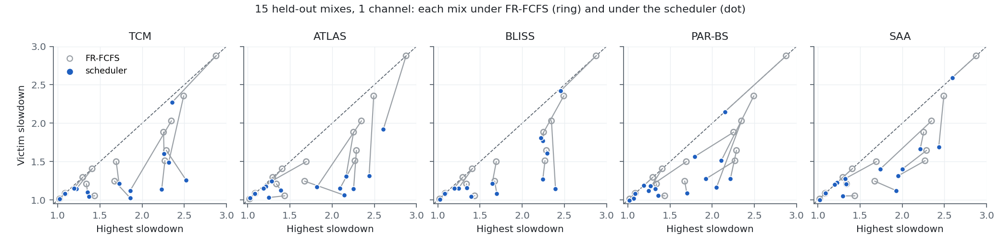
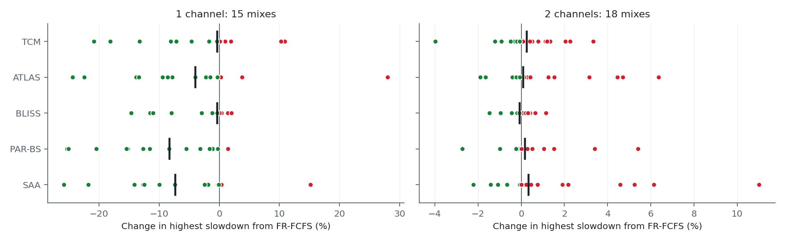

# Scheduler Campaign: Mix Results

On one channel, all five fairness schedulers lower the worst host's slowdown below FR-FCFS without losing throughput. On two channels, none of them moves any measure much away from FR-FCFS.

- **Runs.** The 18 four-host mixes ran under seven schedulers on a one-channel and a two-channel pool: 252 mix runs of 100 ms each. Every host is measured against its own alone run on the same pool type.
- **Worst host, one channel.** Over the 15 mixes not used for tuning, the mean highest slowdown is 1.77 under FR-FCFS. It drops to 1.57 under PAR-BS, 1.63 under SAA, 1.67 under ATLAS and 1.70 under both TCM and BLISS. Measured against the FR-FCFS alone runs instead of its own, PAR-BS is at 1.65, so SAA is lowest on that common baseline.
- **Victim, one channel.** ATLAS protects the victim most (mean victim slowdown 1.20, against 1.55 under FR-FCFS), then TCM (1.25) and PAR-BS (1.26). BLISS and SAA keep it at 1.34 and 1.36.
- **Evenness, one channel.** SAA has the lowest unfairness (1.30) and PAR-BS the next lowest (1.32). ATLAS (1.48) and TCM (1.44) are more uneven than FR-FCFS (1.40): they shift slowdown from the light hosts onto heavy ones such as tealeaf and fotonik3d.
- **Throughput, one channel.** All five raise weighted speedup above FR-FCFS (3.05–3.16 against 2.96). Each delivers between 0.3% and 2.6% less pool bandwidth than FR-FCFS's 14.5 GB/s.
- **Tuning mixes.** On mixes 1, 4 and 13, where the settings were chosen, SAA has the lowest mean highest slowdown (2.91, against 3.64 under FR-FCFS). ATLAS has the lowest mean victim slowdown (1.33, against 3.29).
- **Two channels.** The mean highest slowdown is 1.18–1.20 under FR-FCFS and all five schedulers, and 1.32 under FCFS. Delivered bandwidth is 19.2–19.5 GB/s for all six, against 17.1 GB/s under FCFS.
- **Channel or scheduler.** Measured against the one-channel FR-FCFS alone runs, a second channel cuts FR-FCFS's mean highest slowdown over all 18 mixes from 2.08 to 1.36. The best one-channel scheduler, SAA, reaches 1.84.

## Setup

Every mix run uses the O3 set-up; only the order in which the pool device serves requests changes between schedulers. The 1-channel FCFS and FR-FCFS mixes are the O3 mixed runs; all other mixes are new.

| Item | Setting |
| --- | --- |
| Hosts | 4 hosts, each with 4 x86 cores at 3 GHz on gem5's O3 CPU (ROB 192, LQ/SQ 32, 8-wide issue and commit). L1 32 KiB, L2 512 KiB, L3 8 MiB with the L3 prefetcher as in O3. |
| Pool | 1 or 2 DDR4-2400-like channels in SST, 19.2 GB/s peak each; 2 ranks × 16 banks per channel, 8 KiB rows. With two channels, consecutive 64 B lines alternate between them. A fixed 250 ns link sits between the hosts and the pool. |
| Placement | Host i uses pool slot i, its own 1 GiB range, and restores its workload's slot-i checkpoint. |
| Window | 100 ms of simulated time from restore, statistics every 10 ms. All four hosts share one clock. |
| Per-host front end | Used by every run except the 1-channel FCFS and FR-FCFS mixes. Each host has its own queue per channel; a channel arbiter fills that channel's 32 pending slots, and each bank queue picks by host rank first, then by its own rule (FR-FCFS: row hit, then age; PAR-BS: batch first). Under FCFS and FR-FCFS on the front end, all hosts have the same rank. |
| Clock for scheduler settings | Pool cycles at 1.2 GHz: 1,000 cycles = 0.83 µs. |

How to read this table: it lists what every run shares. Only the scheduler, the channel count and the mix change from run to run.

### Schedulers

| Scheduler | Group | How it picks the next request | Settings in these runs |
| --- | --- | --- | --- |
| FCFS | Baseline | Oldest first; bank queues in arrival order, closed page (a bank closes its row once no command is in progress, so a request that reaches the same row before that still hits). 1 channel: SST's stock timing DRAM. 2 channels: the same logic in our copy, behind the front end. | – |
| FR-FCFS | Baseline | Oldest request to an open row first, else the oldest; rows stay open; no cap on how many row hits may pass older requests. | – |
| TCM | Victim protection | Every quantum, the lightest hosts whose combined bank service stays within the cluster threshold of the total form a latency-sensitive group, served first, lightest first. The other hosts are ordered by niceness (bank-level parallelism rank minus row-hit-rate rank), and that order rotates by one host every shuffle interval. | Quantum 1M cycles (0.83 ms), shuffle interval 800 cycles, cluster threshold 4/24 |
| ATLAS | Victim protection | The host with the least attained service (bank service cycles, with older quanta weighted in) goes first. Over-threshold rule: a request older than the threshold goes first, before any host rank. | Quantum 10M cycles (8.3 ms), history weight 0.875, threshold 100K cycles (83 µs) |
| BLISS | Fairness first | A host picked more than the streak limit in a row is blacklisted and goes behind the others until the list is cleared. One streak counter for the whole pool. | Streak limit 4, clear interval 10,000 cycles (8.3 µs) |
| PAR-BS | Fairness first | When no batch request is left, marks up to the cap oldest requests per host in every bank queue. Batch requests go first, then row hits, then hosts with the fewest marked requests in their busiest bank, then the oldest. | Batch cap 5 per host per bank |
| SAA | Ours | Every epoch, estimates each host's slowdown as its round trip ÷ the 270 ns empty-pool round trip, capped so that its implied alone bandwidth stays within the pool peak, and smoothed over epochs. Hosts are ranked most slowed first while the largest estimate is over 1.1× the smallest; otherwise all ranks are equal. Each host keeps 4 reserved pending slots per channel, and a host with under 10% of the epoch's served requests is admitted first into its reserved slots. | Epoch 12,000 cycles (10 µs), smoothing 0.75 (weight of the previous estimate), 4 reserved slots, light share 10%, imbalance 1.1, row-hit run cap off |

How to read this table: "Settings in these runs" are the values every mix ran with, on both channel counts. They were chosen on mixes 1, 4 and 13 with one channel, so those three mixes are reported apart from the others. ATLAS here is the 10M quantum with the over-threshold rule, and SAA is the bandwidth-form estimate with smoothing, the two variants chosen in tuning.

### Mixes

| Mix | Host 0 | Host 1 | Host 2 | Host 3 | Group | Victim | Demand alone (GB/s) |
| --- | --- | --- | --- | --- | --- | --- | --- |
| 1 (tuning) | tealeaf | STREAM | fotonik3d | multichase | 3 aggressors + 1 victim | multichase | 38.2 |
| 2 | tealeaf | streamcluster | roms | graph500 | 3 aggressors + 1 victim | graph500 | 34.0 |
| 3 | STREAM | fotonik3d | LLM | hnswlib | 3 aggressors + 1 victim | hnswlib | 28.5 |
| 4 (tuning) | tealeaf | fotonik3d | roms | MERCI | 3 aggressors + 1 victim | MERCI | 40.1 |
| 5 | STREAM | streamcluster | LLM | cactus | 3 aggressors + 1 victim | cactus | 22.4 |
| 6 | tealeaf | fotonik3d | streamcluster | Marian | 3 aggressors + 1 victim | streamcluster | 31.3 |
| 7 | tealeaf | STREAM | hnswlib | multichase | 2 + 2 | multichase | 26.9 |
| 8 | fotonik3d | roms | graph500 | cactus | 2 + 2 | cactus | 24.9 |
| 9 | streamcluster | LLM | MERCI | Marian | 2 + 2 | MERCI | 12.9 |
| 10 | tealeaf | LLM | hnswlib | multichase | 2 + 2 | multichase | 18.7 |
| 11 | STREAM | roms | MERCI | graph500 | 2 + 2 | MERCI | 29.4 |
| 12 | fotonik3d | streamcluster | cactus | Marian | 2 + 2 | cactus | 17.9 |
| 13 (tuning) | tealeaf | STREAM | fotonik3d | streamcluster | 4 aggressors | streamcluster | 43.6 |
| 14 | fotonik3d | roms | LLM | streamcluster | 4 aggressors | LLM | 30.0 |
| 15 | tealeaf | multichase | hnswlib | graph500 | 1 aggressor + 3 victims | multichase | 18.6 |
| 16 | roms | MERCI | cactus | multichase | 1 aggressor + 3 victims | multichase | 15.3 |
| 17 | LLM | MERCI | hnswlib | Marian | all AI | hnswlib | 8.0 |
| 18 | MERCI | graph500 | hnswlib | multichase | 4 victims | multichase | 7.9 |

How to read this table: each row is one mix; host i runs the workload in column "Host i". The victim is the host with the lowest pool bandwidth when it runs alone (1 channel, FR-FCFS), leaving out Marian, which uses under 0.02 GB/s of pool bandwidth alone. "Demand alone" adds the four hosts' alone pool bandwidths on 1 channel under FR-FCFS: what the mix would ask of the pool if no host slowed the others. One channel peaks at 19.2 GB/s, and 11 of the 18 mixes ask for more than that. "(tuning)" marks the three mixes the settings were chosen on.

## Measures

Every measure is computed per mix from its four hosts. A mean in a table is the average of the per-mix values over the mixes named above it, not a measure of averaged slowdowns.

| Measure | How it is calculated | Better |
| --- | --- | --- |
| Progress | Instructions per simulated second, summed over the host's 4 cores. For MERCI and multichase: pool requests per second, because their instruction counts include spin and wait loops. | Higher |
| Slowdown (per host) | Progress alone ÷ progress in the mix. The alone run has the same workload, slot and channel count, under the scheduler's alone baseline (next table). | Lower; 1 = not slowed, below 1 = faster than alone |
| Highest slowdown | The largest of the hosts' slowdowns in the mix, leaving out Marian. This is the fairness goal: the worst-off host. | Lower |
| Victim slowdown | The slowdown of the mix's victim (see Mixes). This is the victim-protection goal. | Lower |
| Unfairness | Highest slowdown ÷ lowest slowdown, leaving out Marian | Lower; 1 = all slowed equally |
| Weighted speedup | Sum over the four hosts of progress in the mix ÷ progress alone (that is, 1 ÷ slowdown) | Higher; 4 = no host slowed |
| Harmonic speedup | 4 ÷ the sum of the four slowdowns. A single badly slowed host pulls it down more than it pulls down weighted speedup. | Higher; 1 = no host slowed |
| Jain's index | (x1 + x2 + x3 + x4)² ÷ (4 × (x1² + x2² + x3² + x4²)), with x = 1 ÷ slowdown | Higher; 1 = all equal, 0.25 = one host keeps all the progress |
| Delivered bandwidth | Sum of the four hosts' pool bandwidth in the mix (64 B per request) | Higher; peak 19.2 GB/s on 1 channel, 38.4 GB/s on 2 |
| Mean latency | Pool round trip seen by the host, including the 250 ns link. Each host's mean is weighted by its pool bandwidth, so it is the mean over all requests of the mix. | Lower |
| Row-hit rate | 1 − row activations ÷ column commands, over the whole pool (both channels). Stock FCFS on 1 channel has no such counters. | Neither: a scheduler that gives up row hits pays in bandwidth |

How to read this table: the first seven measures compare each host with itself running alone, so they say what sharing costs. The last three are absolute and compare schedulers directly. Marian is left out of highest slowdown and unfairness because it sends almost no traffic to the pool; it stays in the speedups and Jain's index, where its value is always close to 1.

### Alone baselines

| Scheduler | Alone runs, 1 channel | Alone runs, 2 channels |
| --- | --- | --- |
| FCFS | O3 FCFS alone runs | FCFS alone runs on the per-host front end |
| FR-FCFS, TCM, ATLAS, BLISS, SAA | O3 FR-FCFS alone runs | FR-FCFS alone runs on the per-host front end |
| PAR-BS | PAR-BS alone runs | PAR-BS alone runs |

How to read this table: each row gives the alone runs, 12 workloads × 4 slots per channel count, that its schedulers' slowdowns are measured against. With one host, TCM, ATLAS, BLISS and SAA pick exactly as FR-FCFS does; 11 check runs confirmed this. PAR-BS batches requests even with one host, so it has its own alone runs. On 1 channel they are 11.5% slower than FR-FCFS's for tealeaf and STREAM and 7.7% slower for MERCI; on 2 channels STREAM is 6.6% slower. Measured against these slower alone runs, PAR-BS's slowdowns come out smaller than against FR-FCFS alone runs.

Two columns in each summary table use the FR-FCFS alone runs for every scheduler, so all seven are measured against the same reference. They change only the FCFS and PAR-BS rows.

### Which mixes each mean covers

- **1 channel:** the 15 mixes not used for tuning, with the tuning mixes 1, 4 and 13 in a table of their own.
- **2 channels:** all 18 mixes. No 2-channel run was used for tuning.

## Results, 1 channel

Over the 15 held-out mixes, every scheduler lowers the mean highest slowdown and the mean victim slowdown below FR-FCFS and raises weighted speedup. They differ in which goal they serve best.

### Means over the 15 held-out mixes

| Scheduler | Highest slowdown | Victim slowdown | Unfairness | Weighted speedup | Harmonic speedup | Jain's index | Delivered (GB/s) | Mean latency (ns) | Row-hit rate | Highest slowdown, FR-FCFS alone runs | Victim slowdown, FR-FCFS alone runs |
| --- | --- | --- | --- | --- | --- | --- | --- | --- | --- | --- | --- |
| FCFS | 2.14 | 1.90 | 1.55 | 2.68 | 0.643 | 0.958 | 9.7 | 765 | – | 2.71 | 1.98 |
| FR-FCFS | 1.77 | 1.55 | 1.40 | 2.96 | 0.723 | 0.973 | **14.5** | **522** | 0.73 | 1.77 | 1.55 |
| TCM | 1.70 | 1.25 | 1.44 | 3.11 | 0.756 | 0.972 | 14.4 | 534 | 0.72 | 1.70 | 1.25 |
| ATLAS | 1.67 | **1.20** | 1.48 | 3.15 | 0.767 | 0.969 | 14.4 | 524 | 0.72 | 1.67 | **1.20** |
| BLISS | 1.70 | 1.34 | 1.37 | 3.05 | 0.746 | 0.976 | 14.4 | 532 | 0.72 | 1.70 | 1.34 |
| PAR-BS | **1.57** | 1.26 | 1.32 | **3.16** | **0.776** | 0.981 | 14.1 | 550 | 0.69 | 1.65 | 1.27 |
| SAA | 1.63 | 1.36 | **1.30** | 3.05 | 0.751 | **0.982** | 14.3 | 540 | 0.71 | **1.63** | 1.36 |

How to read this table: each row is a scheduler and each column a measure from Measures, averaged over mixes 2, 3, 5–12 and 14–18. Bold marks the best value in each column, the lowest or highest as Measures says; row-hit rate has no best. The last two columns measure every scheduler against the FR-FCFS alone runs. In the other columns FCFS and PAR-BS use their own alone runs.

- **Fairness.** PAR-BS has the lowest highest slowdown (1.57) against its own alone runs. Against the FR-FCFS alone runs, SAA (1.63) is below PAR-BS (1.65). TCM and BLISS gain least, from 1.77 to 1.70.
- **Victim.** ATLAS keeps the victim at 1.20, TCM at 1.25 and PAR-BS at 1.26. BLISS (1.34) and SAA (1.36) help it less, though all five are well below FR-FCFS (1.55).
- **Evenness.** SAA has the lowest unfairness (1.30) and the highest Jain's index (0.982). ATLAS (1.48) and TCM (1.44) are more uneven than FR-FCFS (1.40).
- **Throughput.** All five raise weighted speedup to 3.05–3.16 (FR-FCFS 2.96) and harmonic speedup to 0.746–0.776 (0.723). They deliver 14.1–14.4 GB/s against 14.5 GB/s, at 524–550 ns mean latency against 522 ns. PAR-BS gives up the most row hits (0.69 against 0.73) and the most bandwidth.
- **FCFS** is worst on every measure: highest slowdown 2.14, and 9.7 GB/s delivered.

How to read this chart: there is one panel per scheduler. Each held-out mix is a grey ring at its FR-FCFS position, joined by a line to a blue dot at its position under that scheduler. A dot below its ring means the victim is less slowed; a dot left of its ring means the worst-off host is less slowed. Points on the dashed diagonal are mixes whose victim is also the worst-off host. ATLAS's dots sit lowest and PAR-BS's furthest left.

### Mix by mix against FR-FCFS

| Scheduler | Highest slowdown below FR-FCFS | Victim slowdown above FR-FCFS | Weighted speedup below FR-FCFS |
| --- | --- | --- | --- |
| TCM | 8 of 15 | 2 of 15 | 2 of 15 |
| ATLAS | 11 of 15 | 2 of 15 | 1 of 15 |
| BLISS | 9 of 15 | 1 of 15 | 3 of 15 |
| PAR-BS | 14 of 15 | 1 of 15 | 0 of 15 |
| SAA | 13 of 15 | 1 of 15 | 2 of 15 |
| FCFS | 1 of 15 | 13 of 15 | 13 of 15 |

How to read this table: each cell counts the held-out mixes in which the scheduler is better or worse than FR-FCFS in the same mix, compared at full precision, each against its own alone runs. The first column is the good case; the other two count failures. These are the three tests of doc 12, in its order for choosing a scheduler: lowest highest slowdown, then no victim above FR-FCFS, then weighted speedup no lower than FR-FCFS.

- **PAR-BS** passes most often. It misses the first test only in mix 3 (1.70 against 1.67) and the second only in mix 12 (1.059 against 1.055). Against the FR-FCFS alone runs it misses the first test in 5 mixes (3, 5, 9, 10, 17), the second in 1 (9) and the third in 3 (9, 17, 18).
- **SAA** misses the first test in mix 3 (1.93) and mix 9 (1.092 against 1.088).
- **Mix 3** (STREAM, fotonik3d, LLM inference, hnswlib) is the only held-out mix where no scheduler beats FR-FCFS's highest slowdown of 1.67. ATLAS raises it most, to 2.14.
- **Victim misses** are all within 0.011 of FR-FCFS, in the light mixes 9 and 17 and in mix 12.

### Tuning mixes 1, 4 and 13

| Scheduler | Highest slowdown | Victim slowdown | Unfairness | Weighted speedup | Harmonic speedup | Jain's index | Delivered (GB/s) | Mean latency (ns) | Row-hit rate | Highest slowdown, FR-FCFS alone runs | Victim slowdown, FR-FCFS alone runs |
| --- | --- | --- | --- | --- | --- | --- | --- | --- | --- | --- | --- |
| FCFS | 4.90 | 4.68 | 2.83 | 1.46 | 0.315 | 0.866 | 10.6 | 1602 | – | 6.69 | 5.18 |
| FR-FCFS | 3.64 | 3.29 | 1.87 | 1.59 | 0.376 | 0.950 | 16.6 | **969** | 0.73 | 3.64 | 3.29 |
| TCM | 3.16 | 1.46 | 2.20 | 1.89 | 0.430 | 0.912 | 16.5 | 1023 | 0.74 | 3.16 | 1.46 |
| ATLAS | 3.04 | **1.33** | 2.28 | **1.92** | **0.435** | 0.892 | **16.7** | 1055 | 0.75 | 3.04 | **1.33** |
| BLISS | 3.26 | 2.00 | 1.93 | 1.79 | 0.420 | 0.949 | 16.6 | 988 | 0.72 | 3.26 | 2.00 |
| PAR-BS | 3.02 | 2.16 | 1.64 | 1.78 | 0.427 | **0.968** | 16.2 | 988 | 0.70 | 3.33 | 2.24 |
| SAA | **2.91** | 1.87 | **1.56** | 1.74 | 0.422 | **0.968** | 16.3 | 1034 | 0.68 | **2.91** | 1.87 |

How to read this table: the same columns as the held-out table, over the three mixes the settings were chosen on. These are the heaviest 1-channel mixes, with 38–44 GB/s of alone demand, so their slowdowns are about twice those of the held-out mixes.

On the tuning mixes SAA has the lowest highest slowdown (2.91) and unfairness (1.56). ATLAS has the lowest victim slowdown (1.33) and the highest weighted speedup (1.92). On the held-out mixes PAR-BS leads on highest slowdown instead, so the settings chosen here do not pick the same order on new mixes.

## Results, 2 channels

On two channels the five schedulers stay within 1.8% of FR-FCFS on highest slowdown, victim slowdown, weighted speedup and delivered bandwidth. Only FCFS is clearly worse.

### Means over all 18 mixes

| Scheduler | Highest slowdown | Victim slowdown | Unfairness | Weighted speedup | Harmonic speedup | Jain's index | Delivered (GB/s) | Mean latency (ns) | Row-hit rate | Highest slowdown, FR-FCFS alone runs | Victim slowdown, FR-FCFS alone runs |
| --- | --- | --- | --- | --- | --- | --- | --- | --- | --- | --- | --- |
| FCFS | 1.32 | 1.13 | 1.20 | 3.48 | 0.864 | 0.993 | 17.1 | 363 | 0.16 | 1.38 | 1.16 |
| FR-FCFS | **1.18** | 1.10 | **1.11** | 3.61 | 0.901 | **0.997** | **19.5** | **316** | 0.56 | **1.18** | 1.10 |
| TCM | **1.18** | **1.09** | 1.12 | 3.61 | 0.901 | **0.997** | 19.3 | 318 | 0.55 | **1.18** | **1.09** |
| ATLAS | 1.19 | **1.09** | 1.12 | 3.61 | 0.900 | **0.997** | 19.3 | 319 | 0.56 | 1.19 | **1.09** |
| BLISS | **1.18** | **1.09** | **1.11** | 3.62 | 0.903 | **0.997** | **19.5** | **316** | 0.56 | **1.18** | **1.09** |
| PAR-BS | 1.19 | **1.09** | 1.13 | **3.64** | **0.906** | 0.996 | 19.2 | 320 | 0.54 | 1.19 | **1.09** |
| SAA | 1.20 | 1.12 | 1.13 | 3.61 | 0.900 | **0.997** | 19.3 | 317 | 0.56 | 1.20 | 1.12 |

How to read this table: the same columns as on 1 channel, averaged over all 18 mixes. Delivered bandwidth is now out of a 38.4 GB/s peak. Bold marks the best value in each column, and several schedulers tie at the shown precision.

- **Small slowdowns.** Only mix 13 asks for more than the 38.4 GB/s of two channels (40.9 GB/s, adding its hosts' 2-channel FR-FCFS alone bandwidths), so the pool is rarely the bottleneck. FR-FCFS's highest slowdown is at most 1.43 (streamcluster in mix 13).
- **Five schedulers, one result.** Against FR-FCFS, their means differ by −0.1% to +1.7% in highest slowdown, −1.5% to +1.4% in victim slowdown, 0.0% to +0.7% in weighted speedup and −1.2% to 0.0% in delivered bandwidth.
- **SAA** is the only one whose victim slowdown is above FR-FCFS on average (1.12 against 1.10).
- **FCFS** has a highest slowdown of 1.32 and delivers 17.1 GB/s, 12% less than FR-FCFS. It still gets 0.10–0.23 row hits per mix, because a closed bank serves a request to the same row that arrives while its last command is in progress.

### Mix by mix against FR-FCFS

| Scheduler | Highest slowdown below FR-FCFS | Victim slowdown above FR-FCFS | Weighted speedup below FR-FCFS |
| --- | --- | --- | --- |
| TCM | 7 of 18 | 5 of 18 | 11 of 18 |
| ATLAS | 7 of 18 | 2 of 18 | 12 of 18 |
| BLISS | 11 of 18 | 3 of 18 | 7 of 18 |
| PAR-BS | 5 of 18 | 5 of 18 | 10 of 18 |
| SAA | 5 of 18 | 13 of 18 | 9 of 18 |
| FCFS | 3 of 18 | 10 of 18 | 12 of 18 |

How to read this table: the same tests as on 1 channel, over all 18 mixes. Of the 180 slowdown differences behind the first two columns, 111 are below 0.01; of the 90 weighted-speedup differences, 70 are below 0.03. A count here therefore says less than on 1 channel.

- **BLISS** is below FR-FCFS on highest slowdown in the most mixes (11 of 18).
- **SAA** raises the victim's slowdown in 13 of 18 mixes. The two large cases are mix 6, where streamcluster goes from 1.24 to 1.37, and mix 13, where streamcluster goes from 1.43 to 1.50; in both mixes the victim is also the most slowed host.

## 1 channel against 2 channels

A second channel lowers slowdowns much more than any scheduler does on one channel, and it leaves the schedulers almost nothing to fix.

| Scheduler | Highest slowdown, 1 ch | Highest slowdown, 2 ch | Highest slowdown vs 1-ch FR-FCFS alone, 1 ch | Highest slowdown vs 1-ch FR-FCFS alone, 2 ch | Victim slowdown vs 1-ch FR-FCFS alone, 1 ch | Victim slowdown vs 1-ch FR-FCFS alone, 2 ch | Delivered (GB/s), 1 ch | Delivered (GB/s), 2 ch |
| --- | --- | --- | --- | --- | --- | --- | --- | --- |
| FCFS | 2.60 | 1.32 | 3.37 | 1.58 | 2.51 | 1.21 | 9.9 | 17.1 |
| FR-FCFS | 2.08 | 1.18 | 2.08 | 1.36 | 1.84 | 1.14 | 14.8 | 19.5 |
| TCM | 1.94 | 1.18 | 1.94 | 1.36 | 1.29 | 1.13 | 14.8 | 19.3 |
| ATLAS | 1.90 | 1.19 | 1.90 | 1.34 | 1.22 | 1.12 | 14.8 | 19.3 |
| BLISS | 1.96 | 1.18 | 1.96 | 1.35 | 1.45 | 1.13 | 14.8 | 19.5 |
| PAR-BS | 1.81 | 1.19 | 1.93 | 1.34 | 1.43 | 1.13 | 14.5 | 19.2 |
| SAA | 1.84 | 1.20 | 1.84 | 1.36 | 1.44 | 1.16 | 14.7 | 19.3 |

How to read this table: every mean is over all 18 mixes, so the 1-channel numbers include the tuning mixes and differ from the held-out table. The first two columns use each scheduler's own alone runs on that pool. The next four measure every run against the 1-channel FR-FCFS alone runs of the same workload and slot, so the 1-channel and 2-channel numbers share one reference and show the absolute gain of the second channel.

- **Worst host.** On the shared reference, FR-FCFS's mean highest slowdown falls from 2.08 on one channel to 1.36 on two. The best one-channel scheduler, SAA, reaches 1.84.
- **Victim.** Under FR-FCFS the victim's mean slowdown falls from 1.84 to 1.14 with a second channel. ATLAS on one channel comes closest, at 1.22.
- **Two channels.** All six run at 1.34–1.36 on the shared reference. ATLAS and PAR-BS are lowest at 1.34, against FR-FCFS's 1.36.
- **Bandwidth.** Delivered bandwidth rises from 14.5–14.8 GB/s to 19.2–19.5 GB/s for FR-FCFS and the five schedulers, and from 9.9 to 17.1 GB/s for FCFS.

How to read this chart: each dot is one mix. Its position is the change in the mix's highest slowdown from FR-FCFS to that scheduler, in the same mix on the same channel count. Left of zero (green) is better than FR-FCFS and right of zero (red) is worse; the black tick is the median over the mixes. On one channel most dots sit left of zero, down to −26%, and the red outliers on the right are mix 3 (TCM +11%, ATLAS +28%, SAA +15%) and mix 14 under TCM (+10%). On two channels the dots stay close to zero; the largest rise is SAA in mix 6 (+11%).

## Results per mix

On one channel, the schedulers that help most often move the worst slowdown off the victim and onto a heavy host. PAR-BS has the lowest highest slowdown, alone or tied, in 8 of the 15 held-out mixes, ATLAS in 4 and SAA in 3.

### Highest slowdown, 1 channel

| Mix | FCFS | FR-FCFS | TCM | ATLAS | BLISS | PAR-BS | SAA |
| --- | --- | --- | --- | --- | --- | --- | --- |
| 1 (tuning) | 4.42 (multichase) | 3.21 (STREAM) | 3.16 (STREAM) | **2.72** (STREAM) | 3.26 (STREAM) | 3.14 (STREAM) | 2.81 (STREAM) |
| 2 | 3.28 (graph500) | 2.88 (graph500) | 2.36 (roms) | 2.61 (tealeaf) | 2.46 (roms) | **2.15** (graph500) | 2.59 (graph500) |
| 3 | 2.07 (STREAM) | **1.67** (fotonik3d) | 1.86 (fotonik3d) | 2.14 (fotonik3d) | 1.70 (fotonik3d) | 1.70 (fotonik3d) | 1.93 (fotonik3d) |
| 4 (tuning) | 6.45 (MERCI) | 4.33 (MERCI) | 2.83 (roms) | 3.07 (tealeaf) | 3.04 (roms) | **2.59** (roms) | 2.70 (roms) |
| 5 | 1.72 (STREAM) | 1.34 (streamcluster) | 1.35 (streamcluster) | 1.39 (STREAM) | 1.34 (streamcluster) | **1.33** (streamcluster) | 1.34 (streamcluster) |
| 6 | 2.36 (streamcluster) | 2.25 (fotonik3d) | 2.26 (fotonik3d) | 2.16 (fotonik3d) | 2.25 (fotonik3d) | **1.79** (fotonik3d) | 2.21 (fotonik3d) |
| 7 | 2.85 (multichase) | 2.35 (STREAM) | 1.86 (STREAM) | 1.82 (tealeaf) | 2.40 (STREAM) | 2.05 (STREAM) | **1.74** (tealeaf) |
| 8 | 2.50 (roms) | 2.27 (graph500) | 2.23 (graph500) | 2.09 (roms) | 2.24 (roms) | **1.93** (roms) | 1.95 (graph500) |
| 9 | 1.19 (streamcluster) | 1.09 (MERCI) | 1.09 (MERCI) | 1.09 (MERCI) | 1.09 (MERCI) | **1.07** (streamcluster) | 1.09 (MERCI) |
| 10 | 2.00 (multichase) | 1.41 (multichase) | 1.22 (LLM) | **1.21** (tealeaf) | 1.25 (LLM) | 1.24 (tealeaf) | 1.23 (multichase) |
| 11 | 3.59 (MERCI) | 2.49 (graph500) | 2.32 (graph500) | 2.44 (STREAM) | 2.22 (graph500) | **2.11** (STREAM) | 2.43 (graph500) |
| 12 | 2.05 (cactus) | 1.44 (streamcluster) | 1.37 (streamcluster) | **1.25** (streamcluster) | 1.39 (streamcluster) | 1.36 (streamcluster) | 1.29 (streamcluster) |
| 13 (tuning) | 3.83 (STREAM) | 3.37 (STREAM) | 3.50 (STREAM) | 3.32 (STREAM) | 3.48 (STREAM) | 3.34 (STREAM) | **3.21** (STREAM) |
| 14 | 2.65 (roms) | 2.29 (streamcluster) | 2.52 (roms) | 2.25 (roms) | 2.30 (roms) | 2.22 (roms) | **2.00** (roms) |
| 15 | 2.30 (graph500) | 1.69 (graph500) | 1.73 (graph500) | 1.28 (graph500) | 1.64 (graph500) | **1.27** (tealeaf) | 1.32 (graph500) |
| 16 | 1.51 (MERCI) | 1.30 (multichase) | 1.19 (MERCI) | **1.18** (MERCI) | 1.19 (MERCI) | 1.19 (multichase) | 1.20 (multichase) |
| 17 | 1.04 (MERCI) | **1.02** (LLM) | **1.02** (LLM) | **1.02** (hnswlib) | **1.02** (LLM) | **1.02** (LLM) | **1.02** (LLM) |
| 18 | **1.05** (MERCI) | 1.09 (multichase) | 1.08 (multichase) | 1.08 (multichase) | 1.08 (multichase) | 1.09 (multichase) | 1.09 (multichase) |

How to read this table: each cell is the mix's highest slowdown under that scheduler, with the host that has it in brackets. Bold is the lowest in the row at the shown precision, so ties are all bold. Each scheduler is measured against its own alone runs. Read along a row to see whether a scheduler lowers the worst slowdown or only moves it to another host.

- **Mix 4:** under FR-FCFS the victim MERCI is the worst-off host (4.33). Under all five schedulers it is no longer, and the worst becomes roms or tealeaf at 2.59–3.07.
- **Mixes 2 and 11:** graph500, a light host, is the worst-off under FR-FCFS. Under TCM, ATLAS and BLISS in mix 2, and under ATLAS and PAR-BS in mix 11, a heavy host (roms, tealeaf or STREAM) takes its place.
- **Mixes 17 and 18:** these light mixes have slowdowns of 1.02–1.09 under every scheduler. FCFS is lowest in mix 18 (1.05) against its own alone runs; against the FR-FCFS alone runs it is 1.24.

### Highest slowdown, 2 channels

| Mix | FCFS | FR-FCFS | TCM | ATLAS | BLISS | PAR-BS | SAA |
| --- | --- | --- | --- | --- | --- | --- | --- |
| 1 | 1.91 (STREAM) | 1.32 (fotonik3d) | 1.33 (fotonik3d) | 1.40 (tealeaf) | **1.31** (fotonik3d) | 1.39 (tealeaf) | 1.40 (fotonik3d) |
| 2 | 1.44 (tealeaf) | 1.21 (streamcluster) | **1.20** (streamcluster) | **1.20** (streamcluster) | 1.22 (streamcluster) | 1.22 (tealeaf) | 1.24 (streamcluster) |
| 3 | 1.22 (fotonik3d) | **1.12** (fotonik3d) | 1.14 (fotonik3d) | 1.14 (fotonik3d) | **1.12** (fotonik3d) | 1.13 (fotonik3d) | 1.15 (fotonik3d) |
| 4 | 1.65 (tealeaf) | **1.42** (fotonik3d) | 1.44 (fotonik3d) | 1.48 (tealeaf) | 1.43 (fotonik3d) | **1.42** (tealeaf) | 1.49 (fotonik3d) |
| 5 | 1.11 (streamcluster) | 1.11 (STREAM) | 1.11 (streamcluster) | **1.10** (streamcluster) | 1.11 (streamcluster) | 1.11 (streamcluster) | 1.12 (streamcluster) |
| 6 | 1.45 (tealeaf) | **1.24** (streamcluster) | 1.26 (fotonik3d) | 1.28 (tealeaf) | 1.25 (fotonik3d) | 1.25 (tealeaf) | 1.37 (streamcluster) |
| 7 | 1.27 (tealeaf) | 1.11 (STREAM) | **1.06** (tealeaf) | 1.11 (tealeaf) | 1.12 (STREAM) | 1.08 (tealeaf) | 1.08 (multichase) |
| 8 | 1.39 (roms) | 1.33 (roms) | 1.32 (roms) | **1.30** (roms) | 1.32 (roms) | 1.31 (roms) | 1.31 (roms) |
| 9 | **1.06** (streamcluster) | **1.06** (MERCI) | **1.06** (MERCI) | **1.06** (MERCI) | **1.06** (MERCI) | 1.07 (MERCI) | **1.06** (MERCI) |
| 10 | 1.08 (tealeaf) | **1.05** (LLM) | 1.06 (LLM) | 1.07 (LLM) | **1.05** (LLM) | 1.06 (LLM) | 1.06 (multichase) |
| 11 | 1.35 (roms) | 1.18 (roms) | 1.20 (roms) | 1.18 (roms) | 1.18 (roms) | 1.18 (roms) | **1.17** (roms) |
| 12 | 1.13 (streamcluster) | **1.11** (streamcluster) | **1.11** (streamcluster) | **1.11** (streamcluster) | **1.11** (streamcluster) | **1.11** (streamcluster) | **1.11** (streamcluster) |
| 13 | 2.04 (STREAM) | 1.43 (streamcluster) | 1.42 (fotonik3d) | 1.49 (tealeaf) | **1.41** (streamcluster) | 1.47 (tealeaf) | 1.50 (streamcluster) |
| 14 | 1.46 (roms) | 1.31 (streamcluster) | 1.36 (roms) | 1.31 (roms) | 1.32 (roms) | 1.31 (roms) | **1.30** (roms) |
| 15 | 1.10 (tealeaf) | **1.08** (multichase) | **1.08** (multichase) | **1.08** (multichase) | **1.08** (multichase) | **1.08** (multichase) | 1.09 (multichase) |
| 16 | **1.05** (roms) | **1.05** (multichase) | **1.05** (multichase) | **1.05** (multichase) | **1.05** (multichase) | 1.07 (MERCI) | **1.05** (multichase) |
| 17 | **1.02** (LLM) | 1.03 (LLM) | 1.03 (LLM) | 1.03 (LLM) | 1.04 (LLM) | 1.03 (LLM) | 1.04 (LLM) |
| 18 | **1.01** (MERCI) | 1.07 (multichase) | 1.06 (multichase) | 1.06 (multichase) | 1.06 (multichase) | 1.07 (multichase) | 1.07 (multichase) |

How to read this table: the same layout as on 1 channel. No 2-channel mix was used for tuning.

On two channels no scheduler wins clearly: FR-FCFS and BLISS are lowest or tied in 8 mixes each, ATLAS in 7 and TCM in 6. FCFS is lowest or tied in the light mixes 16–18 against its own alone runs; against the FR-FCFS alone runs it is 1.07–1.08 there, above FR-FCFS.

### Victim slowdown, 1 channel

| Mix | FCFS | FR-FCFS | TCM | ATLAS | BLISS | PAR-BS | SAA |
| --- | --- | --- | --- | --- | --- | --- | --- |
| 1 (tuning) | 4.42 | 3.06 | **1.23** | 1.30 | 1.29 | 1.75 | 1.69 |
| 2 | 3.28 | 2.88 | 2.27 | **1.92** | 2.42 | 2.15 | 2.59 |
| 3 | 1.26 | 1.25 | **1.03** | 1.06 | 1.09 | 1.09 | 1.12 |
| 4 (tuning) | 6.45 | 4.33 | 1.47 | **1.32** | 2.41 | 2.48 | 1.93 |
| 5 | 1.26 | 1.21 | **1.10** | 1.13 | 1.16 | 1.15 | 1.21 |
| 6 | 2.36 | 1.88 | 1.60 | **1.31** | 1.77 | 1.57 | 1.66 |
| 7 | 2.85 | 2.03 | **1.12** | 1.17 | 1.14 | 1.16 | 1.41 |
| 8 | 1.52 | 1.51 | **1.14** | 1.15 | 1.27 | 1.28 | 1.31 |
| 9 | 1.18 | 1.09 | 1.09 | 1.09 | 1.09 | **1.02** | 1.09 |
| 10 | 2.00 | 1.41 | 1.15 | 1.18 | 1.15 | **1.12** | 1.23 |
| 11 | 3.59 | 2.35 | 1.49 | **1.31** | 1.81 | 1.52 | 1.69 |
| 12 | 2.05 | 1.06 | 1.05 | **1.03** | 1.05 | 1.06 | 1.05 |
| 13 (tuning) | 3.16 | 2.49 | 1.67 | **1.36** | 2.29 | 2.27 | 2.00 |
| 14 | 1.77 | 1.65 | 1.26 | **1.14** | 1.61 | 1.28 | 1.40 |
| 15 | 1.99 | 1.50 | 1.21 | 1.24 | 1.21 | **1.18** | 1.28 |
| 16 | 1.37 | 1.30 | **1.15** | **1.15** | **1.15** | 1.19 | 1.20 |
| 17 | **0.97** | 1.01 | 1.02 | 1.02 | 1.01 | 1.00 | 1.00 |
| 18 | **1.04** | 1.09 | 1.08 | 1.08 | 1.08 | 1.09 | 1.09 |

How to read this table: each cell is the slowdown of the mix's victim (Mixes table) under that scheduler. A value below 1 means the victim ran faster in the mix than in its own alone run.

### Victim slowdown, 2 channels

| Mix | FCFS | FR-FCFS | TCM | ATLAS | BLISS | PAR-BS | SAA |
| --- | --- | --- | --- | --- | --- | --- | --- |
| 1 | 1.33 | 1.19 | **1.13** | **1.13** | 1.14 | 1.14 | 1.21 |
| 2 | 1.20 | 1.13 | 1.14 | **1.11** | 1.12 | **1.11** | 1.15 |
| 3 | **0.98** | 1.02 | 1.01 | 1.02 | 1.02 | 1.01 | 1.00 |
| 4 | 1.28 | 1.18 | 1.14 | **1.13** | 1.15 | 1.16 | 1.15 |
| 5 | 1.02 | **1.01** | **1.01** | **1.01** | **1.01** | **1.01** | 1.02 |
| 6 | 1.41 | 1.24 | **1.19** | **1.19** | 1.22 | 1.21 | 1.37 |
| 7 | 1.12 | 1.06 | **1.05** | **1.05** | **1.05** | 1.06 | 1.08 |
| 8 | 1.06 | 1.04 | **1.03** | **1.03** | 1.04 | 1.04 | 1.04 |
| 9 | **1.00** | 1.06 | 1.06 | 1.06 | 1.06 | 1.07 | 1.06 |
| 10 | 1.05 | 1.05 | **1.04** | **1.04** | **1.04** | 1.05 | 1.06 |
| 11 | **1.05** | 1.09 | 1.09 | 1.09 | 1.09 | 1.11 | 1.10 |
| 12 | **1.02** | **1.02** | **1.02** | **1.02** | **1.02** | **1.02** | **1.02** |
| 13 | 1.63 | 1.43 | 1.40 | **1.33** | 1.41 | 1.39 | 1.50 |
| 14 | **1.14** | 1.15 | 1.15 | 1.15 | 1.15 | 1.15 | 1.15 |
| 15 | **1.05** | 1.08 | 1.08 | 1.08 | 1.08 | 1.08 | 1.09 |
| 16 | **1.03** | 1.05 | 1.05 | 1.05 | 1.05 | 1.05 | 1.05 |
| 17 | **0.97** | 1.00 | 1.00 | 0.99 | 0.99 | 1.00 | 1.00 |
| 18 | **1.01** | 1.07 | 1.06 | 1.06 | 1.06 | 1.07 | 1.07 |

How to read this table: the same layout as on 1 channel. ATLAS has the lowest victim slowdown, alone or tied, in 10 of 18 mixes, TCM in 7.

Unfairness, weighted speedup, delivered bandwidth, mean latency, row-hit rate and every host's slowdown, for each mix, are in doc 15b.

## Results per workload

On one channel, ATLAS cuts the light and medium hosts' slowdowns most and raises the heaviest hosts' the most. PAR-BS and SAA spread the cost more evenly.

### 1 channel, 15 held-out mixes

| Workload | Mixes | FCFS | FR-FCFS | TCM | ATLAS | BLISS | PAR-BS | SAA |
| --- | --- | --- | --- | --- | --- | --- | --- | --- |
| tealeaf | 5 | 1.59 | **1.43** | 1.53 | 1.76 | 1.47 | 1.50 | 1.59 |
| STREAM | 4 | 2.08 | 1.70 | 1.65 | 1.71 | 1.75 | 1.71 | **1.60** |
| fotonik3d | 5 | 1.60 | **1.49** | 1.63 | 1.79 | 1.53 | 1.50 | 1.68 |
| roms | 5 | 2.32 | 1.97 | 2.02 | 2.02 | 2.04 | 1.88 | **1.85** |
| streamcluster | 6 | 1.95 | 1.68 | 1.43 | **1.27** | 1.56 | 1.48 | 1.48 |
| LLM | 6 | 1.36 | 1.24 | 1.15 | **1.09** | 1.24 | 1.12 | 1.18 |
| graph500 | 5 | 2.27 | 2.07 | 1.91 | **1.51** | 1.86 | 1.65 | 1.86 |
| MERCI\* | 5 | 1.67 | 1.33 | 1.16 | **1.12** | 1.24 | **1.12** | 1.20 |
| cactus | 4 | 1.47 | 1.20 | **1.08** | **1.08** | 1.13 | 1.13 | 1.15 |
| hnswlib | 6 | 1.18 | 1.14 | **1.03** | 1.04 | 1.06 | 1.04 | 1.07 |
| multichase\* | 5 | 1.85 | 1.46 | **1.14** | 1.17 | 1.15 | 1.15 | 1.24 |
| Marian | 4 | **1.00** | **1.00** | **1.00** | **1.00** | **1.00** | **1.00** | **1.00** |

How to read this table: each cell is the workload's mean slowdown over the held-out mixes it appears in ("Mixes" counts them), under each scheduler against its own alone runs. Rows run from the heaviest alone pool user to the lightest. Bold is the lowest in the row. \* MERCI and multichase progress is their pool request rate (Measures). PAR-BS's own alone runs are 11.5% slower than FR-FCFS's for tealeaf and STREAM and 7.7% slower for MERCI, which lowers those three PAR-BS cells.

- **FR-FCFS** gives the lowest slowdown to tealeaf (1.43) and fotonik3d (1.49), the heavy hosts with the most row hits. It leaves graph500 (2.07) and roms (1.97) worst.
- **ATLAS** lowers streamcluster (1.68 to 1.27), graph500 (2.07 to 1.51), MERCI and LLM inference. It raises tealeaf to 1.76 and fotonik3d to 1.79, the highest any of the five gives them.
- **TCM** gives the lightest pool users their lowest slowdowns: cactus 1.08, hnswlib 1.03 and multichase 1.14.
- **SAA** has the lowest slowdown for STREAM (1.60) and roms (1.85), and its largest workload mean is 1.86 (graph500).
- **PAR-BS** keeps every workload at or below 1.88 and every heavy host within 0.08 of FR-FCFS or better.

### 2 channels, all 18 mixes

| Workload | Mixes | FCFS | FR-FCFS | TCM | ATLAS | BLISS | PAR-BS | SAA |
| --- | --- | --- | --- | --- | --- | --- | --- | --- |
| tealeaf | 8 | 1.41 | **1.17** | 1.19 | 1.25 | **1.17** | 1.24 | **1.17** |
| STREAM | 6 | 1.35 | 1.15 | 1.15 | 1.13 | 1.14 | **1.05** | 1.12 |
| fotonik3d | 8 | 1.33 | 1.19 | 1.21 | 1.20 | 1.20 | **1.18** | 1.23 |
| roms | 6 | 1.36 | 1.23 | 1.24 | **1.21** | 1.23 | 1.22 | 1.23 |
| streamcluster | 7 | 1.27 | 1.21 | **1.18** | **1.18** | 1.19 | 1.20 | 1.23 |
| LLM | 6 | **1.06** | 1.08 | 1.08 | 1.08 | 1.08 | 1.08 | 1.07 |
| graph500 | 5 | 1.10 | 1.07 | 1.07 | **1.06** | 1.07 | **1.06** | 1.08 |
| MERCI\* | 6 | **1.05** | 1.07 | 1.07 | 1.06 | 1.07 | 1.08 | 1.07 |
| cactus | 4 | 1.03 | **1.02** | **1.02** | **1.02** | **1.02** | **1.02** | **1.02** |
| hnswlib | 6 | **0.98** | 1.01 | 1.00 | 1.00 | 1.00 | 1.00 | 1.00 |
| multichase\* | 6 | 1.10 | 1.08 | **1.07** | **1.07** | **1.07** | **1.07** | 1.09 |
| Marian | 4 | **1.00** | **1.00** | **1.00** | **1.00** | **1.00** | **1.00** | **1.00** |

How to read this table: the same layout, over all 18 mixes on two channels. PAR-BS's own 2-channel alone runs are 6.6% slower than FR-FCFS's for STREAM, which accounts for most of its low STREAM cell.

On two channels the largest workload mean outside FCFS is 1.25 (tealeaf under ATLAS), and the five schedulers differ from FR-FCFS by at most 0.11 for any workload. Under FCFS, the heavy hosts lose most (tealeaf 1.41) while some light hosts run slightly faster than alone (hnswlib 0.98).

## Caveats

- **Tuning.** Every scheduler's settings were chosen on 1-channel mixes 1, 4 and 13, so the held-out means are the fair comparison. The 2-channel runs use the same settings without further tuning.
- **One run per set-up.** Each mix ran once per scheduler and channel count, for 100 ms. The simulation is deterministic, but many 2-channel differences are a few hundredths of a slowdown, and a different window or checkpoint could reorder them.
- **Victim label.** The victim is fixed per mix from the 1-channel FR-FCFS alone runs. The device never sees this label; TCM and SAA classify light hosts online from what they measure.
- **Mixed progress measure.** MERCI's and multichase's progress is their pool request rate, every other host's is its instruction rate. Weighted speedup, harmonic speedup and Jain's index therefore add ratios of two kinds; each ratio is still a host against itself.
- **Own baselines.** FCFS and PAR-BS are measured against their own alone runs. FCFS's are slower than FR-FCFS's for every workload except graph500; PAR-BS's are slower for tealeaf, STREAM and MERCI on 1 channel and for STREAM on 2. The summary tables also give both against the FR-FCFS alone runs.
- **Two kinds of 1-channel baseline mix.** The 1-channel FCFS and FR-FCFS mixes are the O3 runs, without the per-host front end; every other mix uses it. With one host, the front end with FR-FCFS gives results identical to the O3 runs (11 check runs).
- **Row hits.** The 1-channel FCFS runs use SST's stock DRAM code, which records no row activations, so their row-hit rate is missing.
- **Model limits.** Every scheduling decision takes no time, for the baselines and the five schedulers alike. The model has no refresh and no write draining, and 32 pending slots per channel; real controllers differ in all three.
- **Scheduler models.** TCM groups hosts by bank service time instead of misses per kilo-instruction, which only the core knows, and rotates its heavy group instead of the paper's insertion shuffle. BLISS keeps one streak counter for the whole pool. SAA runs with its row-hit run cap off.
- **Scope.** Four hosts, with the L3 prefetcher on as in O3. No run separates the effect of admission from that of the bank queues, and the L3 prefetcher was on in every run.
